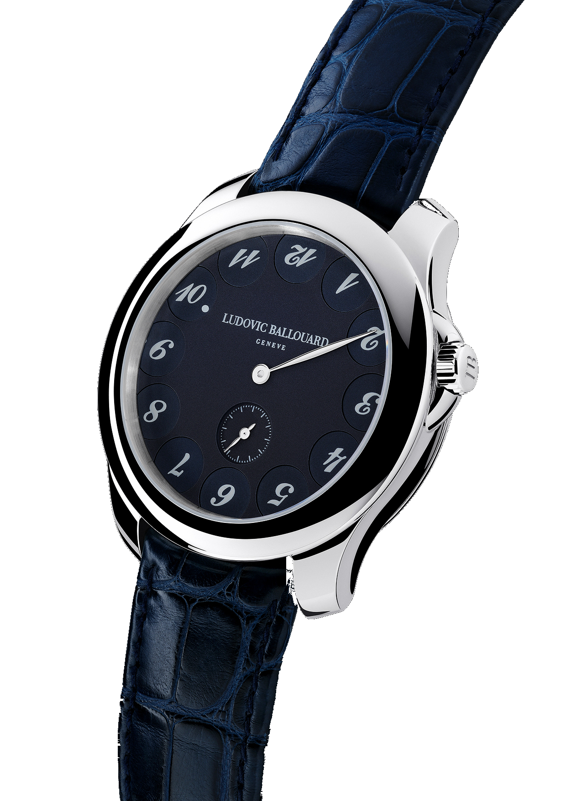
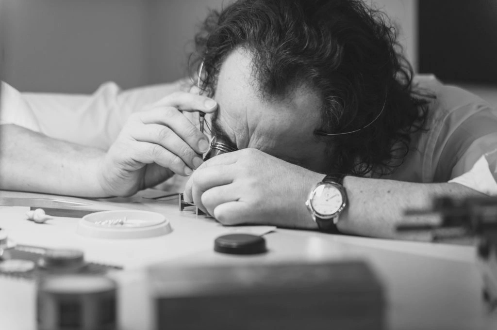
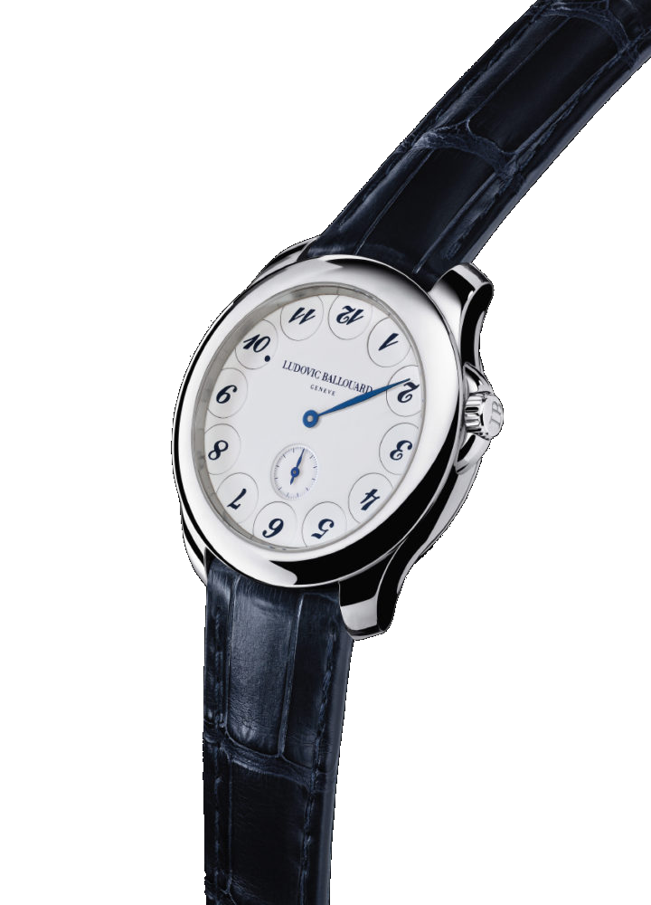
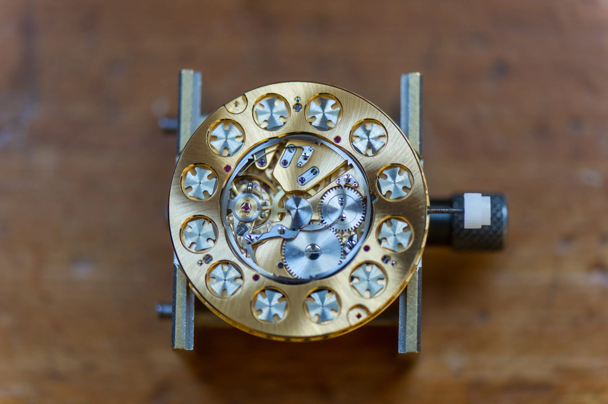
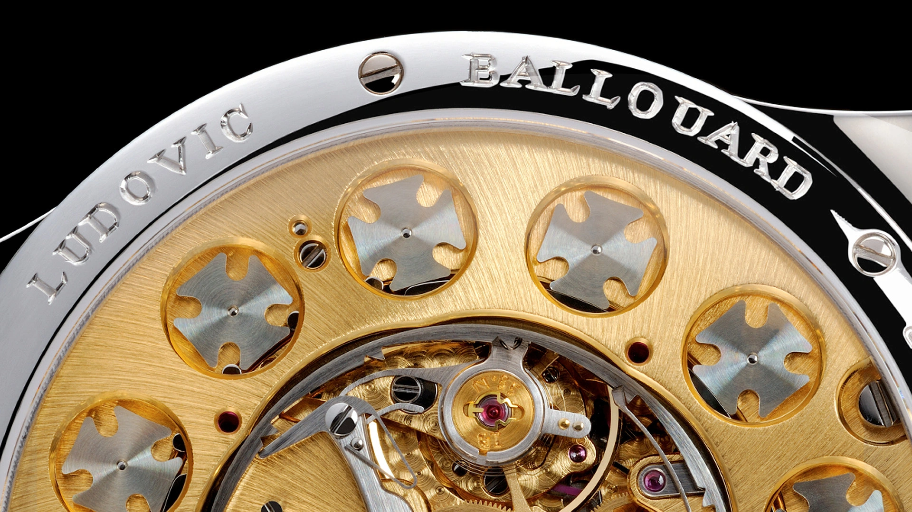
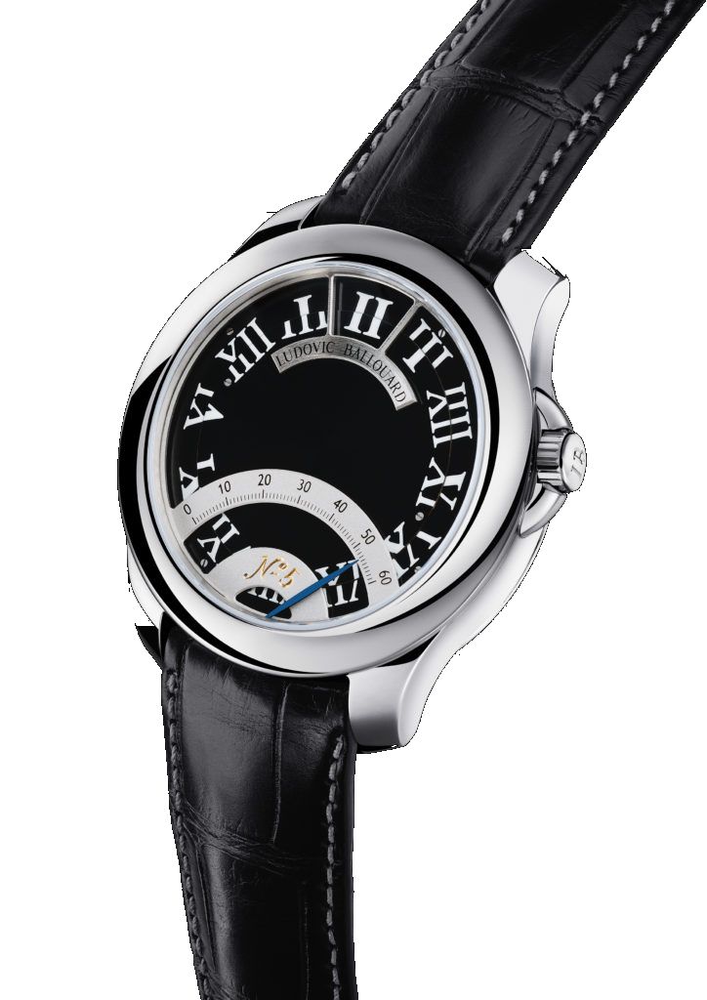

Ludovic Ballouard’s Upside Down keeps eleven hour numerals upside down. The remaining one tells you the hour. When its turn is over, it flips back and the next numeral comes upright.

Each number rotates on its own little disc. It stays in the same place around the dial. My acquaintance with the watch is limited to photographs.

The familiar arrangement survives. Your usual way of reading it does not.

A dot appears beside the upright numeral to help you find it. Ten facing the right way means ten o’clock. The central hand takes care of the minutes, with running seconds in the small dial at six. That extra dot is useful when a six and a nine are part of the experiment.

*Find the dot beside ten. The long central hand is the minute hand. Photo: Ludovic Ballouard.*

I suspect my first few readings would involve looking for a missing hour hand.

A familiar face has been given an unfamiliar instruction, and although I rather like the small amount of attention it asks for, I can imagine wanting a straightforward answer when I am half asleep.

## The watchmaker behind the turning numbers

Ballouard grew up in Brittany making radio-controlled model aircraft. A teacher noticed his aptitude for tiny parts and suggested watchmaking school. He later worked with aircraft instruments, before moving to Geneva and returning to watches.

Three years in Franck Muller’s after-sales department preceded seven at F.P. Journe. During the last three, he was responsible for assembling the Sonnerie Souveraine. Calibre 1505 adds striking mechanisms to the ordinary business of keeping time. Components must interact reliably, and the finished watch has to sound the time safely.

It was a useful apprenticeship for someone with his own ideas.

*Ballouard at the bench. Before his own watches, his work included assembling Journe’s Sonnerie Souveraine. Photo: Ludovic Ballouard manufacturer archive.*

He left Journe in May 2009 and delivered his first Upside Down that December. Starting a watch company in the financial crisis sounds like a decision that would require some explaining to an accountant. Yet Ballouard’s account of it, in his interview with A Collected Man, is quite practical. Suppliers had spare capacity and were willing to take his orders. Collectors who knew his work at Journe were prepared to back a watch they had not seen. The first twelve customers paid deposits before the finished piece was revealed. Their confidence belonged to the man who would assemble it. For a small workshop, that is a different kind of starting capital from an advertising budget, and an unusually useful one when the rest of the industry is becoming cautious.

## The crisis reached the dial

Ballouard recalled watching financial figures move up and down while people worried about the future. His answer was to give the present hour the only upright numeral. The hours behind it and those still ahead would face the other way.

A motto on a caseback would have been considerably easier.

Instead, the idea happens visibly every hour. It has a mechanical cost. Twelve separate discs must hold their positions, then two must change together as the minute hand reaches the top of the dial. The apparent disorder follows a precise routine.

*The pale dial makes the boundaries between the individual numeral discs easier to see. Photo: Ludovic Ballouard.*

There is something pleasingly literal about the arrangement. The philosophical explanation is available if you want it. You can also enjoy finding the one number that has behaved itself, and then turn the watch over to inspect what made that possible.

## What happens underneath

The B01 stores the energy needed for the hour change. A wheel turning once per hour operates a snail-shaped cam, gradually loading a spring-controlled lever. At the change, the stored energy is released and a toothed ring operates two of the numeral mechanisms together, turning the outgoing hour upside down while bringing the incoming hour into its readable position. Each makes half a revolution. The other ten stay put. Around the movement, twelve Maltese crosses control these intermittent rotations. Their shape is associated with the mechanisms used to advance film in older projectors, where movement must be separated by periods of rest. Here, the next numeral is brought into position and held there. The display needs that restraint as much as it needs the jump, otherwise an hour could start turning before its time.

*The small crosses around the perimeter belong to the numeral display. This B01 is photographed in a movement holder. Photo: Ludovic Ballouard.*

The back is a substantial part of the attraction for me. Those repeated components explain something about the dial before you know what each one does. There is a direct relationship between the twelve things you can see behind the watch and the twelve numbers in front.

Ballouard chose to make that work visible through the sapphire caseback. An owner can watch the hour change from the movement side as well.

*The B01 seen more closely in the manufacturer’s catalogue. The crosses can also be observed through the caseback. Photos: Guy Lucas de Peslouan and Gary Getz, Ludovic Ballouard catalogue.*

## A quiet case for a strange display

Outside the numerals, the Upside Down is restrained. A round case, a leather strap and plenty of space on the dial leave the display to do the talking. I prefer the dark-blue version with painted numerals. Cellini lists it under the retailer code Upsidedown.PL-dark Blue. Against that background, the disc boundaries retreat and the upright number becomes the first thing I notice.

I would be less certain about the size. At 41mm, the case deserves a trial on my smaller wrist, particularly with that broad bezel. The absence of a long hour hand does make the face feel open in photographs. Nothing has been added just to make it look busy.

The hand-wound movement asks for regular attention. The manufacturer’s 2026 price list suggests that acquiring the watch would demand considerably more. Mine currently occupies a browser tab, which has rather lower running costs.

## Then he cut the numbers in half

The Half Time, introduced in 2012, takes the same idea in another direction. Its B02 carries the upper and lower portions of the numerals on two discs turning in opposite directions. A complete hour forms at the reading position at twelve. Below it, a retrograde minute hand travels along its scale and returns to the beginning at the hour change.

*The Half Time brings the numeral halves together at the top. Its minute hand uses the curved scale below. Photo: Ludovic Ballouard.*

I still lean towards the Upside Down. Its numbers are the ones you learnt to read on an ordinary wall clock. Ballouard changes their orientation and leaves you to adjust.

If I get to see one, I would ask for it a few minutes before the hour. I would find the dot on the dial first, then turn the watch over and wait for the two little crosses to move.

### The particulars

| | Upside Down | Half Time |
| --- | --- | --- |
| Movement | Hand-wound B01 | Hand-wound B02 |
| Display | Two discs turn 180 degrees each hour, central minutes, small seconds | An hour assembled from two numeral discs, retrograde minutes |
| Case | Platinum or 18-carat red gold | Platinum or 18-carat red gold |
| Diameter and thickness | 41 × 11mm | 41 × 11mm |
| Frequency | 3Hz, 21,600 vibrations per hour | 3Hz, 21,600 vibrations per hour |
| Power reserve | Approximately 40 hours on the manufacturer’s product page | Approximately 36 hours on the manufacturer’s product page |
| Construction | 228 movement components, 51 jewels | Proprietary patented display |
| Water resistance | 30 metres | 30 metres |
| 2026 factory catalogue price, excluding tax | CHF94,000 for standard red-gold and platinum versions | CHF104,000 for standard red-gold and platinum versions |
| Retailer variant identified in this article | Upsidedown.PL-dark Blue, Cellini | Half Time, B02 |
