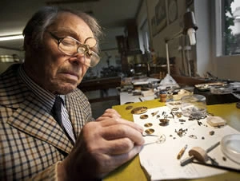
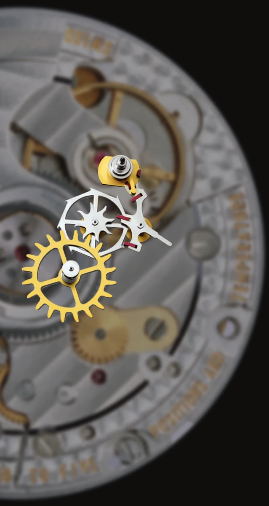
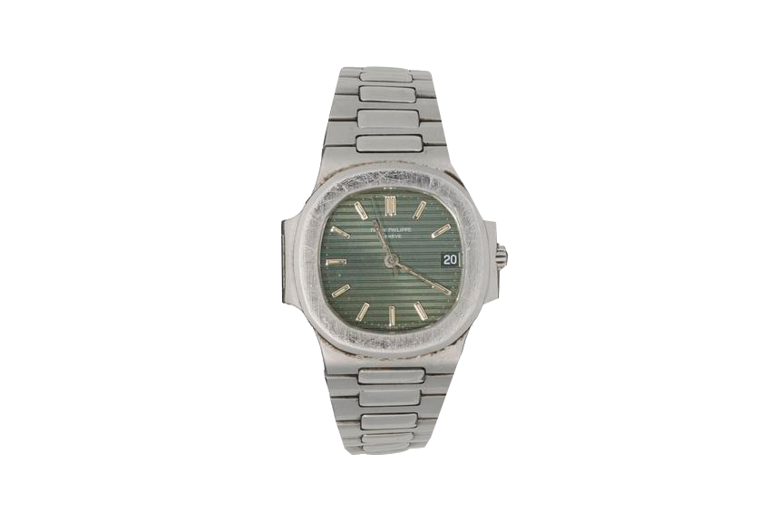
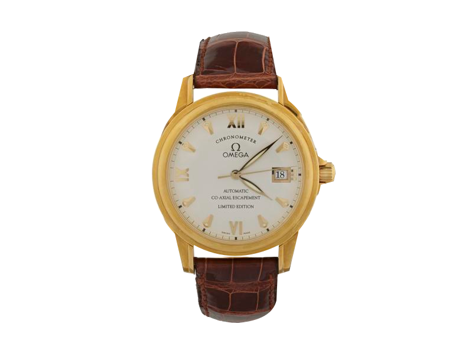
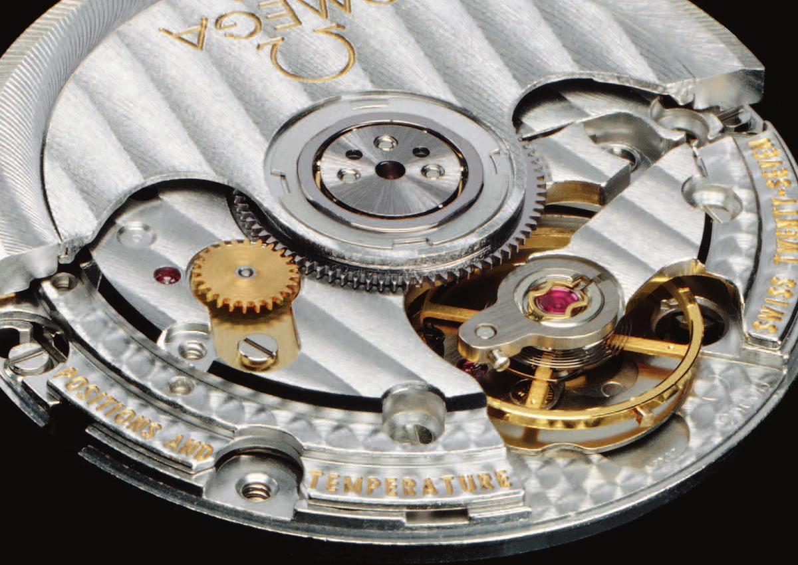

The Clockmakers' Museum collection in London includes a well-worn Patek Philippe Nautilus that tells us more about George Daniels' invention than an immaculate demonstration watch might. Daniels converted its movement at Patek's request in 1981. It received its case and dial in Switzerland and returned to him early in 1982. According to the museum, he wore it for ten years without the escapement needing attention.

Patek nevertheless did not put it into series production. That would take Omega, and several more years.

This is what makes the Co-Axial story interesting: a useful invention and a manufacturable product can be much further apart than the tiny dimensions of a watch suggest. Daniels faced both problems, but could solve only the first on his own.

## Why a tiny drop of oil matters

A mechanical watch's balance and hairspring form an oscillator. Left to itself, it would gradually stop as it lost energy. The escapement replaces those losses in small doses while also controlling when the wheel train, under the load of the mainspring, may advance.

In the Swiss lever escapement, a tooth of the escape wheel slides along a pallet's impulse face. This moves the lever, which passes energy through its fork and the roller pin to the balance. The two pallets work in turn. The arrangement is compact, durable, well suited to manufacture and delivers impulse in both directions of the balance's travel.

That sliding contact needs appropriate lubrication. The amount of oil, where it sits and its condition all matter. As the lubricant changes, so can the energy delivered and the balance's amplitude, with potential consequences for timekeeping. The conventional escapement is not a poor design. The issue is that some of its performance depends on a material that ages.

The claim that Daniels brought the first change in 250 years needs some care. The familiar figure looks back to Thomas Mudge and the origins of the lever escapement in the mid-eighteenth century. It does not mean the modern Swiss version remained unchanged throughout that period, or that no other escapements were developed. Daniels' achievement is substantial enough without either claim.

## A watchmaker who made more than movements

In his Isle of Man workshop, Daniels made watches whose cases and dials were his responsibility as well as their movements. The method associated with his name was not simply an exercise in doing things the old-fashioned way. It kept the path from an idea to a finished component under his control.

During the rise of quartz watches in the 1970s, he pursued a practical improvement to the mechanical watch's operation. The Co-Axial offered neither extra indications nor a more elaborate dial, but a different way of transferring energy. It addressed something an owner might not notice at all on first putting the watch on.

Daniels at his workbench. The small archival image has not been given artificially reconstructed detail. Source: Daniels London; its photographic credit is Sotheby's.

## What makes it coaxial?

The name refers to a shared axis. In the classic arrangement, two wheel levels sit one above the other and are rigidly connected. They turn together, not against each other. The balance runs on a separate axis.

The lever carries two locking pallets and a separate impulse jewel. The balance roller also has its own impulse jewel, distinct from the pin that engages the fork. Separating these functions allows energy to travel through the lever in one direction and directly from the wheel to the balance in the other.

The expression “radial impulse” can be misleading. It refers to impulse faces arranged radially with respect to the escape wheel, not a push towards the balance's centre, which would not turn it. This geometry permits a short pushing contact in place of the conventional extended slide. Friction has not disappeared from the watch, but the energy transfer depends on it differently.

Omega's illustration of the calibre 2500 escapement. Components are separated for visibility; these are not their operating distances. Source: Omega, Omega's Co-Axial Story, 2010.

## One oscillation, two routes

Start with the escape wheel held by a locking pallet. The mainspring is trying to drive the train onwards, but the balance has not yet reached the unlocking position.

When it arrives, its roller pin moves the fork. The lever turns and unlocks the wheel. A tooth on the smaller wheel then pushes the lever's separate impulse jewel, allowing the fork to deliver energy through the roller pin to the balance. This is the indirect impulse.

The next tooth is arrested, but the balance continues. At the end of its free arc, the hairspring turns it back. On the return journey it unlocks the lever again; this time a tooth on the larger wheel reaches the impulse jewel on the balance roller. The maintaining energy now bypasses the lever.

By the end of the cycle there have been two impulses and two steps of the escape wheel. Much of the balance's movement between them has been free travel, not continuous engagement with a gear. The model below lets you stop at unlocking, indirect impulse and direct impulse.

<!-- lume-model co-axial -->

Begin by comparing phases three and seven. Then examine the locking positions: the wheel stays still while the balance continues to move. The highlighted energy route is a guide to the sequence, not an additional component.

## Patek did not simply close the door

The Nautilus disproves the convenient version in which Patek Philippe never seriously engaged with Daniels' idea. There was collaboration, prototype work and a wearable result. What did not follow was series production.

In a 2003 interview with Roger Smith, Daniels recalled a disputed test report. An assessment from FAR had found poor results in Patek's implementation; Daniels maintained it had not been made to his instructions. That is his account, rather than an independent explanation from the manufacturer of why the project ended.

The distinction matters. A watch that worked well after its inventor had personally adjusted it did not automatically establish that the same design could be manufactured in quantity, at an acceptable cost and with consistent quality. Equally, disappointing performance from a disputed prototype did not establish that the underlying principle was unsound.

The actual Daniels Nautilus, not a modern watch used for illustration. Science Museum Group / The Clockmakers' Museum, L2015-4220. © The Board of Trustees of the Science Museum, CC BY-NC-SA 4.0. Background removed; original watch pixels retained.

## What about Rolex?

The Rolex connection also left a tangible object. The 2012 Sotheby's sale of Daniels' collection included a reference 16220 Datejust, its calibre 3135 fitted by Daniels with a slim Co-Axial escapement. The catalogue also records a meeting in Geneva in 1984.

Daniels took offence at being kept waiting for seventeen minutes, an episode often repeated in accounts of the visit. But an incident in a waiting room cannot explain a company's entire technical decision. What can be established is narrower: discussions took place, a modified Rolex existed, and no Rolex production watch resulted. Without internal records, we cannot responsibly assign precise weight to cost, manufacturability or institutional pride.

Resistance to an outsider is a strong theme in Daniels' own telling. As readers, we should distinguish his understandable frustration from what surviving watches and documents can establish.

## Hayek's decision still needed a factory

Omega's tribute following Daniels' death credited Nicolas G. Hayek with the decisive backing. The Swatch Group chairman recognised the invention's potential and initiated work with Omega in the early 1990s.

Daniels could be unsparing about Swiss specialists in his interviews, but he acknowledged Omega's manufacturing achievement. Turning individually adjusted parts into a dependable production series was an engineering task in its own right. His drawings needed to be supported by machining, inspection and assembly methods.

The first series-produced Co-Axial Omega arrived in 1999: a De Ville with calibre 2500. The gold example in the museum belongs to a 999-piece edition. It is an understated dress watch; the important change was not on its dial.

A gold example of the 1999 De Ville with calibre 2500. Science Museum Group / The Clockmakers' Museum, L2016-2312. © The Board of Trustees of the Science Museum, CC BY-NC-SA 4.0. Background removed; original dial and case.

In 2007, calibre 8500 arrived as a movement designed around the Co-Axial. That was more significant than a new calibre number: the escapement was no longer merely being accommodated within a host movement, but had become the starting point for its design.

Detail from Omega's photograph of calibre 2500. The large rotor can easily draw attention away from the much smaller escapement. Photograph: Omega, 2010.

## What the Co-Axial does not promise

Reduced lubrication requirements do not mean freedom from servicing. The complete watch still contains bearings that need lubrication, components subject to wear and seals that age. Omega's own user manual describes reduced friction and lubrication needs, not perpetual maintenance-free operation.

Nor is the Co-Axial inscription a certificate of accuracy. The balance, hairspring, regulation, assembly and condition of the complete movement all contribute. Master Chronometer certification and resistance to magnetic fields involve separate developments and tests. They do not follow automatically from this escapement alone.

It makes little sense, therefore, to rank two watches solely by their escapement names. The Co-Axial answers a specific technical problem. It does not demonstrate that every conventional Swiss lever watch must be less accurate or less durable.

## The story did not end in 1999

Roger Smith continued developing the principle. In his version, both sets of teeth were incorporated into a single wheel, fixing their relationship without having to align two separate components during assembly. Subsequent versions reduced the wheel's weight and size.

Daniels' story lends itself to a solitary English watchmaker's victory over an industry. His persistence was certainly essential. But the finished result also includes Omega's manufacturing work and Smith's later developments.

The next time you notice Co-Axial on an Omega dial, consider those two kinds of work. One involved finding a different way for a few tiny components to meet. The other involved learning how to make that happen reliably, again and again.
