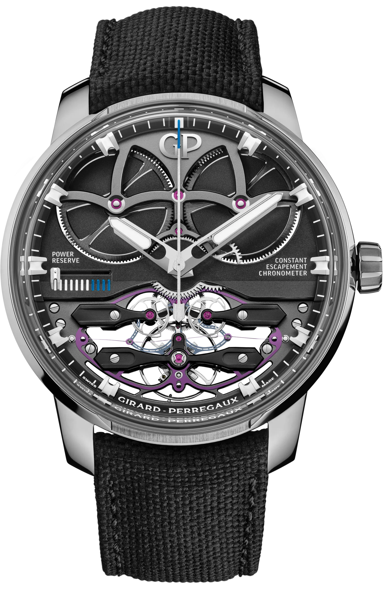
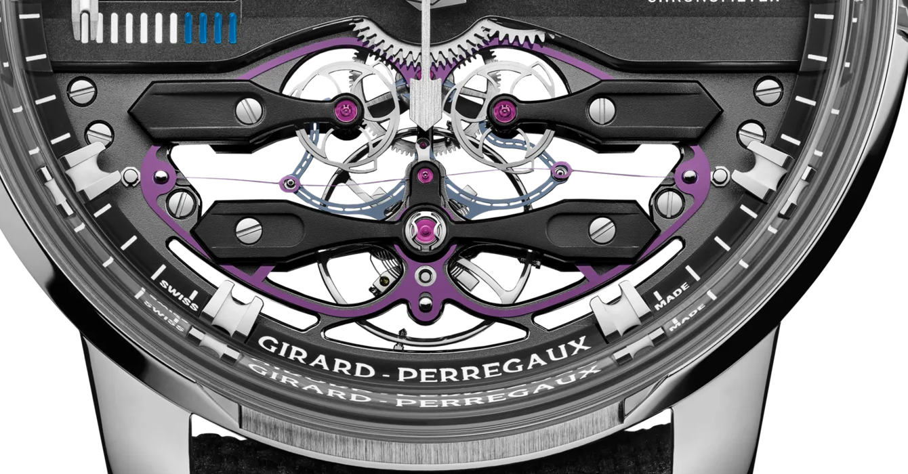
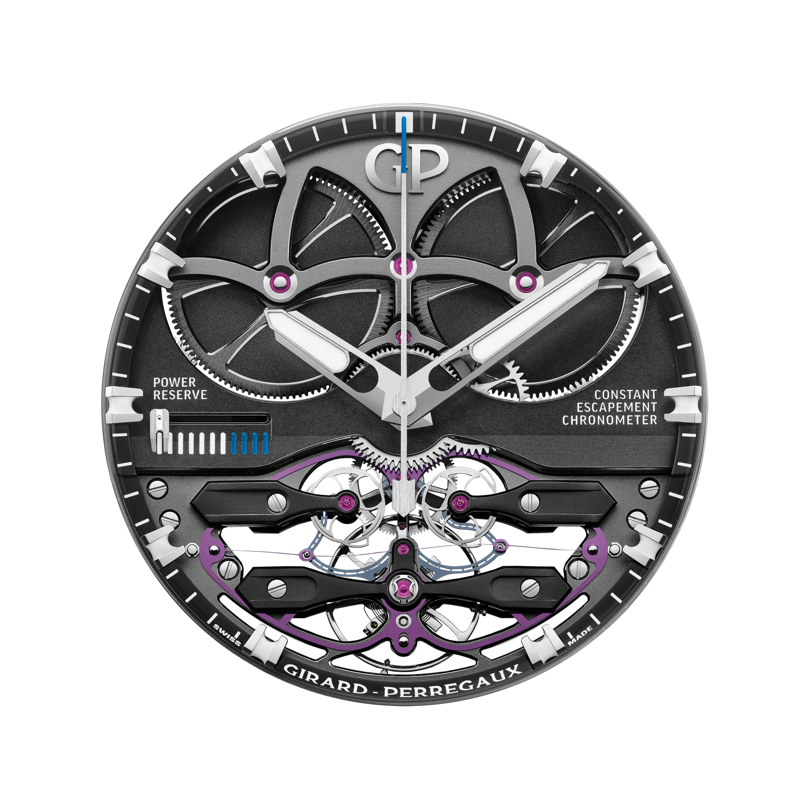
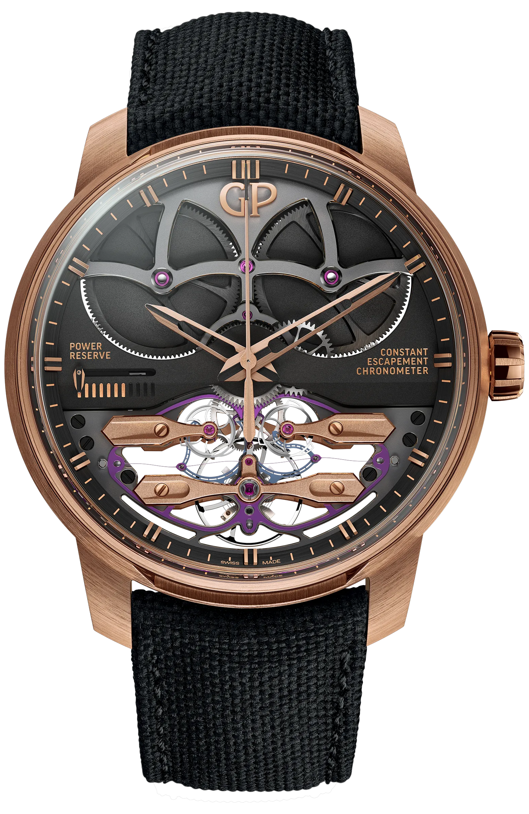
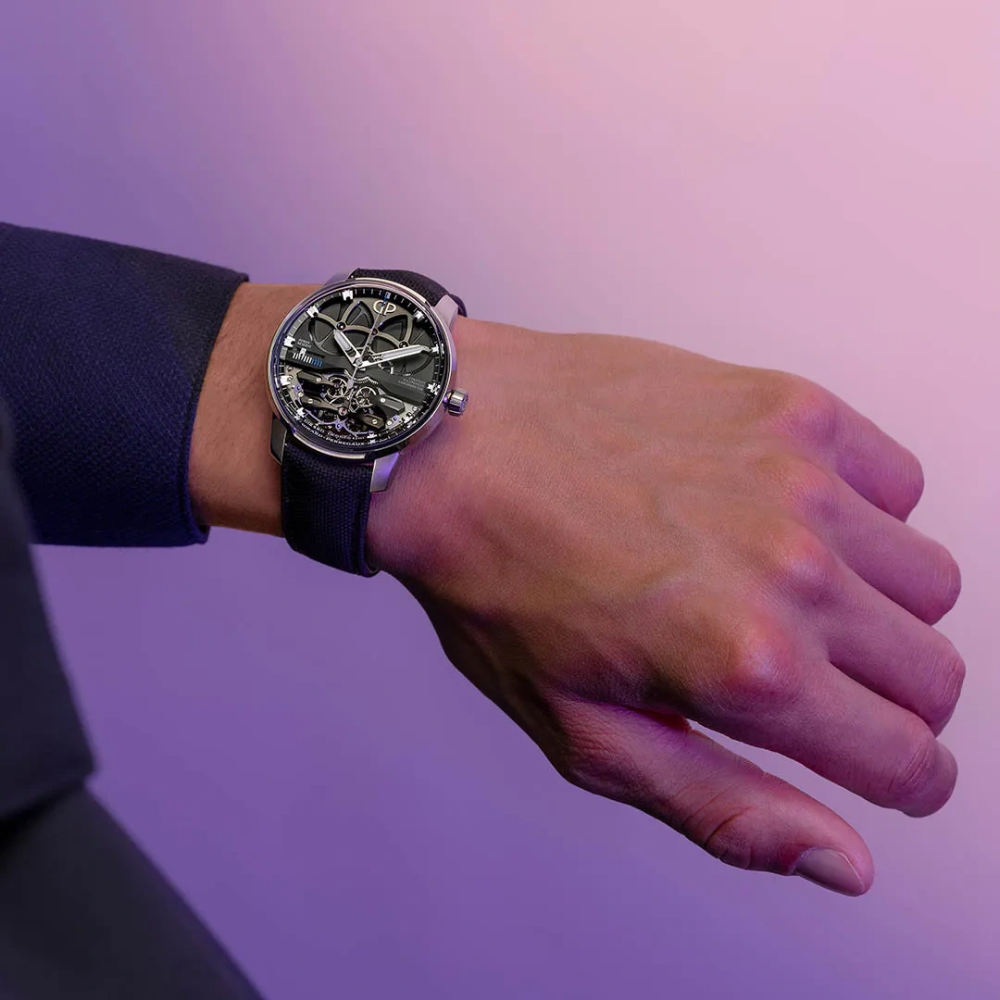

The Constant Escapement places a small elastic store between the watch's changing supply of power and its balance. A silicon blade loads, reaches an unstable condition and snaps into its other configuration. The motion releases an impulse. What appeals to me is how ordinary the starting idea is. You can explore it with a bent card, although making a wristwatch from the same idea takes considerably more work. I have only studied this watch in photographs.

The card is the easy part. Getting the next impulse right is harder.

## What the mainspring cannot promise

A mainspring delivers changing torque as it unwinds. The train carries that drive to the escapement, which replaces some of the energy the balance loses during each swing.

Changing drive can change the angle of that swing, its amplitude.

In a finished movement the duration of an oscillation can depend on its amplitude. A watch may therefore keep a different rate just after winding and several days later. Constant-force systems aim to reduce that change.

The balance and hairspring still set the rhythm. The Constant Escapement is concerned with making the impulses that sustain it more consistent.

*Reference 93510-21-1930-5CX. Look below the hands for the purple frame and the fine blade crossing it. The large barrels above perform a different job. Manufacturer image: Girard-Perregaux.*

The GP09200 has two different springs to identify.

The coiled hairspring returns the balance towards its resting position. The butterfly-shaped silicon assembly takes in and passes on energy. Their fine dimensions make them easy to confuse in a photograph.

## A ticket, then a manufacturing problem

The idea belongs to Nicolas Déhon. In the familiar account he was flexing a train ticket between his fingers when he noticed it snap from one curved state into the other. A Hong Kong university paper on the escapement repeats the episode.

His name also appears on Sowind's later patent concerning bistable springs. There is a substantial engineering record behind the anecdote.

The Constant Escapement L.M. arrived in 2013 and won that year's GPHG Aiguille d'Or. The silicon assembly was already present in the 93500 family and its GP09100-0002 movement. A very small part had become the reason for building a rather large watch.

Elasticity alone could not produce a working escapement. The blade needed a repeatable shape and a predictable transition, then had to cooperate with moving parts inside a wristwatch. Silicon microfabrication made such geometry practical. Girard-Perregaux describes a photolithographic process that defines forms conventional machining cannot readily make. I find the contrast in scale particularly revealing. The purple frame is large enough to recognise immediately, while the blade across it has a quoted fine dimension of fourteen microns. The familiar comparison with a human hair conveys its smallness, though hairs vary considerably. What matters is how the frame supports this fine feature and lets it do the same job repeatedly. A clear photograph of the entire assembly makes that relationship much easier to follow than a large number printed beside the watch.

*The blade runs across the upper part of this detail. Its central connections give it a wave-like profile. The balance sits below it. Photo: Girard-Perregaux, detail from the manufacturer's front view.*

## Two places to rest

Bring the ends of a slender elastic strip towards one another and it bows. With suitable geometry it can settle in either of two configurations, curved towards one side or towards the other. Both are stable. Passing between them requires additional energy.

That is bistability. The strip has two shapes it can hold by itself.

A sideways load initially meets resistance. The strip deforms as the load increases. Eventually the existing equilibrium loses stability and the strip snaps across. Part of the energy released by that transition can be passed through the escapement to the balance. Slow loading and rapid transition are distinct stages, which is why slowing the action down helps so much.

The next cycle prepares the opposite transition. In the watch, the central connection and supporting frame produce more elaborate deformation than a card held between two fingers. The card explains the change of stability. Wheels and levers make it useful in an escapement.

The blade creates no energy. Every fresh impulse requires another loading cycle.

In the workshop, start with the two stable shapes and increase the lateral load slowly. Then switch to the separate energy-metering lesson and reduce the drive. It shows what happens when there is insufficient energy to prepare a dose for every beat.

<!-- lume-model constant-escapement -->

## The balance still decides when

Loading the store and timing its release are separate tasks.

The drive prepares the energy. The escapement's connection to the balance controls its timing. Equal doses delivered whenever convenient would be of little use to a watch.

The Neo uses two escape wheels working alternately. A small action from the balance initiates the next transition, allowing the stored energy to restore what the oscillator has lost. The GP09200 runs at three complete oscillations per second. Each complete oscillation has an outward and a return swing, giving six half-oscillations and six impulse opportunities per second. The fast snap and the repeating rhythm therefore describe different things. One is a short event, the other determines when that event can occur again. An open movement exposes both, though finding the small working parts beneath the black bridges takes a little patience. The large train wheels are much easier to notice first, and the curved silicon frame can look like decoration until you find the fine blade crossing it.

*GP09200. Power travels from the twin barrels through the train to the escapement. The new blade works within that familiar division of tasks. Manufacturer image: Girard-Perregaux.*

Provided the drive can prepare the next cycle, the blade's geometry helps make the energy release repeatable. Below the useful operating range, there may no longer be enough energy to do so. The name Constant Escapement makes no exception to conservation of energy.

Stable amplitude is also different from a correct rate. A poorly adjusted watch can gain time very consistently. The Neo's COSC certification is a separate test of timekeeping. Its blade addresses a consequence of changing drive, while the finished movement still needs adjustment and verification.

## The watch around the experiment

The Neo brings the hour and minute hands to the centre and leaves the movement open around them. The titanium 93510-21-1930-5CX and pink-gold 93510-52-3552-5CX show how much the material changes the appearance of the same technical idea.

The purple silicon stays below the two bridges in both versions.

*Reference 93510-52-3552-5CX. Pink-gold bridges and case give the silicon assembly a warmer setting. Manufacturer image: Girard-Perregaux.*

A seven-day reserve is relevant here because the energy-metering system has a long interval over which to manage changing drive. The case is harder for me to warm to. At forty-five millimetres it would probably announce itself on my wrist before I had found the blade (despite having spent this entire article looking for it).

*The titanium Neo in the manufacturer's wrist photograph. The angle also reveals the height of the sapphire crystal and case. Photo: Girard-Perregaux.*

| Version | Reference and calibre | Dimensions and reserve |
| --- | --- | --- |
| Early white-gold Constant Escapement L.M. example | 93500, GP09100-0002 | 48 mm, the cited auction example has a six-day indication |
| Titanium Neo Constant Escapement | 93510-21-1930-5CX, GP09200 | 45 × 14.8 mm, at least 7 days, 3 Hz, 266 components, 29 jewels |
| Pink-gold Neo Constant Escapement | 93510-52-3552-5CX, GP09200 | 45 mm, a pink-gold expression of the same principle |
| Titanium Neo, manufacturer's price when checked | USD 105,000, 27 October 2026 | The displayed US-dollar price, without a currency conversion |

I would want to see the lower opening in person. I would probably ask the watchmaker to point out the blade, then stay long enough to find out whether I could follow its snap with my unaided eye.
