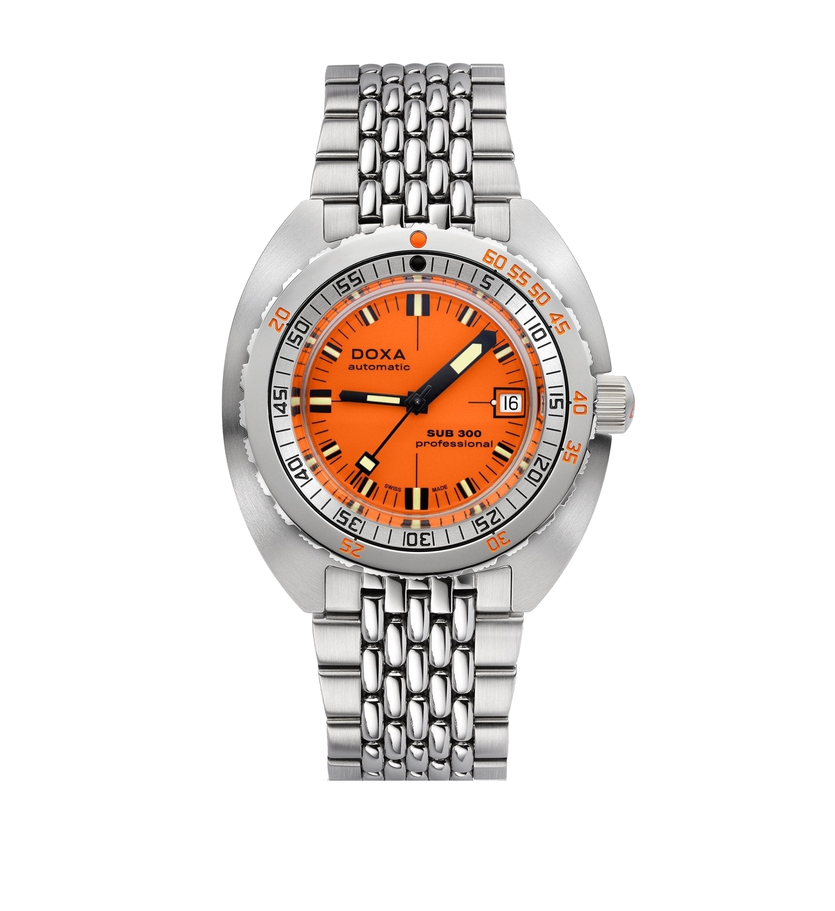
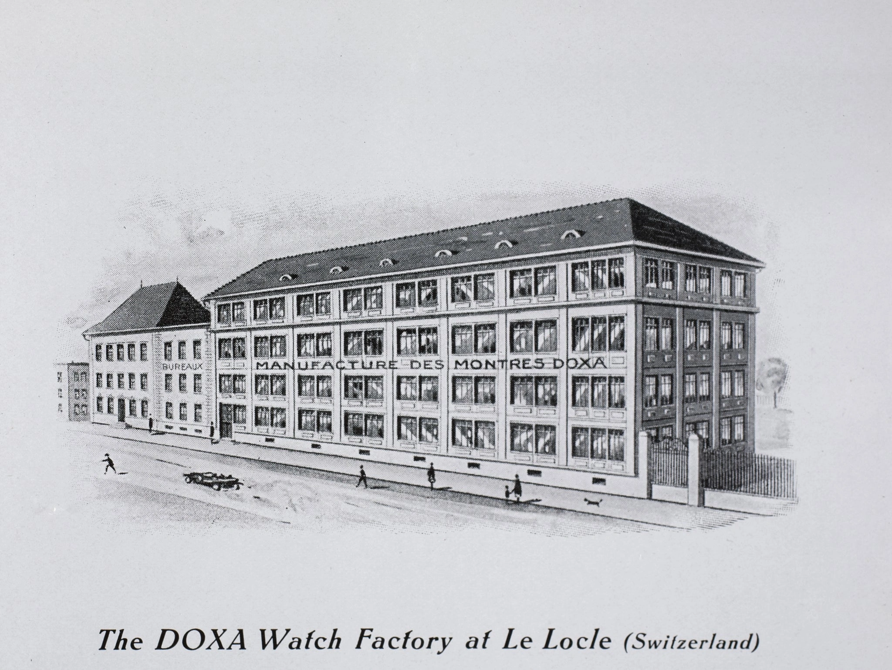
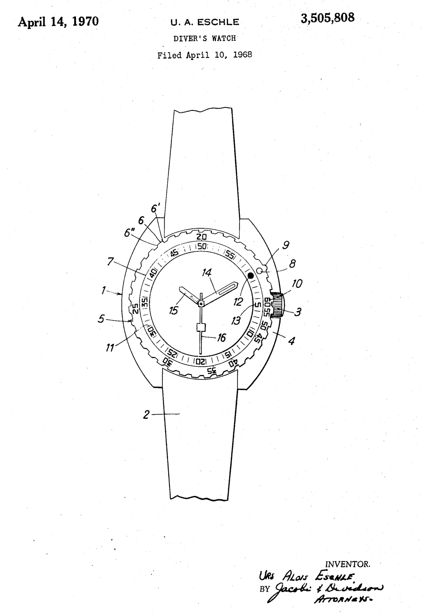
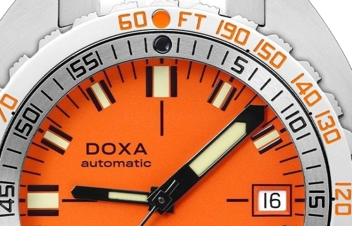
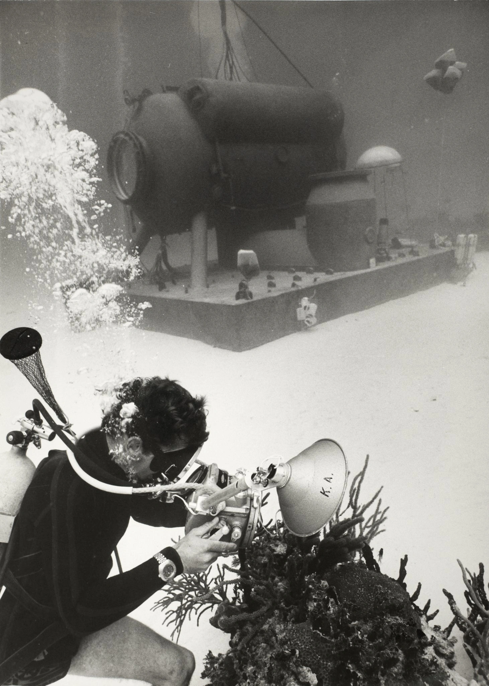
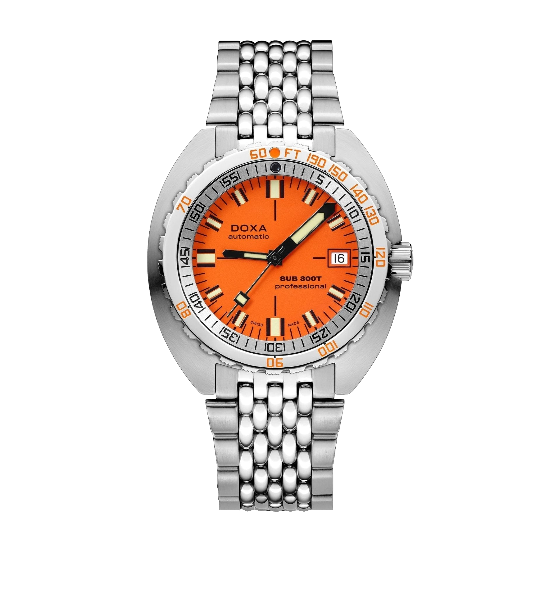

The orange-dialled Doxa SUB 300 arrived at Basel in 1967 with diving-table information engraved beside the minute scale on its bezel. The minute hand was conspicuously large.

I know the Doxa from photographs. Orange would normally make me think of a summer watch, so I wanted to understand why this particular one had ended up that colour.

The first chapter belongs to the SUB 300, without the T.

The SUB 300T followed within the developing family. Orange and the double scale were there from the beginning, with a Swiss lake involved in their development.

*Today's SUB 300 Professional, reference 821.10.351.10. The bezel pairs a depth scale with elapsed minutes. Photo: DOXA.*

## A practical problem in Lake Neuchâtel

Urs Eschle started the project at Doxa in Le Locle in 1964. Recreational diving was growing, and he wanted a watch those divers could afford, with a display they could read quickly when visibility was poor. Claude Wesly joined the watchmakers and divers involved. He had worked on Cousteau's expeditions, bringing experience from the environment in which this new watch would have to work. The team could question how each part of a familiar watch served someone underwater, including whether its two main hands deserved equal space on the dial.

They tested colours in Lake Neuchâtel. Eschle later remembered polluted water. I find that detail more interesting than another photograph of a perfect blue sea.

The difficult water was part of the point.

The trials included yellow and orange. Eschle recalled orange proving the most legible down to thirty metres. That result informed a whole display, with substantial luminous markers and a minute hand given more prominence than the hour hand. The designers treated the two hands differently because elapsed minutes mattered more directly to the task.

*Doxa's Le Locle factory, shown in an archival illustration published by the manufacturer. Eschle began the SUB project here. Source: DOXA.*

## Orange paint does not make its own light

Water absorbs red and orange wavelengths more readily than blue, leaving an orange object with progressively less of the light it normally reflects. The dial can darken as it descends.

Reading the dial involves more than naming the colour of its background. The contrast with the hands matters, as do the luminous material and the light available. Suspended particles change the conditions again. A flat colour sample tells you very little about whether you can pick out a moving hand quickly, especially when other things demand your attention. Eschle's team chose a display through trials in a particular lake. The reported thirty metres belongs to those trials. It is not a depth at which every orange dial in every body of water suddenly behaves identically. The photograph shows you the bright surface and dark hand under photographic lighting. Underwater, the surrounding light becomes another part of the display, and the watchmaker has very little control over it.

I like that large minute hand as much as the orange. Someone chose what your eye should find first, then gave it the space.

## A table you could wear

Patent US3505808A shows both scales sharing a starting point. Swiss priority dates to 1967, with the American grant following in 1970.

*The original American drawing sheet. The patent was granted in 1970, following Swiss priority in 1967. Follow the two scales around the minute hand. Source: US3505808A.*

The black graduations measure elapsed time. Beside them, depths in feet or metres occupy positions corresponding to time values, allowing the minute hand to supply information against both scales on a single ring. It looks crowded at first. On the current watch the bezel turns in one direction. Aligning its common starting mark with the minute hand gives an elapsed-time reading from that point, with no extra mechanism inside the case.

Those depth numbers are printed information. The watch does not measure depth.

Doxa drew its depth and time limits from the US Navy's air-diving tables. The no-decompression limit describes a profile for which that table does not require mandatory decompression stops. Increasing depth reduces the available time under the same assumptions. Hence the unusual spacing of the depth markings around the bezel. Both scales start together, while the minute hand provides the elapsed-time reading. Eschle had put an existing set of data beside the information a diver was already checking. The rest of the Navy manual stayed ashore. Repetitive dives and time spent at the surface involved further calculations, and the watch carried no mechanism for performing them. A static ring could display selected pairs of values. It could not follow the history of a day's diving.

The body takes up nitrogen during an air dive, with depth and exposure time affecting the amount. Decompression procedures address the release of that gas as pressure falls. This is why a time limit on a bezel describes a particular set of assumptions, rather than a personal guarantee.

I appreciate how little extra machinery this required. The movement kept telling the time. A piece of engraved steel shortened the distance between a reading and a separate table.

*Detail from the current 300T factory photograph. FT denotes feet, and the outer figures indicate depths. The hand measures elapsed time. Photo: DOXA.*

For diving today, training, suitable procedures and equipment remain essential. This historical scale is no substitute. A no-deco label does not remove safety stops or guarantee a risk-free ascent.

## Cousteau and the equipment counter

Wesly connected Eschle with Cousteau's US Divers operation. Their collaboration included testing the bezel and bringing the watches to the American market. Doxa dates the exclusive distribution agreement to 1968.

The Aqua Lung emblem on the dial came from that relationship.

Its twin-cylinder design made the connection visible on the watch itself. Distribution also put the Doxa alongside other diving equipment, in front of people who might actually use it. For a manufacturer establishing a place in dive watches, that combination of a recognisable name and a relevant sales network had practical value.

*An archival diving photograph published in Doxa's Non-Deco feature. The underwater equipment gives the watch's intended working environment some context. Source: DOXA.*

The Musée international d’horlogerie holds a SUB 300T from 1970, number 5042, issued to a Swiss military diver.

Calibre 2872 from ETA appears in Doxa's record of a later French naval version.

## Two descendants, still different

The SUB 300T family subsequently included the helium-valve Conquistador. During saturation diving, helium can enter a watch held under pressure for an extended period, then press against the crystal from inside as external pressure falls. The valve gives it a way out. That adapted the watch to a specialised use far removed from the original recreational diver's requirements, while the colour and familiar scales could remain.

Today's SUB 300 Professional, reference 821.10.351.10, has domed sapphire. The SUB 300T Professional, reference 840.10.351.10, pairs flat sapphire with a helium valve.

*The current SUB 300T Professional, reference 840.10.351.10, with flat sapphire and a beads-of-rice bracelet. Photo: DOXA.*

I would want a closer look at that broad steel case before considering one for my wrist. There is a lot of metal outside the dial. The minute hand and crowded bezel, though, would keep me at the window for a while.

### References and current factory specifications

| | SUB 300 Professional | SUB 300T Professional |
|---|---|---|
| Steel-bracelet reference | 821.10.351.10 | 840.10.351.10 |
| Case diameter | 42.5 mm | 42.5 mm |
| Case thickness | 13.4 mm | 13.65 mm |
| Crystal | Domed sapphire | Flat sapphire |
| Movement | Automatic, COSC | Automatic |
| Stated power reserve | 38 hours | 38 hours |
| Frequency | 28,800 vph | 28,800 vph |
| Factory water-resistance rating | 30 bar | 120 bar |
| Helium valve | No | Yes |
| Historical connection | The appearance of the 1967 SUB 300 | The later SUB 300T family |

*These are current models. ETA 2872 identifies the base movement of the historical naval version mentioned above.*

If I find one in a shop window, I want to inspect the bezel marked in feet. This time I would lean in to read the small numbers.
