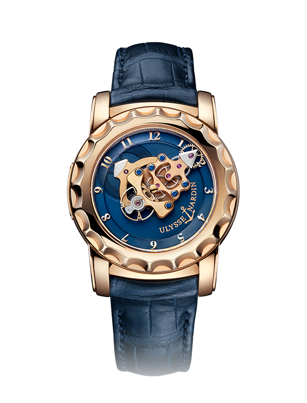
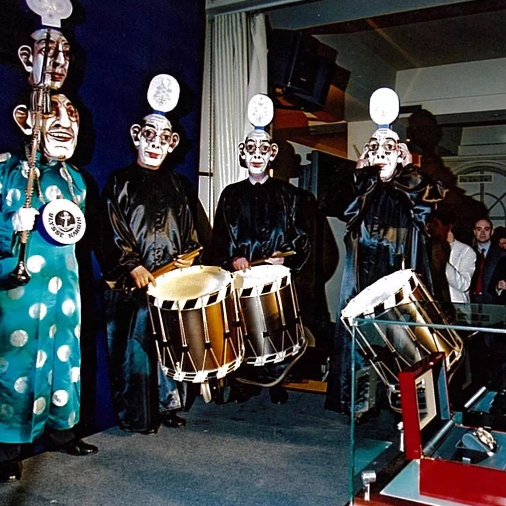
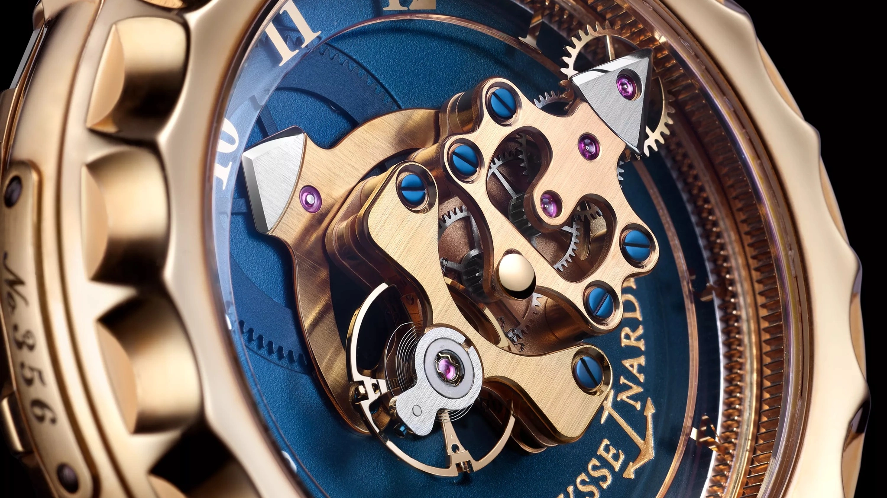
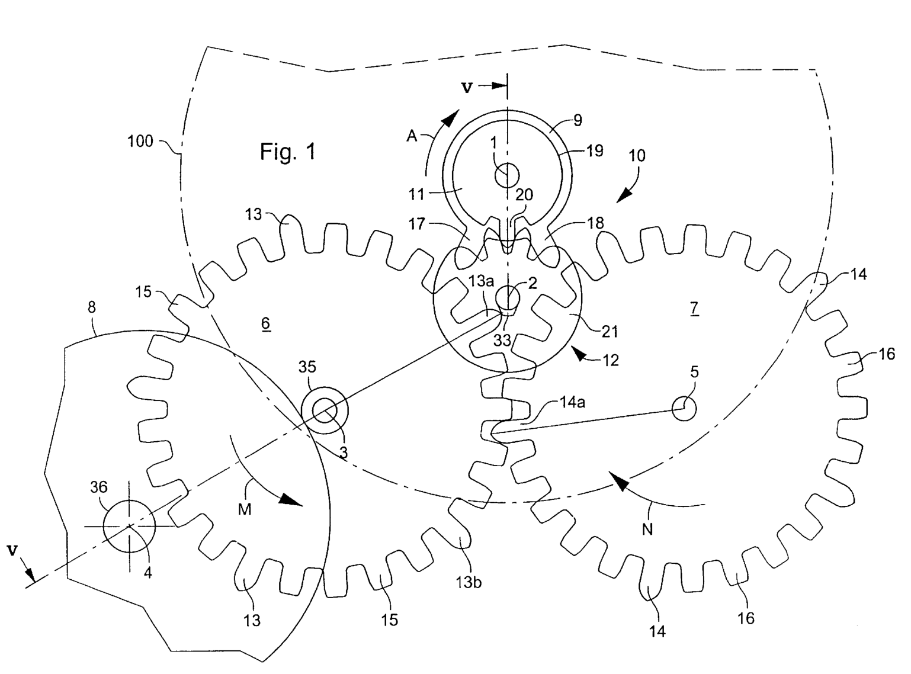
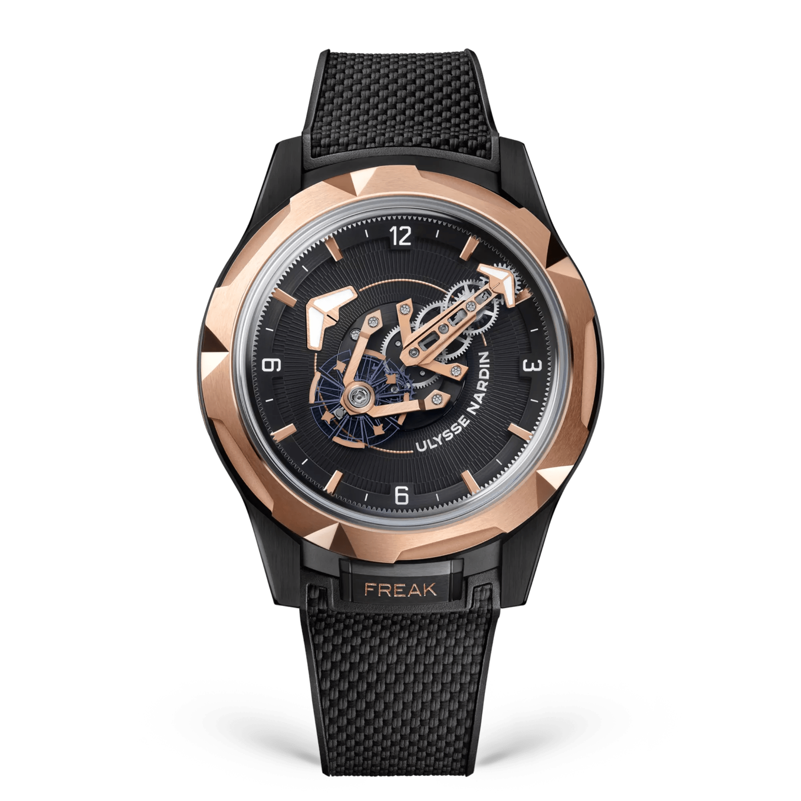
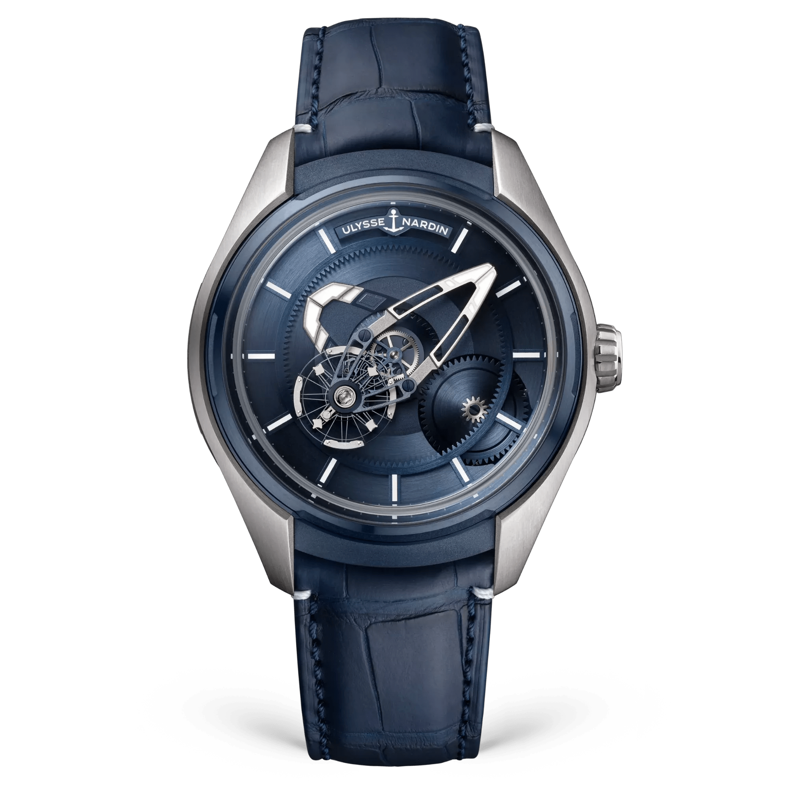

The Freak uses a working gear train to indicate minutes. Its long bridge carries the balance and escapement around the watch once an hour. You read the end of that assembly against the fixed chapter ring, much as you would read the tip of an ordinary minute hand.

I know it through photographs. I tend to study the mechanism first, then remember that it is supposed to tell me something.

The original watch displays hours and minutes. That is all.

It moves an entire upper assembly to do it. I like the extravagance of that decision, particularly given how readily I forgive a watch that runs a little fast.

*An early Freak in the factory archive. Follow the long movement bridge for minutes and the shorter arrow beneath it for hours. Photo: Ulysse Nardin.*

## The two rotations

The chapter ring stays with the case. Above it, the long bridge takes an hour to turn, while the hour indication associated with the lower barrel takes twelve. At quarter past, the upper assembly points towards three. The lower indication sits partway between hour numerals, as a familiar hour hand would.

The wheels are busy within that slow orbit. Their axes travel with the bridge, while the wheels also turn relative to one another to transmit the mainspring's energy towards the regulator. Two different kinds of movement therefore occupy the same small space. Watch for a minute and the bridge advances only a short distance around the case. The balance keeps oscillating throughout, accompanied by the escapement that parcels out the power. The large mainspring stays on the lower level, so the upper assembly does not have to carry the complete energy store on its hourly journey. Separating these motions makes the watch much easier to understand. A part can keep working on its own axis while the structure supporting that axis slowly carries it somewhere else.

There is no crown on the original design. Winding takes place at the back, and the upper bezel sets the time. The case itself supplies the controls.

This carrousel carries the regulator around, as a tourbillon would, while indicating minutes.

Carole Forestier-Kasapi had developed a rotating-movement concept. Rolf Schnyder saw a possibility for Ulysse Nardin, and Ludwig Oechslin reworked the idea into a practical construction. The production Freak arrived in 2001 with its two silicon escape wheels.

*The masked launch in 2001, with Schnyder and Oechslin. Photo: Ulysse Nardin factory archive.*

That seems a more appropriate welcome for this watch than a solemn man behind a dark counter. Phillips later documented pink-gold prototype P001, reference 016-88. The unusual idea survives as a numbered physical object.

## Two wheels, alternating impulses

The Dual Direct escapement keeps the balance oscillating. In a Swiss lever escapement, power reaches the balance through the lever. Oechslin's two meshing wheels deliver their impulses directly to the roller on the balance arbor, alternating between the two directions of its swing.

The wheels turn in opposite directions.

One helps the balance on its outward journey. The other helps it back. A separate rocking member locks the wheels in turn. Because they mesh, holding either one stops both.

*The early architecture at close range. The train and regulating assembly travel with the long bridge. Photo: Ulysse Nardin.*

Patent US6301981B1 describes the sequence in four stages. A long tooth on the first wheel gives an impulse, after which the rocking member catches the second wheel. The balance continues through its free arc and returns, releasing the lock. The second wheel then delivers the next impulse, and the first wheel is caught. Locking and release belong to the rocking member. The impulse passes from wheel to balance. In the illustrated example, each wheel has five long teeth separated by shorter ones that maintain the connection between the pair. The same wheel therefore has two jobs. It drives its partner through their meshing teeth and, at the appropriate point, supplies energy to the balance.

*An operating phase from the original patent. The complete figure has been rotated for readability. Find the locking member between the two large wheels. Source: US6301981B1.*

## Why the wheels became silicon

Starting and stopping those small wheels costs energy. Their mass mattered, and the mainspring had to pay for every acceleration. Pierre Gygax proposed silicon, a light material that could also be formed into small, precise shapes difficult to obtain through traditional metalworking.

A lighter wheel takes less energy to start and stop.

In 2001, the Freak brought silicon escape wheels into a production mechanical wristwatch. The material has since found its way into many watches that look entirely conventional from outside.

Direct impulse avoids the longer sliding transfer associated with the Swiss lever. It does not remove every contact or loss from the movement. Running these escapement contacts without oil is a result of the particular design, rather than evidence that a whole watch can operate without friction.

Subsequent Freaks changed the escapement as well. The Dual Ulysse transferred its impulses indirectly through an intervening part. Seeing two escape wheels is not enough to identify the original Dual Direct arrangement.

## Follow it in the workshop

Begin with the bridge and the lower hour indication. Press +1 hour to return the minute indication to the same position while advancing the hour. Then open the escape-wheel enlargement. One phase separates the impulses from the periods of locking.

<!-- lume-model freak -->

The two views use separate clocks. The overview accelerates the hourly orbit. The enlargement slows the escapement into a teaching cycle, so you can follow it without the balance becoming a blur.

## The name outlived the original mechanism

Later reference 026-88 examples with calibre UN-01 retain the early Freak appearance. Today's Freak ONE uses the automatic UN-240 and a DIAMonSIL-treated escapement. The rotating display has survived, with further engineering underneath it.

*The current Freak ONE, reference 2405-500-2A/3D. The display follows the original idea, with the automatic UN-240 underneath. Photo: Ulysse Nardin.*

The UN-240 balance completes three oscillations a second. That means six half-swings, or the stated 21,600 vibrations an hour. Its quick rhythm is especially noticeable beside the slowly travelling bridge. The movement has 229 parts and a ninety-hour reserve, enough to cover an ordinary weekend with some time left over.

The Freak X is a separate branch. Reference 2303-270/03 has the UN-230 and a crown for setting, so the familiar three-part description of the Freak family needs qualifying. The crown is present. The rotating minute indication remains.

*Freak X Ti Blue, reference 2303-270/03. The crown sits on the right. The hour indication and rotating bridge remain. Photo: Ulysse Nardin.*

I find the ONE's indicating bridge easier to pick out in a photograph than the direction of the original gold train. The case size gives me more pause. Forty-four millimetres would need a proper trial on my wrist.

### References and factory specifications

| | Freak ONE | Freak X Ti Blue |
|---|---|---|
| Reference | 2405-500-2A/3D | 2303-270/03 |
| Calibre | UN-240 | UN-230 |
| Winding | Automatic, Grinder | Automatic |
| Frequency | 21,600 vph, 3 Hz | 21,600 vph, 3 Hz |
| Power reserve | 90 hours | 72 hours |
| Current factory component count | 229 | 214 |
| Case diameter | 44 mm | 43 mm |
| Time-setting | Upper bezel | Crown |

*These are current versions. The 2001 Freak was a manually wound, seven-day design. The Dual Direct explanation follows the original patent.*

I would still ask to see the original blue-and-gold version first. Finding the time among its moving parts is precisely what I would want to try.
