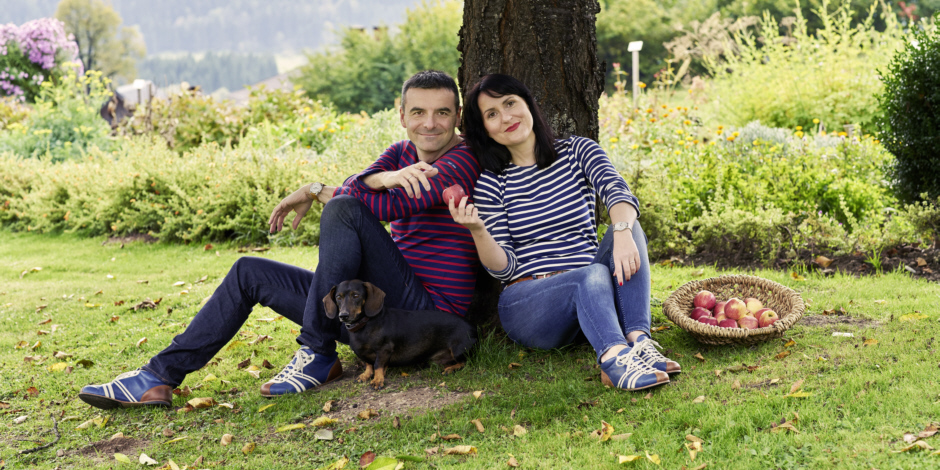
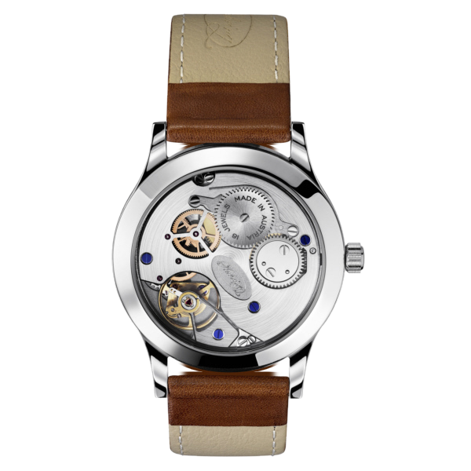
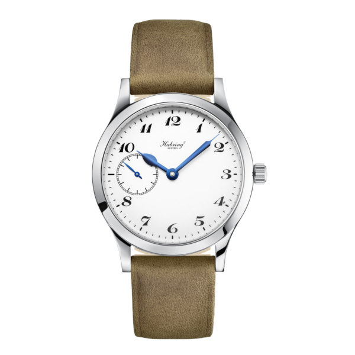
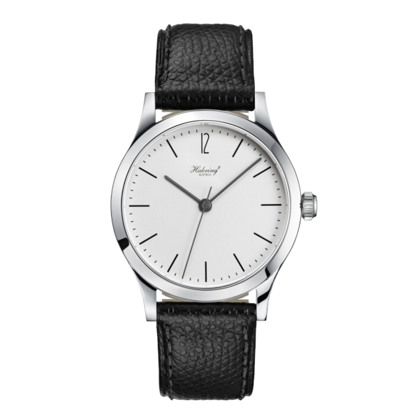
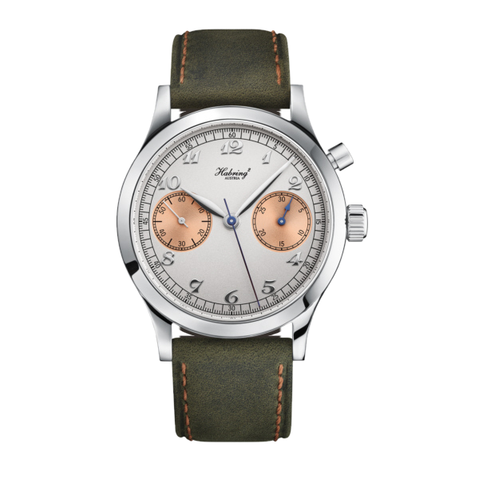
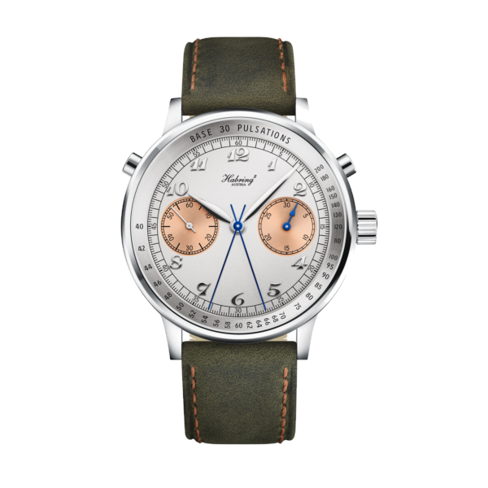
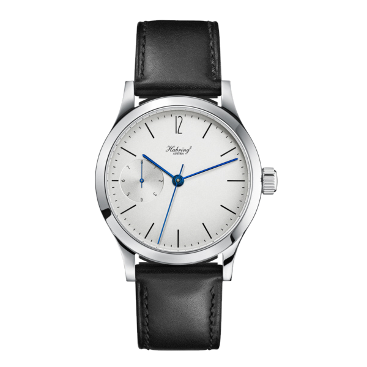
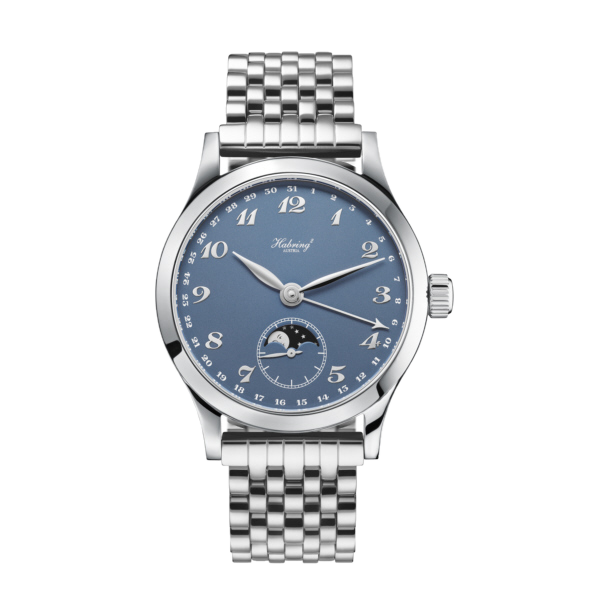
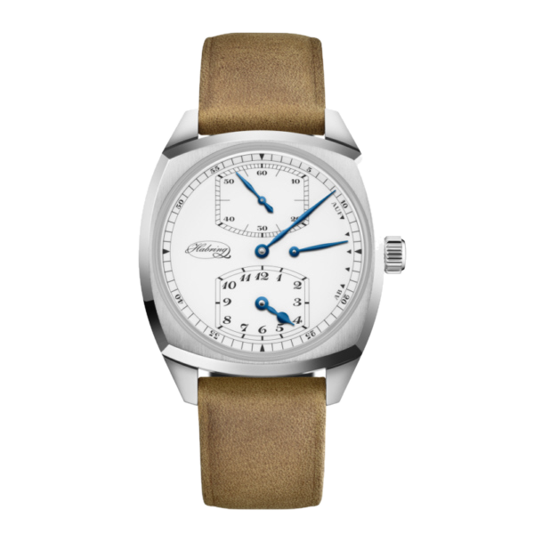
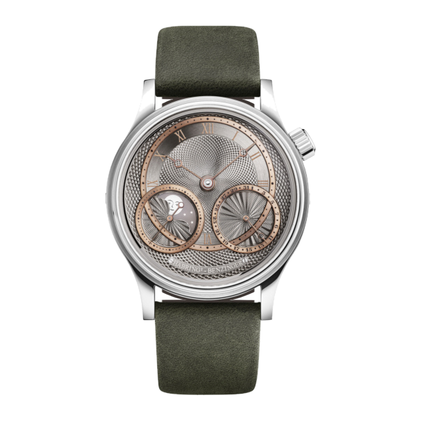

At first glance, the Erwin does not look particularly complicated. A pale dial, slender hands and three central indications. The seconds hand advances in individual steps, much like that of an inexpensive quartz watch. There is no battery, though. A hand-wound mechanical movement sits behind the caseback, with an additional mechanism turning its faster internal rhythm into one step per second.

That is what makes Habring² interesting to me. The reason to care about the watch is not necessarily the first thing you notice. A movement that looks perfectly ordinary can take considerable thought to achieve.

## Richard and Maria build a business

Habring² began in 2004. The superscript two is not a calibre number or a mathematical flourish: it represents the two Habrings, Maria Kristina and Richard. Both are present in the name, even if Richard's technical inventions tend to dominate accounts of the company.

Richard's professional biography dates his work on complicated watches and movements to 1989. Maria brought experience in customer relationships, management, quality control and after-sales service. These are not secondary concerns in a small manufacture. A finished watch needs a reliable supply of parts, a delivery date, an owner and, eventually, someone able to repair it. A drawing board cannot sustain a watch company on its own.

Richard and Maria Habring, from the company's own image archive. Photograph: Habring².

For many years the setting was Völkermarkt, a small town in Carinthia. The business moved to Leibnitz in Styria in 2025; the Austrian register recorded the change of registered office on 20 August. Older profiles and manufacturer texts still refer to Völkermarkt, while the current contact address is in Leibnitz.

## The split-seconds chronograph and the Valjoux 7750

Richard's best-known early work concerns the IWC Doppelchronograph. A split-seconds chronograph has two central seconds hands running together. One can be stopped to read an intermediate time while the other continues. Press the button again and the stopped hand catches up. The French term for this is rattrapante.

Traditionally, the function required expensive mechanisms and careful adjustment. Working with the familiar Valjoux 7750 base, Richard developed an approach that was easier to produce. He dispensed with the traditional column wheel in the split-seconds control: a cam-operated switching element moves the brake arms surrounding the split-seconds wheel. Filed in 1992 and subsequently published as **DE4209580A1**, the patent names Richard Habring as inventor and IWC as applicant. The function remained; its construction was reconsidered.

IWC introduced the Pilot's Watch Double Chronograph, reference **IW3711**, in 1992, with calibre **79230**. Those are the reference and movement designation of the IWC, not of a later Habring² watch. The **Doppel 2.0**, introduced by the independent company in 2012, continued this line of thinking and won the GPHG Sports Watch Prize that year.

## From bought-in bases to the A11

Habring² is still often described as a small company adding clever modules to ready-made ETA movements. That is an important part of its early history, but no longer an adequate account of the current watches.

A11 development began in 2011. The first Felix introduced the proprietary base calibre in 2014, the company's tenth anniversary. The earlier Valjoux relationship did not disappear entirely: retaining interfaces for existing complications was a sensible engineering decision. It does not make the A11 a rebadged 7750.

Specialists in Austria, Germany and Switzerland produce components to Habring drawings. A proprietary construction need not mean that every screw is made in the same room. The important distinction is control over the design and the supply of parts, rather than dependence on a single outside supplier's base movement.

The Felix's A11B calibre. A movement designation is not a watch reference. Photograph: Habring²; background removed while retaining the original photograph's colour pixels.

There is a practical benefit for earlier watches too: maintaining their repairability is part of the plan. For an independent maker, the fate of a watch in twenty years matters at least as much as the number of proprietary components listed at launch.

## Eight models and eight different jobs

The official catalogue identifies the following watches by model name rather than providing a uniform numerical reference for every dial and strap combination. These factory names are therefore the reliable search identifiers. **Codes beginning with A11 identify movements**, not invented substitutes for watch references. The GPHG entry for the Doppel 2.0 explicitly lists its reference as “n/a”.

### Felix and the A11B base calibre

**Factory model name: Felix. Calibre: A11B.**

The Felix provides the starting point: hours, minutes and small seconds at nine. Its steel case measures 38.5 mm across and approximately 7 mm high. The hand-wound movement runs at 4 Hz and offers a 48-hour reserve. No conspicuous complication is needed to show the Habrings' preferred proportions: open dial space, a narrow bezel and a restrained appearance.

Felix, pale-dial version. Photograph: Habring²; original product photograph with its background removed.

### Erwin and the jumping seconds

**Factory model name: Erwin. Calibre: A11S.**

The Erwin adds central jumping seconds. It remains a mechanical watch, although the hand advances only once per second. Its case is 38.5 mm across and 9 mm high; manual winding and a 48-hour reserve remain part of the specification. The photograph shows the Klassik dial. A different dial does not automatically imply a different movement.

Erwin Klassik. Photograph: Habring²; original product photograph with its background removed.

### Chrono-Felix and the single pusher

**Factory model name: Chrono-Felix. Calibre family: A11C.**

One button starts, stops and resets the chronograph. A 30-minute counter sits at three and running small seconds at nine. The current manufacturer specification gives a 38.5 mm case, approximately 12 mm in height, and a 48-hour reserve. The photograph shows the Breguet Salmon-Panda version, not the perpetual-calendar model. Similar names do not make them the same watch.

Chrono-Felix Breguet Salmon-Panda. Photograph: Habring²; original product photograph with its background removed.

### Doppel 38 and intermediate times

**Factory model name: Doppel 38. Calibre: A11R_H1.**

This is the split-seconds branch of the family. The photographed Breguet version records an intermediate time without interrupting the main timing operation. It is manually wound, with a 48-hour reserve and a 30-minute counter. Its middle case is 38.5 mm, but different bezels are offered; “38” does not describe every version's overall external diameter. The specified height including the domed crystal is approximately 13 mm.

Doppel 38 Breguet. Photograph: Habring²; original product photograph with its background removed.

### Foudroyante-Felix and the flashing seconds

**Factory model name: Foudroyante-Felix. Calibre: A11F.**

The small hand at nine completes a revolution every second while the central seconds hand advances in individual steps. That fast rotation is the foudroyante, or flashing-seconds display. It runs continuously rather than operating as an independently started stopwatch. The 38.5 mm hand-wound version has approximately 45 hours of reserve. The 42 mm **Foudroyante-Felix-Date** is a separate model with calibre **A11FD**.

Foudroyante-Felix without date. Photograph: Habring²; original product photograph with its background removed.

### Oskar and the calendar

**Factory model name: Oskar. Calibre: A11Ups.**

The Oskar Date-Moon has a quieter kind of complexity. A pointer date follows the dial's perimeter, while small seconds and a moon phase share the register at six. The case measures 38.5 mm and the hand-wound movement offers 48 hours of reserve. This blue-dial, bracelet version also shows that Habring² is not confined to pale dials and black leather straps.

Oskar Date-Moon with blue dial. Photograph: Habring²; original product photograph with its background removed.

### Josef and the regulator layout

**Factory model name: Josef. Calibre: A11GSP.**

A regulator separates the indications: minutes at the centre, hours at six and jumping seconds at twelve. A reserve indicator sits at three. Inside the 38.5 mm cushion-shaped case is a hand-wound movement with 48 hours of reserve. This is more than a graphic rearrangement of a dial: it changes the way the owner reads the time.

Josef. Photograph: Habring²; original product photograph with its background removed.

### Jorge and hand guilloché

**Factory model name: Jorge. Calibre: A11JBM.**

The Benzinger collaboration gives decoration more room. Its hand-guilloché dial places small seconds and a moon phase at eight, with a pointer date at four. A 38.5 mm case houses a hand-wound movement with 48 hours of reserve. Not every Habring² is austere. Restraint here is about dispensing with unnecessary presentation, not refusing decorative handwork.

Benzinger × Habring² Jorge. Photograph: Habring²; original product photograph with its background removed.

## What accessible means here

Accessible does not mean inexpensive. The Felix's 2015 GPHG entry listed a price of CHF 4,450 excluding VAT. That is a historical figure, not a current quotation. It was already a substantial sum, but it bought a proprietary movement assembled in small series.

I would not judge Habring² against the cheapest mechanical watch. The more interesting question is how much actual watchmaking a buyer receives in a jumping-seconds mechanism, a rattrapante or an unusual display. Making a complication easier to produce need not make it less useful or less satisfying to operate.

The awards recognise particular watches too. Following the Doppel 2.0, the Jumping Second Pilot received a GPHG award in 2013, the Felix in 2015 and the Doppel-Felix in 2018. The latter three won in the Petite Aiguille category. This does not establish that every Habring² is superior to every alternative. It does show why the small Austrian company's work deserves attention alongside better-known names.

## Where the money goes

The company's own account emphasises reliability, direct customer relationships and the absence of advertising campaigns. It still communicates, publishes a magazine and works with retailers. The useful distinction is that it does not seem intent on reproducing a large luxury brand's marketing operation on a smaller scale.

The presentation box makes the point more concretely. According to the standard technical description, the handmade wooden box includes a separate compartment and a set of spare parts. That makes more sense to me than another story about a brand ambassador. The packaging contributes to keeping the object usable later.

What makes Habring² important to me is that unusual watchmaking is never separated from everyday use. Its work asks a consistent question: can the same difficult task be achieved with fewer unnecessary components, a more repairable construction and a more accessible price? There is more interesting watchmaking in its answers than the restrained dials initially suggest.

