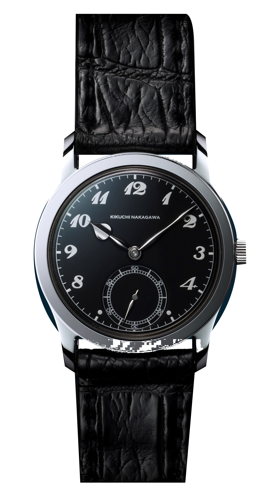
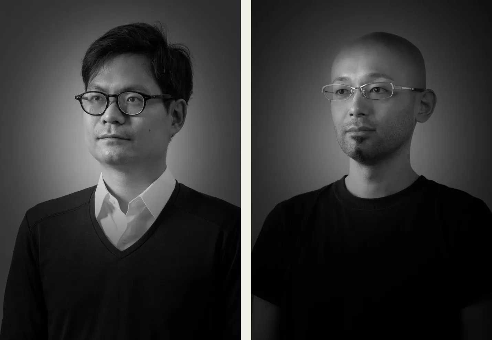
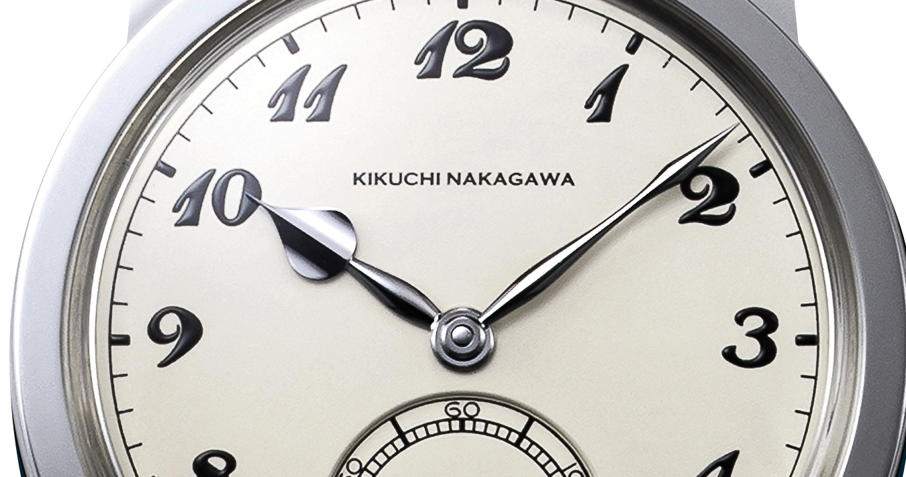
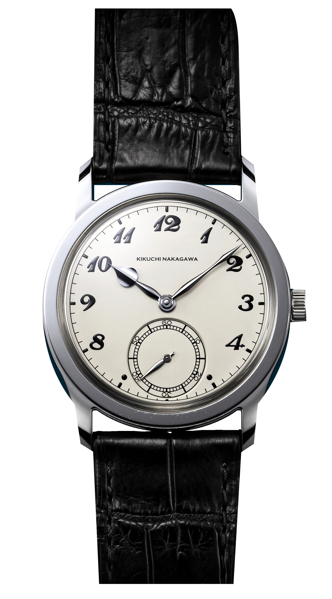
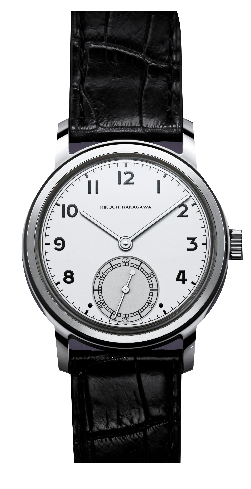
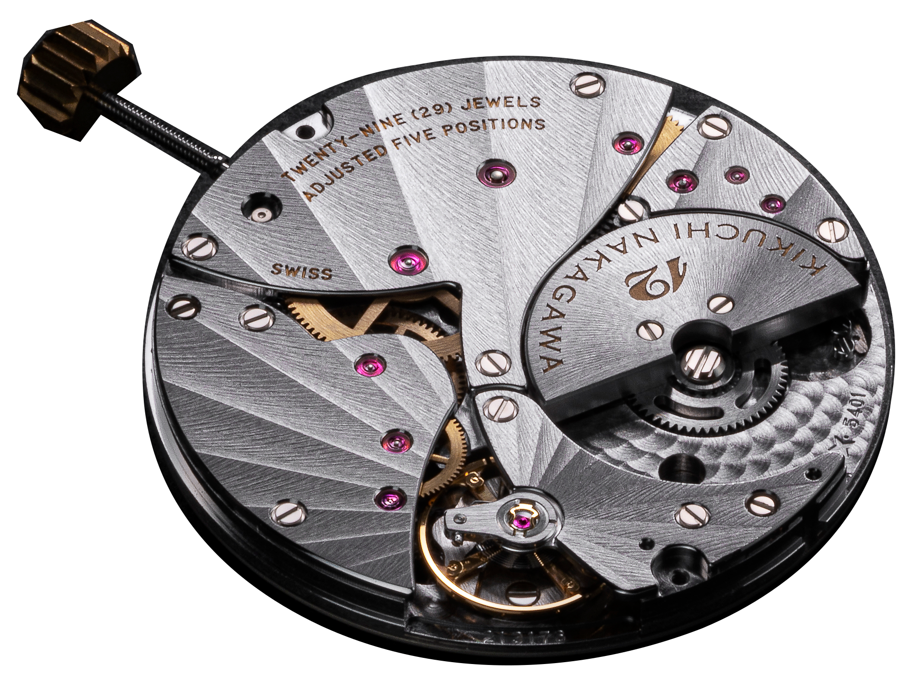

The Murakumo has a steel hour hand with a broad spade at its tip. In one factory photograph it looks black. In another it is almost white. That change was enough to make me stop at the hands before looking at anything else. I have only seen the watches in photographs.

Enlarge the photograph and the hand acquires shoulders and separate sides. Its shape takes a little studying. The rest of the watch can wait.

*The Murakumo's steel hands catch different reflections against the black dial. Photo: Kikuchi Nakagawa.*

## Two routes to the same bench

Yusuke Kikuchi studied architecture at the University of Tokyo, then worked for a software company. Within two years he had left for watchmaking school in Paris. Tomonari Nakagawa began by training as a swordsmith. His subsequent watchmaking career included Citizen and a small-scale independent workshop. They met in Paris in 2012. By June 2018 they had founded a company together, with an attachment to watches of the thirties through the fifties and a particular interest in what could be done with metal. The familiar outlines would stay. The surfaces would receive rather more attention.

*Yusuke Kikuchi on the left and Tomonari Nakagawa on the right. Two separate factory portraits, arranged by Lume. Photos: Kikuchi Nakagawa.*

## Where the black comes from

The black comes from a reflection. Carefully finished steel flashes when it reflects bright surroundings towards your eye. Turn it away and it darkens. There is no black coating.

Traditional black polishing uses fine abrasive paste on a metal plate. Pressure has to remain controlled, because removing material unevenly changes the surface being made. Rounding an edge would also change the reflection. Scaling that work up to a watch case brings another difficulty. The lugs still have to keep their shape, and the transitions between curved and flat surfaces must remain distinct. A screw head is a comparatively small patch to keep even. Here the work reaches across the exterior, while the hands offer several tiny planes facing different directions. They consequently brighten at different moments. What interests me in the photographs is how the hand can be dark while the bezel beside it remains bright. The reflection makes their geometry easier to follow.

*The upper face and side of the hour hand reflect different surroundings. Detail from an original manufacturer photograph. Photo: Kikuchi Nakagawa.*

I would worry about scratches. Desks and shirt buttons are close at hand. I like the result much more than I would enjoy protecting it all day.

## Similar size, different manners

On the Murakumo the long minute hand almost reaches the outer track. I find its outline easier to follow on the white dial, the version entered in the GPHG as reference KN001WH.

*On the white Murakumo the small-seconds track comes very close to the six. Photo: Kikuchi Nakagawa.*

The Ichimonji changes the hands to slender bars and uses simpler Arabic numerals. Its narrower strap opening alters the balance of the case, too. Brushing on the case middle and back interrupts the mirror finish, so a turn of the watch reveals a surface that scatters the light instead. It looks a little more familiar as an everyday object. The hands still have separate upper faces and sides, even though they take up much less space on the dial.

*The Ichimonji's long bar hands change the character of the dial as much as its numerals do. Photo: Kikuchi Nakagawa.*

The Genmon removes the seconds register and uses the KN002 designation for its movement. I would miss that extra circle. The Murakumo needs it, to my eye.

## A movement behind a metal back

Both small-seconds models use the KN001 supplied by Vaucher, from its VMF 5401 micro-rotor family. The winding weight sits within the movement's height, rather than requiring space above it for a large rotating mass. That helps explain the low case. Its two-day reserve would still leave me restarting a watch put aside on Friday evening before Monday morning.

The movement stays behind a solid back on both watches.

*The micro-rotor sits beside the bridges in the maker's movement photograph. A metal caseback covers it when the Murakumo is worn. Photo: Kikuchi Nakagawa.*

I find that decision slightly frustrating. At this price I would want to see the mechanism, especially once I knew a small rotor was doing the winding. I can also follow the reasoning, because the back offers another steel surface to finish and a glass window would interrupt the work just where another watch might start showing it off. The watch can be picked up, set and worn without its owner ever seeing a wheel. There is consistency in that, with the exterior carrying the same attention all the way round. My curiosity would survive the explanation, though. I would turn the watch over, find my own reflection on the cover and turn it back again. An impressive reflection would still leave me wanting a look at the movement.

## The names behind the parts

The product descriptions identify the suppliers. Matsuura makes the case, YUKI Precision the hands and Comblémine the dial. The strap and sapphire manufacturers are named as well. Kikuchi and Nakagawa establish the forms and finish the exterior using parts commissioned from those specialists.

I find that list more useful than an in-house claim.

It also explains a sensible division of work. Vaucher supplies a thin automatic movement. The two watchmakers concentrate their time on the shapes and surfaces that make these watches recognisable. Whether that justifies the price is a separate judgement. A related Vaucher calibre could turn up under another maker's dial. Those broad Murakumo hands would be much harder to mistake.

New orders are currently paused across the range.

The prices remain on the website, even though the order book is closed. My enquiry would probably stop at the price before reaching the question of delivery. The figures below are the manufacturer's pre-tax prices, checked on 6 November.

| Model | Murakumo | Ichimonji | Genmon |
| --- | --- | --- | --- |
| Calibre | KN001, Vaucher | KN001, Vaucher | KN002, Vaucher |
| Display | Hours, minutes, small seconds | Hours, minutes, small seconds | Hours, minutes |
| Diameter | 36.8mm | 36.8mm | 36.8mm |
| Height including crystal | 8.5mm | 8.5mm | 9mm |
| Lug to lug / strap width | 45.5 / 22mm | 45.3 / 20mm | 45 / 21mm |
| Reserve | 48 hours | 48 hours | 48 hours |
| Frequency | 3Hz | 3Hz | 3Hz |
| Water resistance | 3atm | 3atm | 3atm |
| Manufacturer price before tax | US$23,000 | US$22,000 | US$27,000 |

I would ask to see the white Murakumo first. A slow turn towards a light should show the spade hand changing its reflection. Afterwards I would turn the watch over once, just to find out how much that missing window bothered me.
