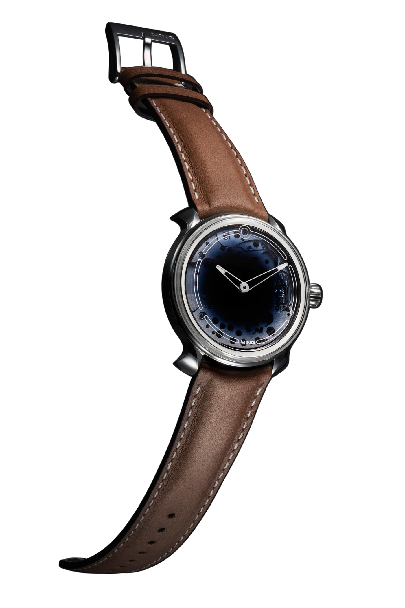
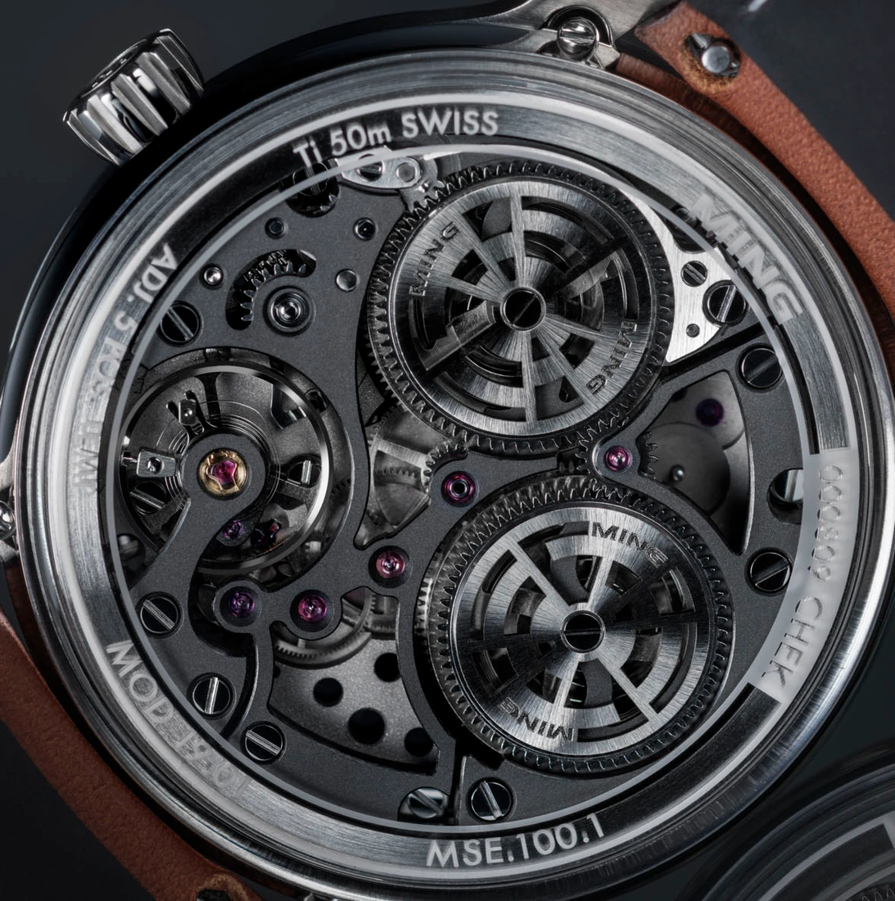
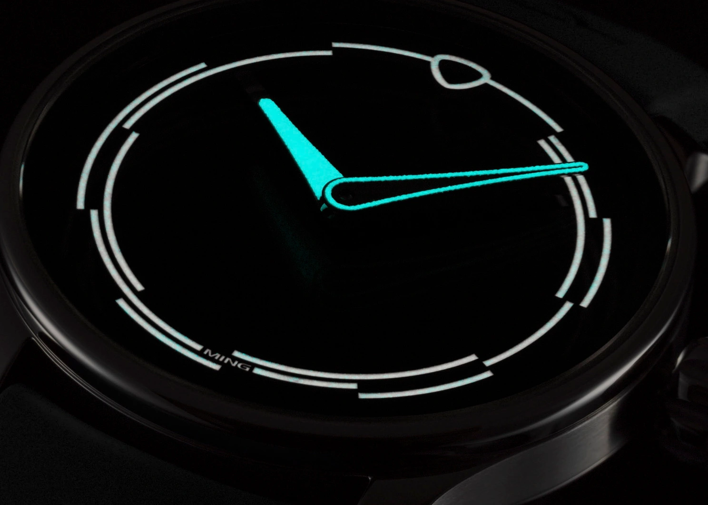
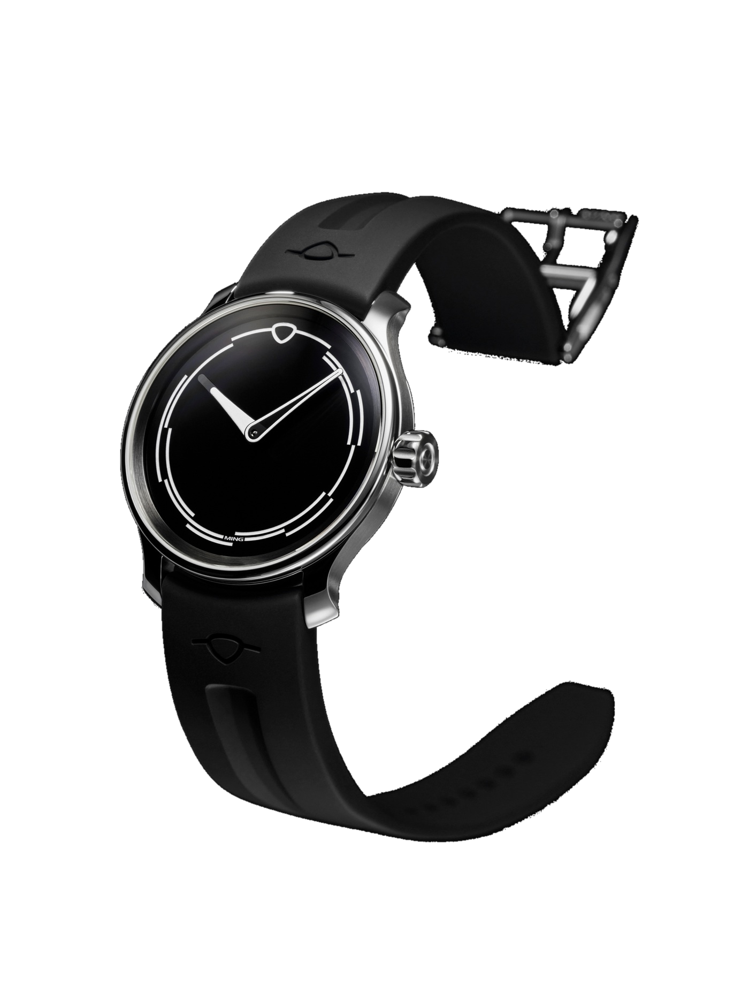
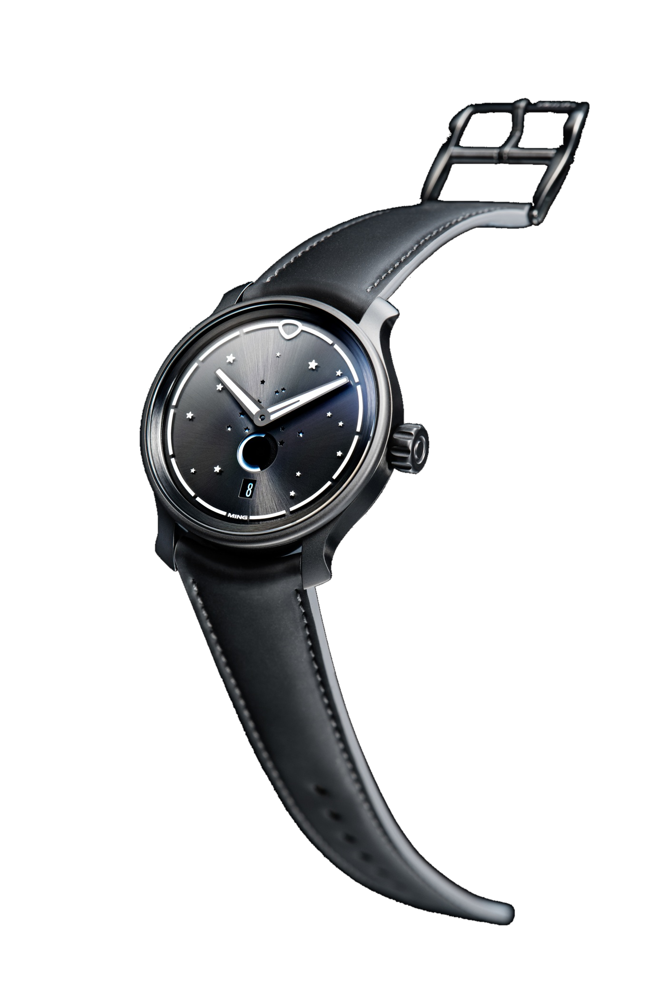
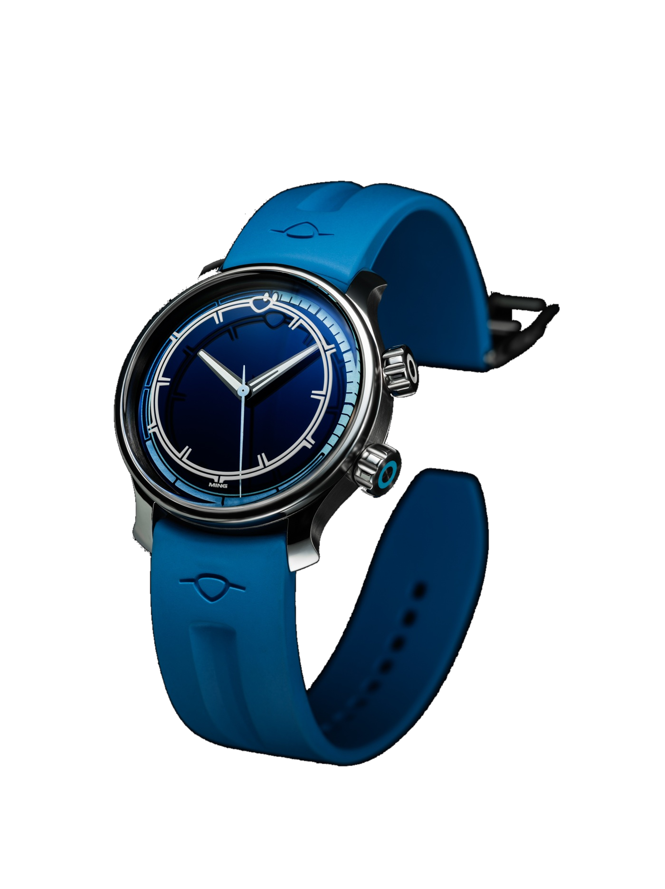
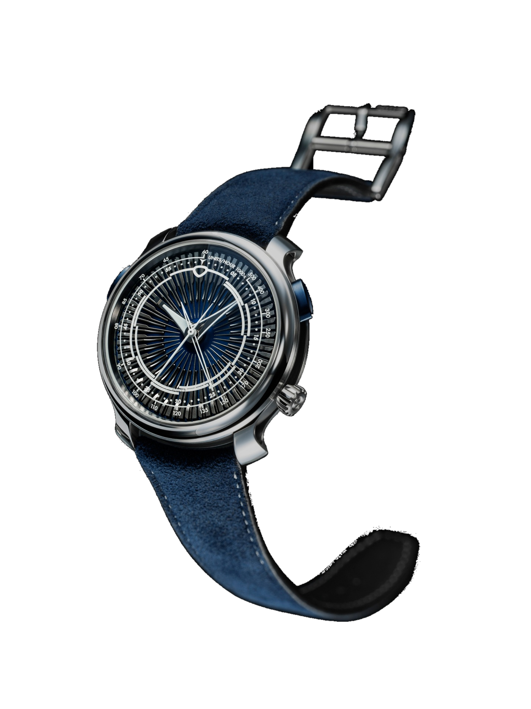
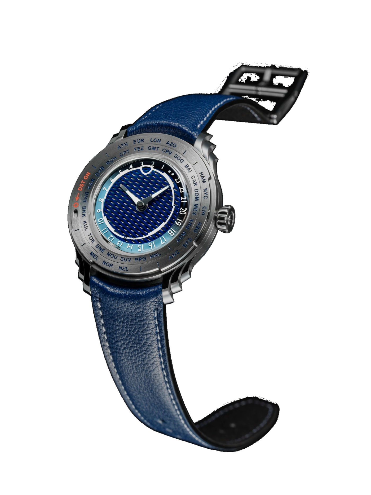

I have never held a MING. Their unusual appearance has always interested me, though. The 37.02 Minimalist looks almost silver in one photograph and deep black in another, with its hour markers apparently sitting above the hands. I keep looking at the pictures to work out which surface belongs where.

There is no name on the front to help.

The man responsible spent years photographing other people's watches before making his own. That feels like a useful place to begin with MING. Once you follow Ming Thein's decisions about light and materials, the appearance starts to make sense.

## Borrowing the watches came first

Thein wanted access to watches beyond an intern's salary. Collectors he met through watch forums lent him pieces to photograph, giving him time to study them before handing them back. A collection with return dates has certain financial advantages. He read about movements, made drawings and developed ideas about what he would change. Photography became his profession. By the first MING launch he was Chief of Strategy at Hasselblad and an adviser to DJI's board. He arrived at watch design with experience of looking very closely at small objects, alongside an understanding of the companies making the equipment he used, while the collector friendships remained part of the project.

That is the part of the story I like. Someone spends enough time looking at watches to form a few stubborn ideas of his own, then finds people who can help him make them.

Thein led the design, with a group of collector friends discussing and challenging the results. The first model, the 17.01, appeared on 8 August 2017, with 150 planned in each of two dial colours.

*The early MING team. Photo, Horologer MING.*

The flared lugs were already there on that first watch.

## Giving the glass more to do

The 19.01 makes the construction easier to see from the side. Tall sapphire crystals above and below the movement meet a narrow titanium caseband. Its separate sapphire dial shades from opaque blue at the centre to transparent at the perimeter, where the movement plate comes into view. There is still a dark patch behind the hands, giving them something to stand out against.

*19.01. The sapphire dial clears towards its edge, exposing the plate beneath. Photo, Horologer MING, background removed.*

The strap curves into short, flared lugs. It follows the outline of the case closely enough to look continuous, although curved quick-release bars hold an otherwise replaceable strap in place.

A movement had to fit into all of this.

After visiting several Swiss manufacturers, MING chose Schwarz Etienne, which had its own movement family and the ability to adapt it to the design. The hand-wound MSE100.1 offers over 100 hours of reserve, with openworked bridges and barrel covers giving a view into it from the back. The parts visible around the dial's perimeter contribute to the front of the watch as well. The movement's appearance therefore mattered before there was a finished case to put it in.

*MSE100.1 by Schwarz Etienne. Open bridges and two barrels seen from the back. Photo, Horologer MING.*

MING opened its own Swiss facility in La Chaux-de-Fonds in 2024, with Mauro Egermini and Luc Bourgeois joining from Schwarz Etienne. Design, engineering and final quality control are in Malaysia, with production and assembly in Switzerland. Different projects involve different movement partners, and MING names them. I much prefer that to hiding a bought-in movement behind a new calibre number and leaving the reader to find out who made it.

## A dark dial can be enough

The first watch I bought with my own money was a Seiko SNXS79K1. Its dial can look grey or completely black depending on the light, and I still like that about it. MING takes the idea much further. A change of angle can alter the relationship between several surfaces, as well as their reflections.

In the 37.02 Minimalist, channels in the underside of the sapphire hold luminous material. The scale stays on the glass, the hands pass beneath it, and the dark surface sits further down. From an angle, those layers shift relative to one another in your view, which accounts for the floating appearance in the photographs. Polar White fills the channels and glows white. The hands use blue-emitting Super-LumiNova X1. In darkness the case largely disappears and the two luminous outlines remain, separated by both colour and depth. In daylight, reflections take over again.

*37.02 Minimalist. The two luminous colours separate the scale from the hands in darkness. Photo, Horologer MING, dial detail.*

I would miss the seconds hand. I like seeing something move.

The automatic Sellita SW300.M1 drives just the hour and minute hands here, with no date window. I can see the appeal of leaving the dial so empty, though I would still put that small movement back into it.

*The Minimalist in daylight. The scale belongs to the sapphire, with the dark surface below it. Photo, Horologer MING, background removed.*

MING announced a CHF 3500 price for the Minimalist from 1 April 2026. That keeps it firmly in my looking-at-pictures budget. At that price I want to understand what work has gone into the watch, and there is something to follow here, from machining the sapphire to developing the luminous material.

The moonphase 37.05 Series 2 Special Edition uses HyCeram for its stars. This combines luminous material with ceramic, a different formulation from the white-emitting Polar White.

*37.05 Series 2 Special Edition. The hand-wound 288.M1 offers around 38 hours of reserve, which will not see it through a whole weekend in a drawer. Photo, Horologer MING, background removed.*

## Sixty clicks underneath the crystal

The 37.09 Bluefin moves the sapphire dial itself. Its lower crown turns the elapsed-time scale while the fixed hour markers stay on the upper crystal, allowing you to set zero against the minute hand and count the minutes passing from that point. Sixty clicks, one direction of rotation, the usual diving-bezel job. It happens inside the case, so the outside edge can stay smooth.

*37.09 Bluefin. The second crown rotates the sapphire timing scale. Photo, Horologer MING, background removed.*

The water-resistance rating is 600 metres, yet the diameter is 38mm. I like that combination, because I do not need a diver to occupy my whole wrist. The thickness gives more away about the pressure-resistant construction than the diameter does. The Bluefin won the Sports Watch Prize at the 2024 GPHG.

It also has a seconds hand, driven by its version of the Sellita SW300.M1.

## Leaving room for the other ideas

The 20.01 Series 5 uses the Agenhor 6361.M1 AgenGraphe to record elapsed seconds and minutes with central hands, clearing the subdials out of the way for the radial framework machined from a single piece of titanium.

*20.01 Series 5. Laser-machined titanium ribs receive a blue coating, then further laser work exposes the bright surfaces. Photo, Horologer MING, background removed.*

The 57.05 Comet, introduced in August, is a world timer. Two superimposed patterns create the changing effect in its centre. Around them sit the city names and a manual daylight-saving adjustment, shifting the affected cities by an hour.

Remembering when each country changes its clocks is still your job.

*57.05 Comet. A daylight-saving adjustment surrounds the layered central pattern. The lugs have a stepped profile. Photo, Horologer MING, background removed.*

If I could talk to Thein about the Minimalist, I would want to see the earliest drawings. Did the watch come first, with a search for the right luminous material afterwards, or did an interesting material give him the reason to design it?

## References and dimensions

| Model | Movement | Diameter / thickness | Power reserve |
| --- | --- | --- | --- |
| 19.01 | Schwarz Etienne MSE100.1, manual | 39 / 10.9mm | over 100 hours |
| 37.05 Series 2 Special Edition | Sellita 288.M1, manual | 38 / 11.9mm | approx. 38 hours |
| 37.02 Minimalist | Sellita SW300.M1, automatic | 38 / 11mm | approx. 45 hours |
| 37.09 Bluefin | Sellita SW300.M1, automatic | 38 / 12.8mm | approx. 50 hours |
| 20.01 Series 5 | Agenhor 6361.M1, manual chronograph | 41.5 / 14.2mm | approx. 55 hours |
| 57.05 Comet | Sellita 330.M2, automatic world timer | 40 / 10.33mm | approx. 50 hours |

*MING announced a CHF 3500 price for the 37.02 Minimalist from 1 April 2026. Dimensions and reserves are taken from the manufacturer's specifications.*
