The Otsuka Lotec No. 6 has two hands, but little else about it resembles a conventional two-hand watch. Both travel across the upper part of the dial, following nested arcs. Beneath them sit brushed metal, screws and a rotating disc glimpsed through a narrow opening. It looks closer to a workshop instrument than a piece of jewellery.

Its unusual appearance is not merely decorative. Watch for long enough and one hand returns to the beginning of its scale. The other follows at a different interval. What initially looks like industrial styling turns out to be a different way of displaying time.

This is a good introduction to the Tokyo brand. Jiro Katayama did not just give a familiar watch an unfamiliar case. He reconsidered how to read it.

## The machine came before the idea

Katayama trained in car design and went on to work on cars and other products. He did not arrive at watchmaking through a family workshop or a conventional horological education. In 2008, he bought a small bench lathe at an online auction and began learning to machine metal.

The lathe lived in his kitchen. It was hardly a place to build a car, but a watch case seemed manageable. Books, experiments and imperfect components became part of his education. The gap between a drawing and a finished metal object was now his problem to solve.

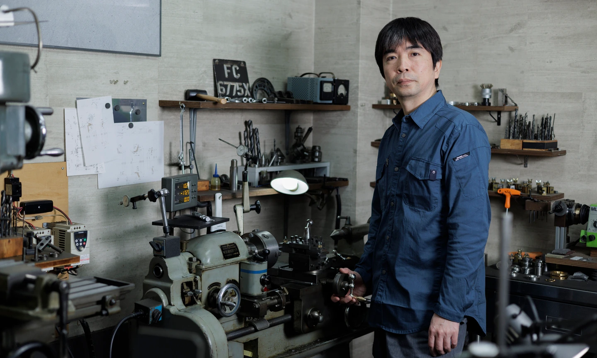

Jiro Katayama in the workshop. Otsuka refers to the Tokyo neighbourhood. Photograph: ŌTSUKA LŌTEC.

He began selling watches in 2012. The brand took its name from the workshop's neighbourhood, while the objects themselves retained something of his earlier profession. Case, controls and display belong together, as they would on a carefully designed machine.

It would be misleading to describe today's Otsuka Lotec as an entirely solitary undertaking. Katayama also works with the team at Tokyo Tokei Seimitsu. The distinctive point of view remains his, but sustaining production requires more than one person's ideas and hands.

## What a touchscreen leaves out

Levers, knobs, cast parts and machined surfaces matter to Katayama. A mechanical switch makes an action visible and tangible. On a touchscreen, we often interact with a representation of that action instead.

His watches need not look old-fashioned to recover some of that directness. They need to show something of how they work. The No. 6's hands, the No. 7.5's raised windows and the No. 8's exposed lever are different ways of doing so.

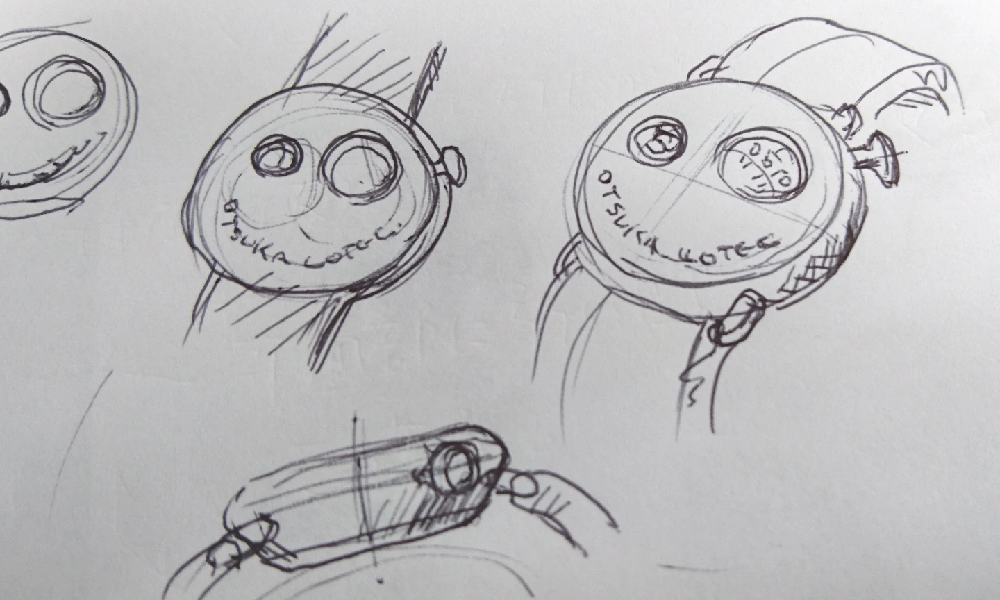

Exploring the three-window layout. The arrangement of the display already shapes the case around it. Photograph: ŌTSUKA LŌTEC.

Look at the photographs and imagine removing the prominent screw heads. The cases would become considerably more anonymous. The boundaries between different metal finishes matter, too: straight or circular brushing, matte surfaces and bright edges make separate components legible. These watches do not try to conceal the fact that somebody assembled them.

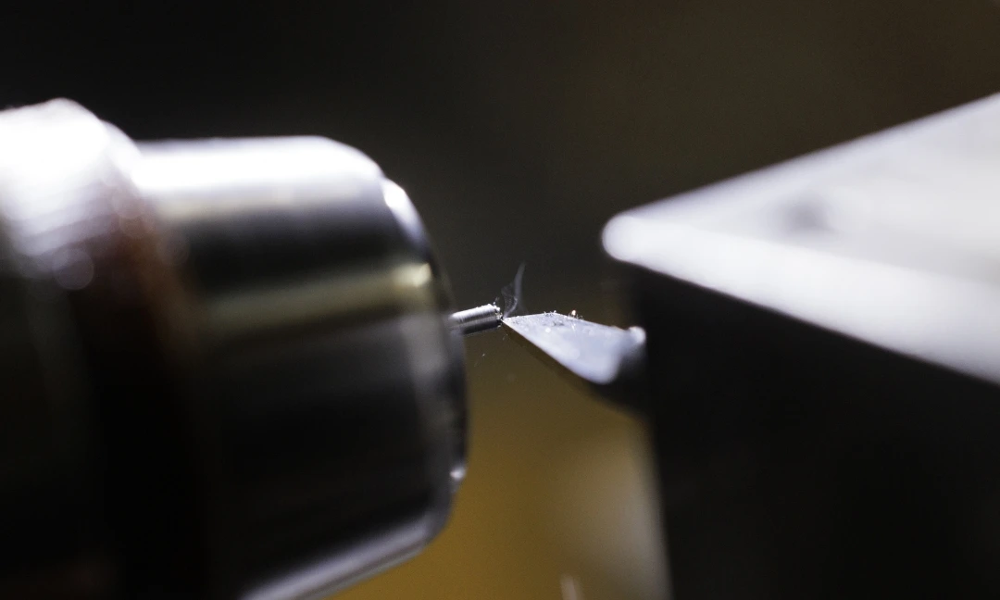

Metalworking was the starting point. Photograph: ŌTSUKA LŌTEC.

## No. 6: two hands that return

The No. 6 is the natural place to begin. Its coaxial hour and minute hands each follow a sector rather than making a complete revolution. At the end of their scales, they return to the beginning. This is a retrograde display: the minute hand resets each hour, while the hour hand follows a twelve-hour cycle.

Reading it requires no new number system, only a small adjustment to habits formed around a circular dial. The nested scales explain the instrument-like appearance immediately. A round aperture supplies the date; a partially exposed disc shows the seconds.

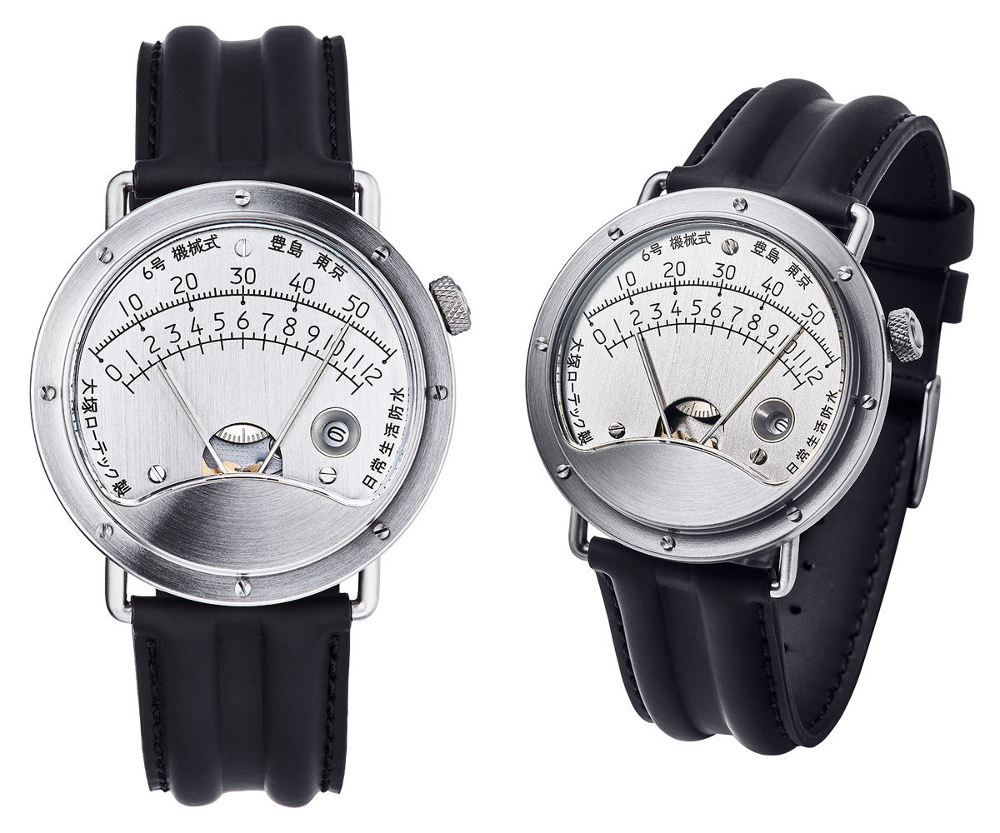

No. 6. The hands share an axis, but each has its own scale. Original transparent-background photographs: ŌTSUKA LŌTEC.

An automatic Miyota 9015 drives the brand's own module. The steel case measures 42.6 mm across and 11.8 mm thick, with approximately 40 hours of power reserve. In 2024, the No. 6 won the GPHG Challenge Watch Prize, bringing institutional recognition to an unconventional design.

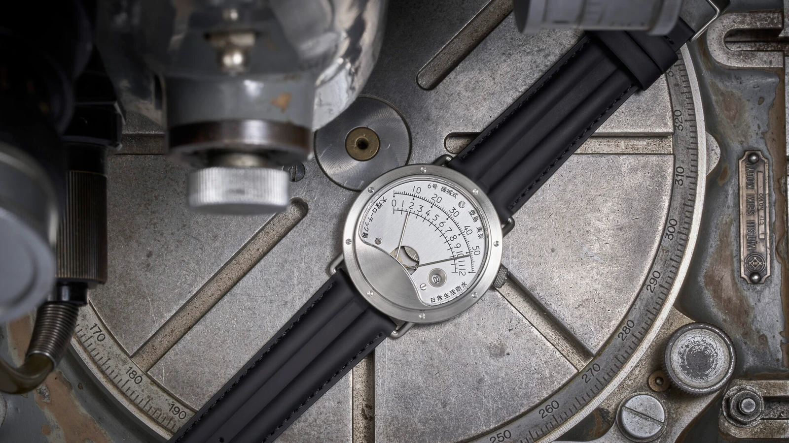

The manufacturer's No. 6 workshop photograph. Its surfaces and curves look entirely at home among machine parts. Photograph: ŌTSUKA LŌTEC.

The two returning hands might suggest perfectly synchronised resets. The manufacturer notes, however, that their midnight returns can occur up to a minute apart. For a prospective owner, that is more useful information than another adjective about the watch's originality.

## No. 7.5: time through three windows

The No. 7.5 largely abandons the conventional dial. Three raised windows separate hours, minutes and seconds. The hour jumps to the next numeral on the hour, while rotating discs provide the other two indications.

It is easy to see a resemblance to the lenses of an old camera. This is more than a graphic reference: the windows rise above the surface, making the profile as interesting as the front view. A sapphire magnifying lens gives the hour numeral additional emphasis.

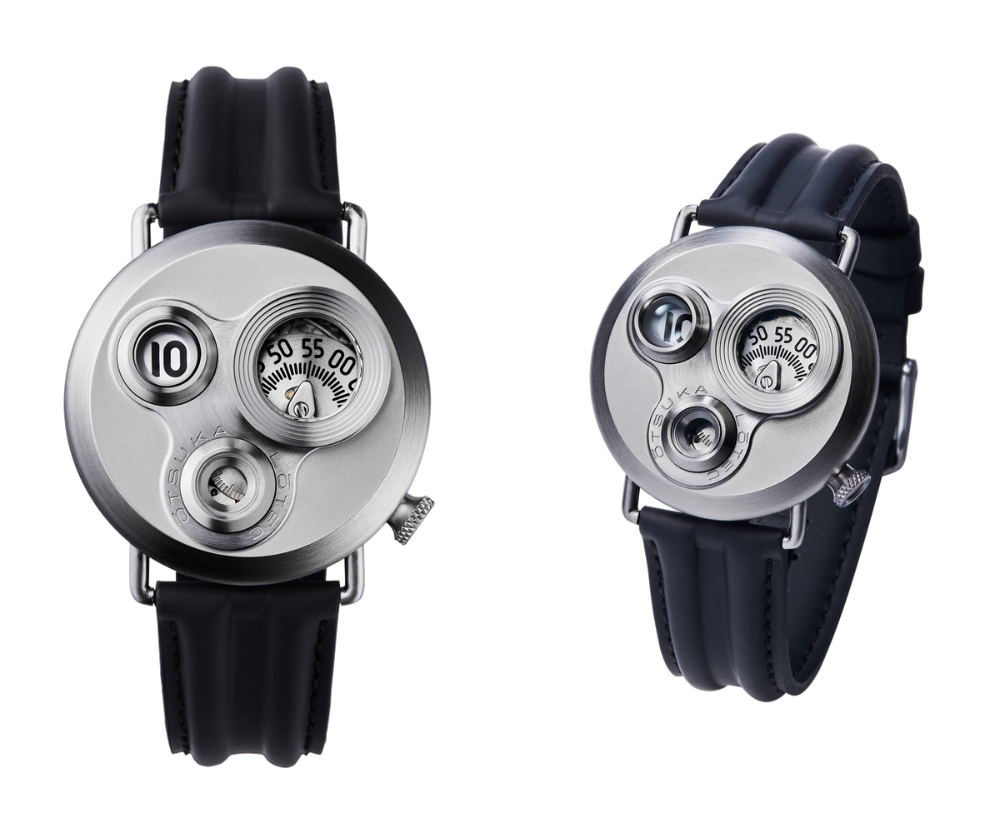

No. 7.5. Three windows over discs, rather than three conventional subdials. Photographs: ŌTSUKA LŌTEC.

Inside the 40 mm case, a Miyota 82S5 works with an in-house jumping-hour module. Read the thickness specification carefully: the basic figure is 11.2 mm, but the maximum is 14.8 mm. Those raised windows need space. A smaller diameter than the No. 6 does not automatically make this a flatter watch.

## No. 5 KAI: an hour numeral that points to the minutes

The No. 5 KAI moves further from familiar dial layouts. The disc carrying the current hour travels beside a minute scale on the right. Its numeral tells you the hour; its position against the scale gives you the minutes. The next hour numeral then takes over.

This is a satellite, or wandering-hour, display. A five beside the 45-minute mark means 5:45. Explaining the system takes longer than reading it once you know where to look.

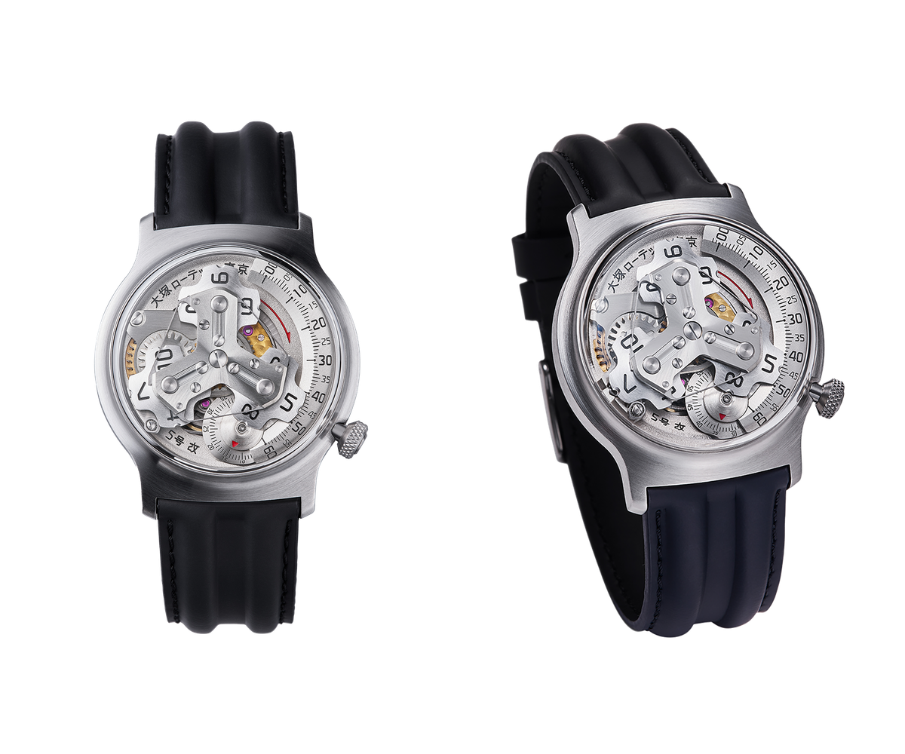

No. 5 KAI. Read the hour numeral travelling alongside the right-hand scale. Photographs: ŌTSUKA LŌTEC.

The KAI carries forward the form of the 2012 No. 5, using a Miyota 90S5 base. Its own module includes miniature MinebeaMitsumi bearings; the bearing supporting the seconds disc measures just 1.5 mm in outer diameter. The industrial exterior can be deceptive. Very small and precise components make its movements possible.

The case is 40.5 mm across, with an overall thickness of 12.2 mm including the tall sapphire crystal. Exposing the mechanism feels justified here. You are not merely looking at decorative wheels: you can follow how the correct numeral arrives at its reading position.

## No. 8: this year's arrival adds a sliding indicator

The numbers are not a release sequence. The No. 9 appeared in 2025, whereas the No. 8 was announced on 10 March 2026. Of the five watches in the current range, the No. 8 is the latest design.

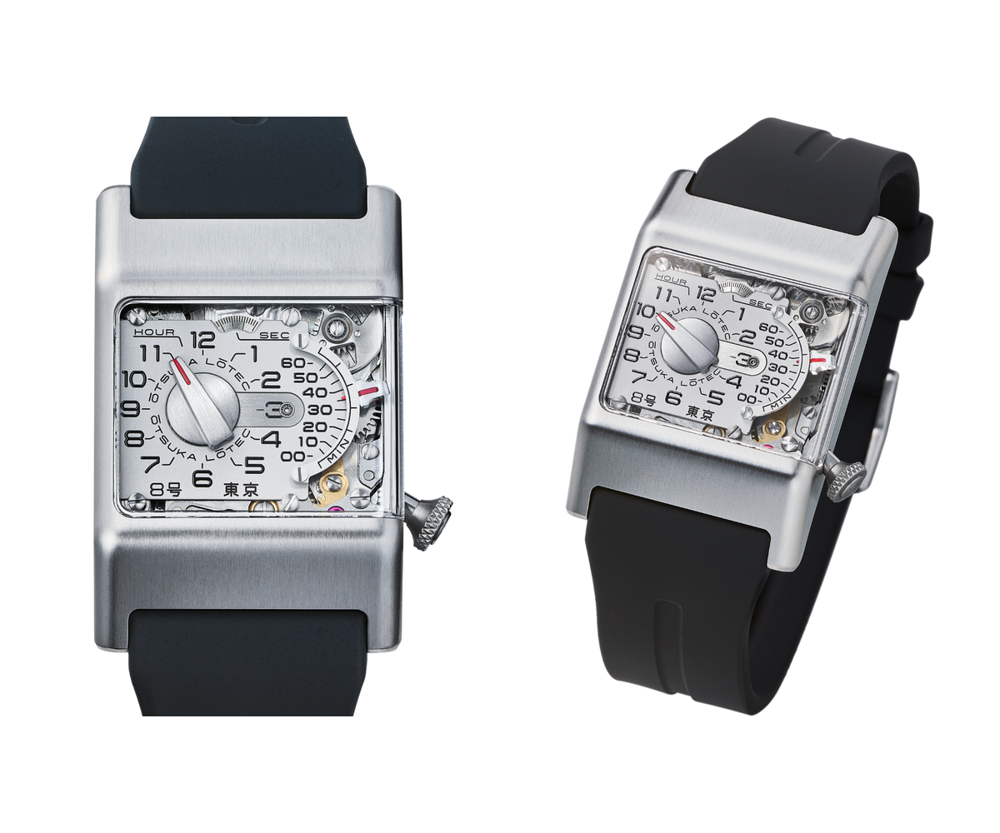

No. 8. The mechanism between its two dial levels can also be observed through the side crystal. Photographs: ŌTSUKA LŌTEC.

Jumping hours now accompany a linear minute indicator, which the manufacturer calls a fader, borrowing the language of mixing desks. On the hour, it returns from 60 to zero as the hour indication changes. Linked to a flywheel, its lever passes between two dial levels. Looking through the side reveals more than a case wall.

The rotating seconds disc at the top has another peculiarity: a full revolution takes 90 seconds. Remember that before comparing its motion with a conventional one-minute circuit.

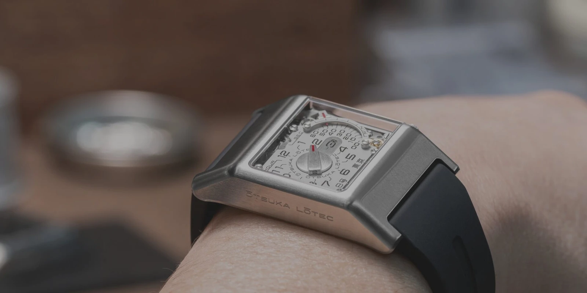

The manufacturer's wrist photograph. The No. 8 is 31 mm wide and 47.8 mm from lug to lug. Photograph: ŌTSUKA LŌTEC.

Above the automatic Miyota 90S5 sits a 62-component module with three miniature ball bearings. Power reserve is approximately 32 hours, shorter than that of the other models discussed here. The rectangular case, rubber strap and distinct directions of movement give it a separate character. Beside a No. 6, it looks like a different instrument rather than another version of the same watch.

## No. 9: a watch that also sounds the hour

For the No. 9, Katayama cites the kind of electricity meter whose moving parts are visible through glass. It is an apt reference. Beneath a tall transparent enclosure, the mechanisms sit alongside one another rather than being arranged around a conventional dial.

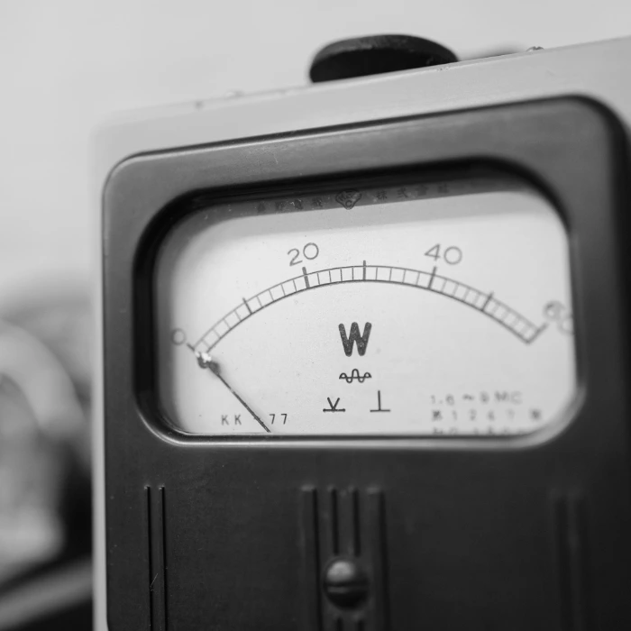

An analogue instrument from the brand's reference imagery. This is not identified as the specific meter behind the No. 9, but it illustrates Katayama's interests. Photograph: ŌTSUKA LŌTEC.

Hours and minutes occupy the right-hand side; elsewhere sit a tourbillon and power-reserve indicator. On the hour, the hour disc jumps, the minute disc returns to its starting position and a hammer strikes a pipeline-shaped gong. It is an hourly striking mechanism, not a minute repeater that sounds the time on demand.

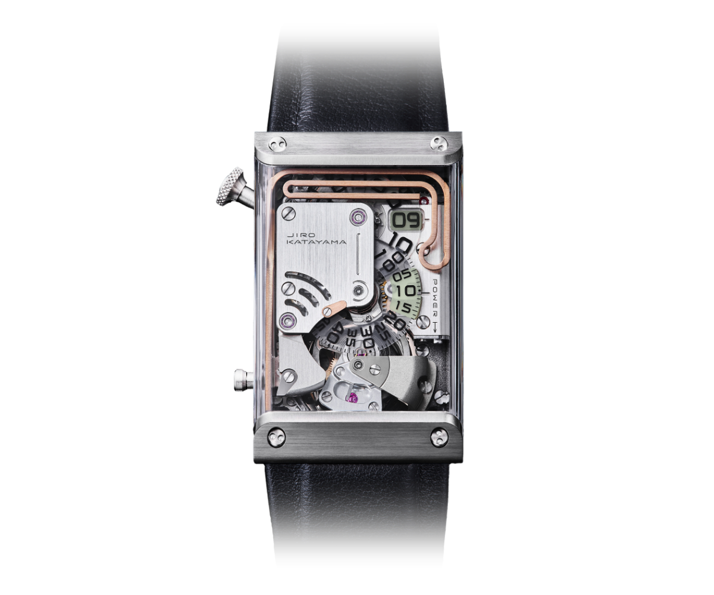

No. 9. Display and striking components remain visible beneath the sapphire enclosure. Photograph: ŌTSUKA LŌTEC.

The hand-wound Cal. SSGT is an in-house development with 278 components. The manufacturer also discloses that some parts, including the barrel, come from the 6498 calibre. That does not make the construction less interesting. It makes the description more accurate: an in-house movement need not mean complete independence in every component.

The No. 9's price belongs to a very different category from the rest of the range. Here, “microbrand” might describe the scale of the operation, but certainly not affordability. Yet the fascination with old instruments remains recognisable. More complicated watchmaking has not erased the original design interests.

## Five models, five different propositions

These are official Japanese list prices including local tax, checked on 11 October 2026. They are not landed prices in another country and do not imply immediate availability.

| Model | Display principle | Japanese list price |
| --- | --- | ---: |
| No. 7.5 | Three windows, jumping hour | JPY 396,000 |
| No. 6 | Two retrograde hands | JPY 495,000 |
| No. 5 KAI | Hour numeral travelling beside a minute scale | JPY 825,000 |
| No. 8 | Jumping hour and returning minute fader | JPY 1,089,000 |
| No. 9 | Jumping hour, rewinding minutes, tourbillon, hourly strike | JPY 17,600,000 |

Buying one is a separate matter. The official shop uses a raffle system and currently requires a Japan-issued payment card and a Japanese delivery address. It does not ship to Hungary or other overseas destinations. The next announced No. 7.5 registration date is 18 October, but the geographical restrictions still apply.

Seeing the watches in person and buying them are not the same, either. The permanent display at Isetan Shinjuku, launched on 8 July 2026, offers an opportunity to examine them, but there are no sales at the display. Anyone expecting a straightforward retail purchase in Tokyo should know that distinction beforehand.

There are practical constraints, too. The watches carry a 3 ATM water-resistance rating. For the No. 6, No. 7.5, No. 5 KAI and No. 8, the manufacturer instructs owners to set the time forwards only. Unusual displays can require unfamiliar handling. We have not handled these watches; the dimensions and operating details here come from manufacturer documentation.

## You need not like all five

The relative calm of the No. 6 and the crowded mechanics of the No. 9 will not necessarily appeal to the same person. One reader may find the three-window No. 7.5 irresistible; another may consider it too unusual to wear every day. This is not a collection in which the main decision is choosing a dial colour.

That is what makes Otsuka Lotec worth exploring. Katayama returns to the same simple task and keeps finding different mechanisms and different ways of reading them. The result sometimes resembles a camera or an instrument more closely than a familiar wristwatch. It remains capable of doing the job it was built for.

With the No. 6, it is not the screws that hold our attention longest. We find ourselves waiting for the hand to reach the end of its scale and begin again.
