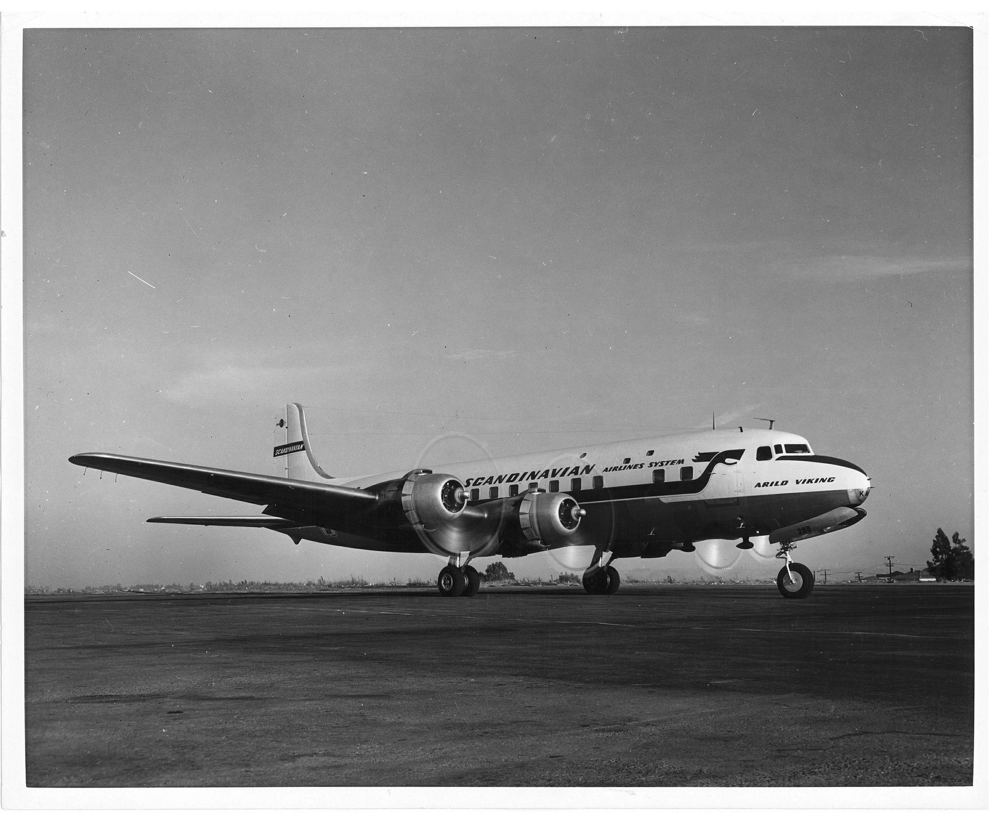
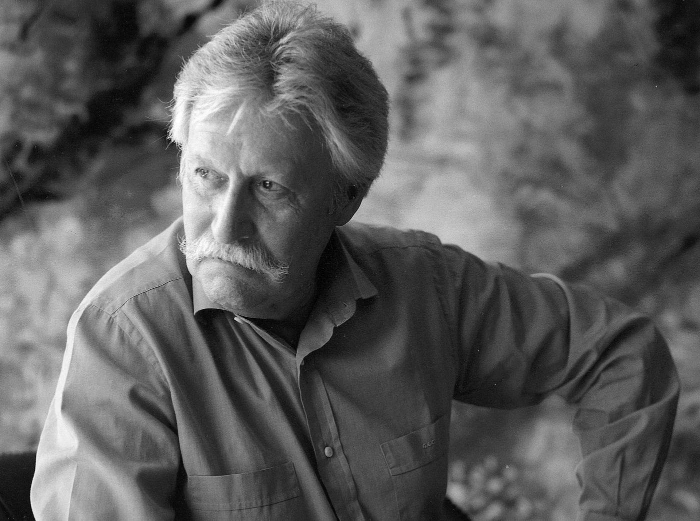
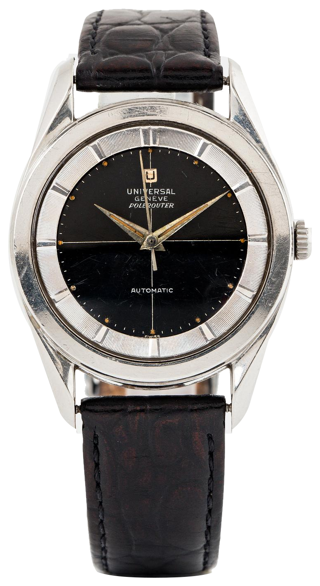
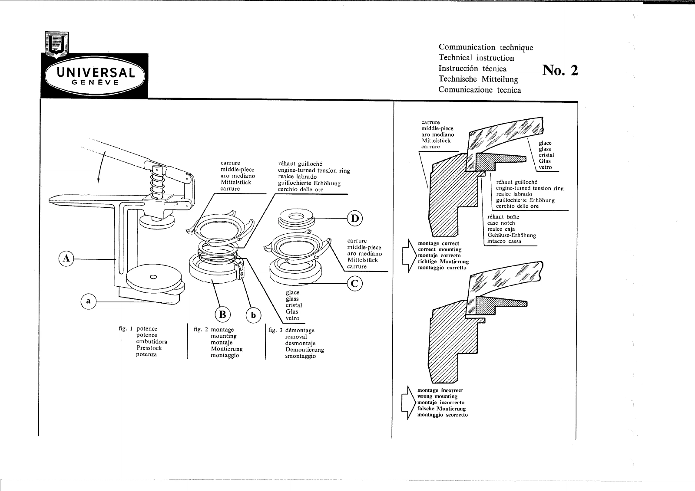
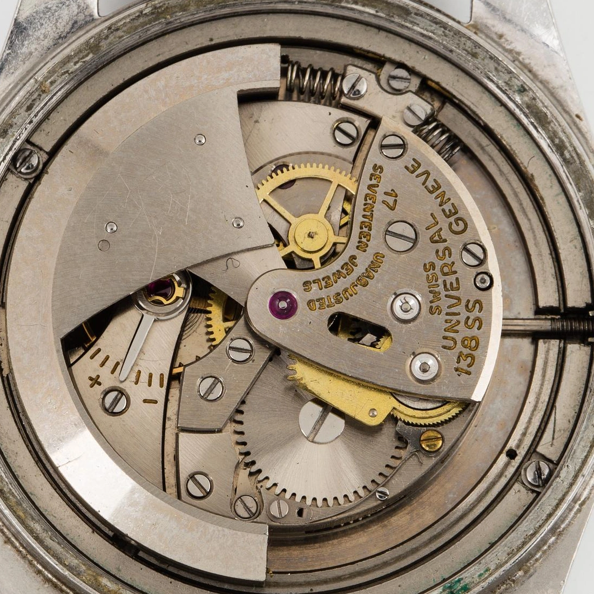
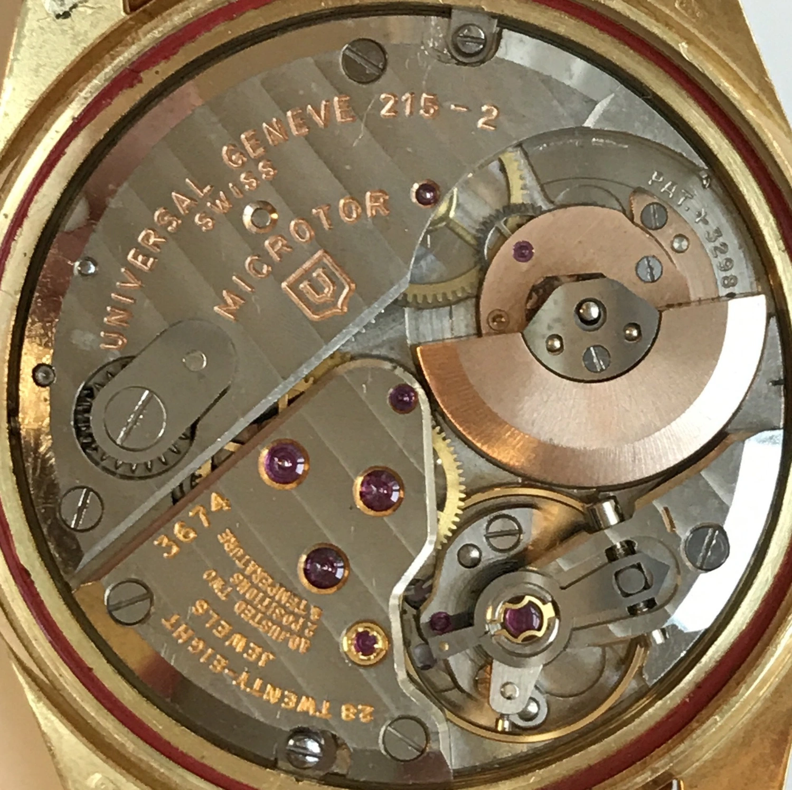
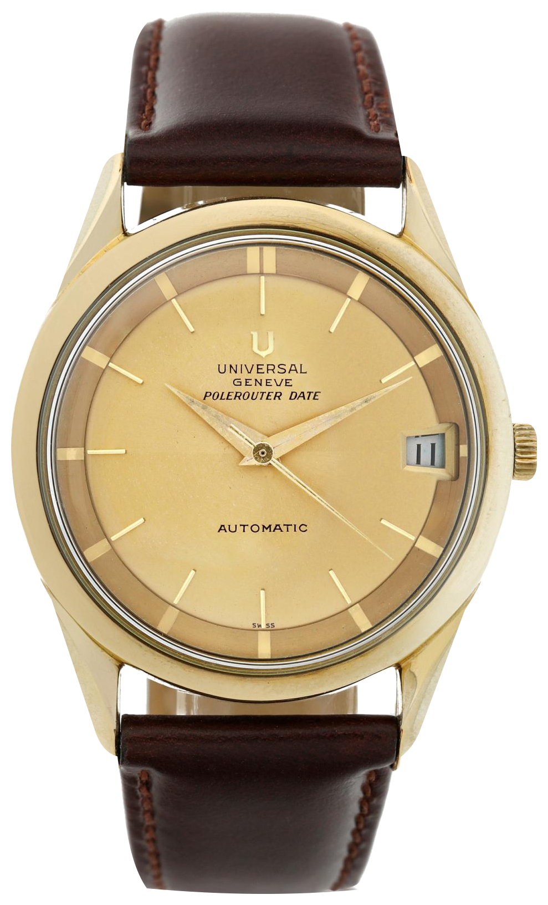

SAS opened its Copenhagen to Los Angeles polar service on 15 November 1954. The Universal Genève watch associated with that route was designed by Gérald Genta, aged twenty-three. The Royal Oak and Nautilus were still a long way off.

It is the lugs that usually make me stop at a Polerouter photograph. Each twists away from the round case, catching light along a different surface. Then the broad, textured ring takes over. There is quite a lot happening around an otherwise quiet dial.

I have yet to handle one. Those are the details I keep enlarging on a screen.

## Los Angeles, via Greenland

The aircraft was a Douglas DC-6B. The service stopped at Søndre Strømfjord, now Kangerlussuaq, in Greenland, and Winnipeg in Canada. On a globe, that northern route shortened the distance between Europe and America's west coast.

SAS describes four years of preparation. Passengers were given protective clothing for the cold, and an Arctic survival manual travelled aboard. An unusually substantial addition to the in-flight reading.

*A Douglas DC-6B from the SAS archive. This was the aircraft type used to inaugurate the Copenhagen polar service in 1954. Photograph, SAS.*

Universal connected its watch with polar aviation and promoted its resistance to magnetism. The earliest dials read Polarouter. The more familiar Polerouter spelling followed later.

The compass and the wristwatch had different problems to solve.

Near the magnetic pole, the horizontal component of Earth's field weakens. A compass needle loses the force that normally gives it a useful direction. In a mechanical watch, magnetised components can disturb timekeeping, particularly when the balance spring is affected. These are distinct effects, and the compass problem alone tells us little about the magnetic protection a watch needs.

I find the resulting watch rather more interesting than a story about battling some enormous polar magnet. It looks remarkably composed for something associated with survival clothing and a new air route.

## Before the famous commissions

Genta trained as a goldsmith and jeweller in Geneva. When he began working for Universal Genève, he was still near the start of his career. The Polerouter gave him an early opportunity to change the proportions of a round watch through its lugs and the arrangement beneath its crystal.

I sometimes tire of seeing this watch introduced solely as a rehearsal for the Royal Oak. It deserves a little time before somebody brings out the octagon.

*A later portrait of Gérald Genta. He was twenty-three when he designed the Polerouter. Photograph, Gérald Genta Heritage.*

The black example below has a fine crosshair through its centre and a wide silver-coloured ring carrying the hour markers. That ring gives the dial a smaller visual centre, while its closely spaced grooves break up the light. The long hands reach towards the boundary between the two surfaces.

The case hardly needs to be large for any of this to work.

*Polerouter S-20217-4, circa 1955, with the bumper automatic calibre 138 SS. The textured ring and twisted lugs are clearly visible on this example. Photograph, Bukowskis, background removed.*

On the early Polarouter, the inner ring also helped secure the acrylic crystal. Universal's Technical Note 2 shows the case, crystal and engine-turned tension ring as separate pieces, with a cross-section explaining how they must seat together. A little further into the family's development, the case and crystal fittings changed. The broad ring remained a recognisable feature. I like finding a component in a repair manual after first admiring it in a photograph, especially when the drawing reveals that the bit I took for decoration has a practical job, and that fitting it slightly wrong changes whether the whole assembly sits properly in its case. It makes the grooves and the restrained centre seem like decisions taken around an actual construction problem.

*Technical Note 2. The cross-sections on the right show correct and incorrect seating of the crystal and ring. Document, Universal Genève, preserved by The Polerouter Reference Website.*

## The small rotor came afterwards

The first Polarouters used calibre 138 SS. Its automatic winding weight swung between spring buffers rather than making a complete revolution. Both buffers are visible beside the large weight in the opened watch below.

This is the movement that belongs at the beginning of the SAS story.

*Calibre 138 SS inside the same S-20217-4. The two spring buffers limit the winding weight's travel. Photograph, Bukowskis, detail.*

Universal filed the patent now identified as CH329805 on 27 May 1955. It describes an off-centre winding weight recessed into the movement. That arrangement underpins the 215 Microtor family.

A conventional central rotor sweeps above the bridges, covering a good deal of the mechanism and adding height. Here the designers used space between the barrel and balance, bringing the winding system down alongside the rest of the movement. There is a trade-off. A smaller weight has less leverage for a given force, so its mass distribution and the gearing matter. The patent shows a reversing arrangement that lets the rotor wind the mainspring in either direction, changing which intermediate wheel engages as the weight turns the other way. The benefit was a slim automatic watch with much of the mechanism still visible when its back was removed. That sort of packaging keeps me looking at movement photographs far longer than I intended.

*The date-equipped 215-2, a member of the 215 family. The small rotor sits at the upper right, above the balance. Photograph, The Polerouter Reference Website movement gallery.*

Development continued through versions such as the date-equipped 218-2 and the later 68 and 69 families. The later winding systems replaced the earlier spindle arrangement with a bearing unit. This was an idea that the company kept working on across successive generations.

The faces changed too. On the 204605-7 below, the date opening narrows towards the centre, the dial is champagne-coloured and the ring is much quieter than on the black watch. It looks rather more at home with a suit.

*Polerouter Date 204605-7, circa 1960. Gold-plated and steel construction, with the Microtor calibre 218-2. Photograph, Sotheby's, background removed.*

## What remains of the lugs

Those twisted surfaces make case condition particularly important to me. Repeated polishing can soften the edges that separate them. The watch may look cleaner afterwards, while losing some of the shape that made me interested in it.

The winding mechanism has its own history of wear.

Adam Hambly's repair account shows how a worn Microtor spindle or bearing can allow the weight to rub against surrounding parts, leaving circular marks inside the caseback. The damage can be repaired. It also explains why an attractive dial tells you very little about the condition of the automatic winding system.

I like the Polerouter more for having a construction that can be followed, developed and repaired. The name on its design is part of the attraction, but so is finding out what went wrong with a particular rotor and what an actual watchmaker did about it. The size helps as well. The vintage examples shown here are around thirty-five millimetres across, leaving their lugs some room on a modest wrist.

If I were looking for one, I would start with a black, dateless example and ask for close photographs of the case edges before getting too attached to the dial.

## References in this article

| Watch or movement | Reference | Its place in the story |
| --- | --- | --- |
| Early Polarouter case families | 20214 / 20217 | The original factory drawing shows the inner ring helping to secure the acrylic crystal. |
| Black-dial Polerouter | S-20217-4, 138 SS | The pictured Bukowskis example, circa 1955, catalogued at 35.5 mm. |
| Date-equipped Microtor | 215-2 | The movement in the close photograph, with its recessed winding weight. |
| Champagne-dial Polerouter Date | 204605-7, 218-2 | The pictured Sotheby's example, circa 1960, catalogued at 35 mm. |
| Later Microtor families | 68 / 69, 1-68 / 1-69 | Bearing-mounted rotors, with a date function in the 69 versions. |

*Dimensions refer to the individual auction examples illustrated here. Construction details were checked against the original factory documents.*
