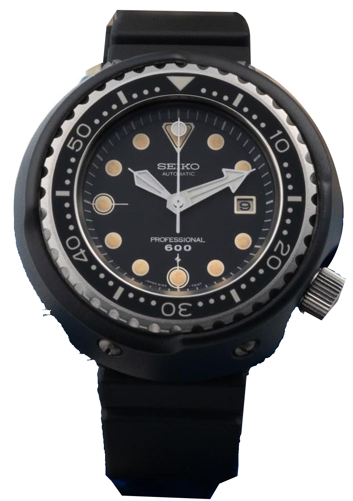
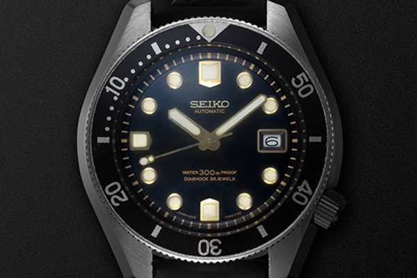
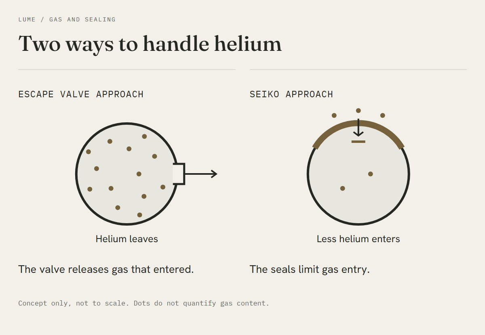
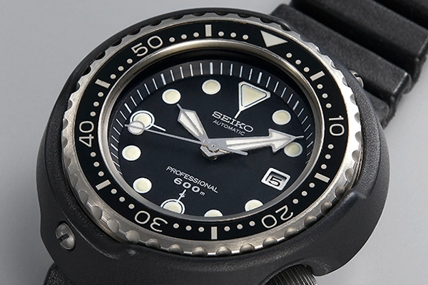
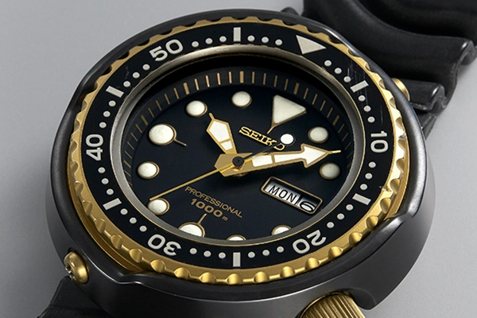

A professional diver wrote to Seiko in 1968 to say its 300m watch was unsuitable for his work. Oshima used a diving bell and worked as deep as 350 metres. Seiko invited him to explain the failures, then sent its staff to see the equipment at Kure, where the complaint became a list of practical requirements.

The complaints continued aboard the ship, well above the seabed.

Seven years later came the Professional Diver's 600m, reference 6159-7010. Collectors would call it the Tuna. I keep coming back to the screws around its large protective shell. They make the watch look almost dismantle-able, which turns out to be rather close to the point.

*The 1975 reference 6159-7010 examined by Antiquorum. Its wide arrow minute hand and screw-secured black protector are clearly visible. Photo: Antiquorum.*

## The chamber was part of the problem

Development leader Taro Tanaka visited the drillship at Kure with an engineer from Suwa. The divers described failures in the decompression chamber, alongside more tangible troubles with snagged cables and straps that became brittle in the cold. The earlier 300m model below already had a one-piece case and a recessed crown. There was useful work to build on, alongside a rather long list of complaints.

*Seiko's historical presentation identifies this as the 1967 300m model. The one-piece case preceded the Tuna. Photo: Seiko Watch Corporation.*

A saturation diver can remain under pressure between working excursions, resting in a chamber filled with a helium-containing breathing mixture. The watch sits in that atmosphere too. Helium atoms can slowly pass through seals that keep out water. When the chamber pressure is reduced, gas inside the watch may escape more slowly than the pressure outside falls. The crystal then has a pressure difference acting on it from within. A successful water-pressure test has answered only part of the question.

A dry chamber can therefore cause a very expensive problem.

## What the valve actually does

Rolex used an automatic helium valve to release the excess internal pressure. It opens once the pressure difference is sufficient, then closes again. DOXA's Conquistador also adopted a helium valve. The patent record for CH492246A names Rolex Montres as the original applicant and records a filing date in 1967.

I would leave national loyalties out of it. The valve releases excess internal pressure. Seiko sought to limit gas entry enough to avoid needing that outlet.

*The valve releases gas that has entered. The Seiko sealing system limits entry. Our own conceptual illustration, not to scale. Composition: Lume.*

The myth is the valve as a universal badge of quality. A swimming pool supplies none of the helium-rich atmosphere of a saturation chamber. The extra part alone proves little.

## The letter L was only part of it

Ikuo Tokunaga specialised in the behaviour of materials. He recalled that developing the equipment to measure helium penetration had been far harder than arranging a pressure test.

The L-profile gasket seals around the crystal edge, and the threaded retaining ring fixes the assembly in place so that the sealing element stays where the designer needs it. Geometry alone will not do it. The material must also resist gas penetration, since an accurately made gasket would achieve little if helium passed through it readily during a long exposure. A one-piece titanium inner case removes the screwed caseback joint, although the crown and crystal still need effective seals. Seiko had already used a one-piece case on its earlier diver. The work lay in matching materials and fixing methods to an environment that had defeated an otherwise capable watch, then checking whether the complete assembly could withstand it.

An atom has no reason to be impressed by a letter.

Here helium resistance means performance under the intended operating conditions. The aim is to prevent harmful internal overpressure through saturation work and decompression. It does not establish zero permeation at every possible pressure for an unlimited length of time.

*The 1975 model. A broad minute hand and distinct twelve o'clock marker make the dial easier to read quickly. Photo: Seiko Watch Corporation.*

## Titanium under the black

The first protector had a hard black coating over titanium. Solid ceramic arrived with the 1986 generation and its 1,000m rating. The sealed inner case is a separate part.

The shell shields the crown and bezel from impacts and snagging. Removing it also gives access to dirt accumulated around the bezel. That explains the screws rather better than a stylistic preference does. It is not an invitation to prepare a fifty-year-old watch for diving at home.

Tanaka's design had to pull all these requests into a wearable object. The 6159B remained inside, a high-frequency automatic from an established movement family. Elsewhere, apparently minor decisions mattered just as much. The corrugated strap could accommodate changes around the wrist as the diving suit compressed, and its polyurethane material coped better with cold than the earlier PVC. Tokunaga connects Tanaka's strap idea to the bellows of a folding camera, an object whose ability to fold and extend had a useful parallel on the wrist. The divers also wanted a watch they could wear ashore without feeling embarrassed by its appearance. That was ambitious. On my wrist, a case approaching five centimetres would struggle most with this last part of the brief.

## A familiar outline with changing parts

The Professional 600m reached the market in June 1975. A quartz version followed in 1978 with calibre 7549, then the 7C46 arrived with the 1986 generation. The broad minute hand and round protector survived those changes, helping rather different watches look immediately related. With the mechanism hidden inside a sealed case, the continuity is easy to see before the differences become apparent.

*The 1986 descendant has a ceramic protector and a 1000m marking. Photo: Seiko Watch Corporation.*

The 2020 SLA041 is another generation again, with a sapphire crystal and an 8L35 movement. Borrow its specifications for the original and sapphire quietly arrives forty-five years early. The original used Hardlex, a hardened mineral glass.

| Historical point | Specification |
| --- | --- |
| First Professional 600m | 6159-7010, June 1975 |
| Original movement | 6159B, automatic with manual winding |
| Frequency | 36,000 vibrations per hour, 5Hz |
| Inner case | One-piece titanium |
| Outer protector | Titanium with a hard black coating |
| Crystal | Hardened mineral glass |
| Original water-resistance rating | 600m, designed for saturation use |
| Diameter | 50mm on Antiquorum's examined example |
| Period price example | ¥85,000 in the 1977 Japanese factory catalogue |
| Quartz transition | 1978, calibre 7549 |
| Ceramic protector and 1000m | 1986, calibre 7C46 |

I now look at the screws first when I open a photograph of the 6159-7010. The protector used to seem merely large. I would like a closer look at the gaps that let a finger reach the crown and bezel while keeping both surrounded by that thick shell.
