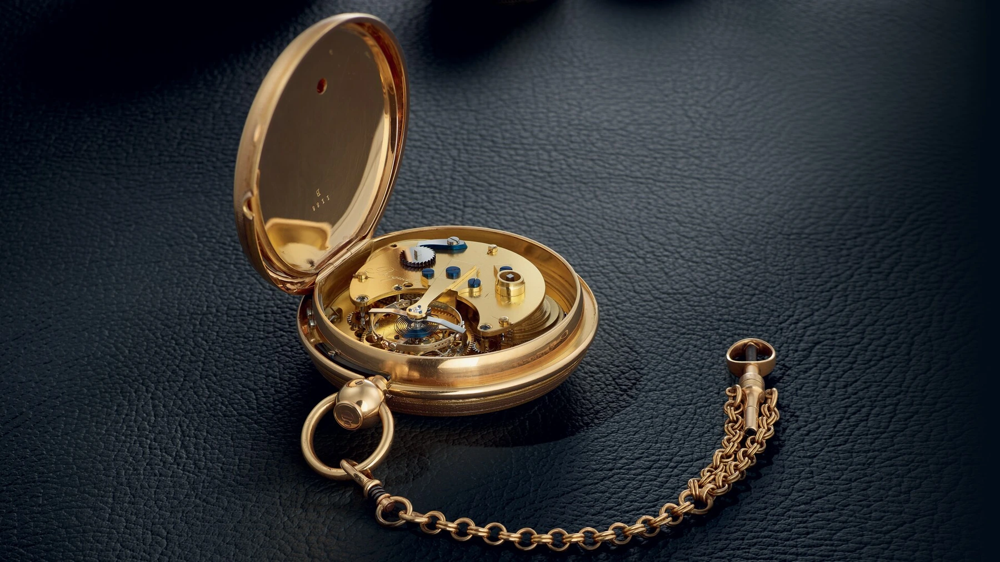
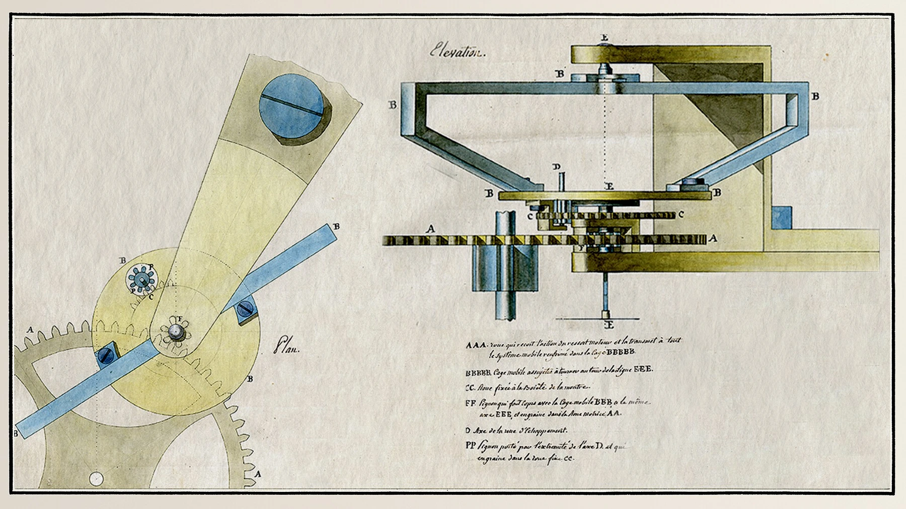
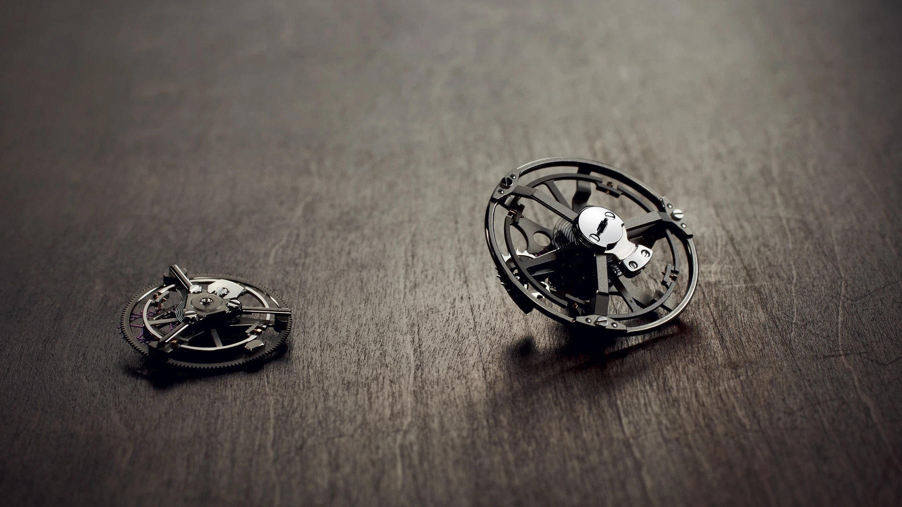
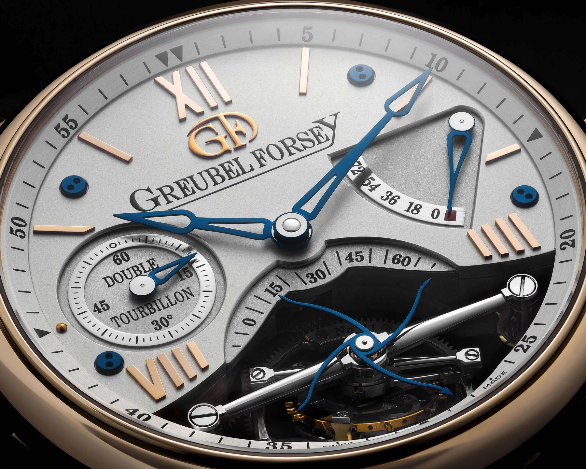
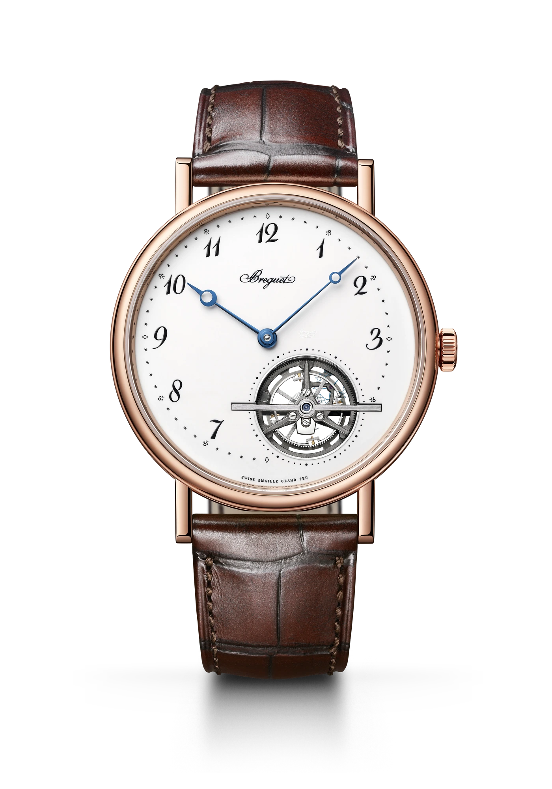
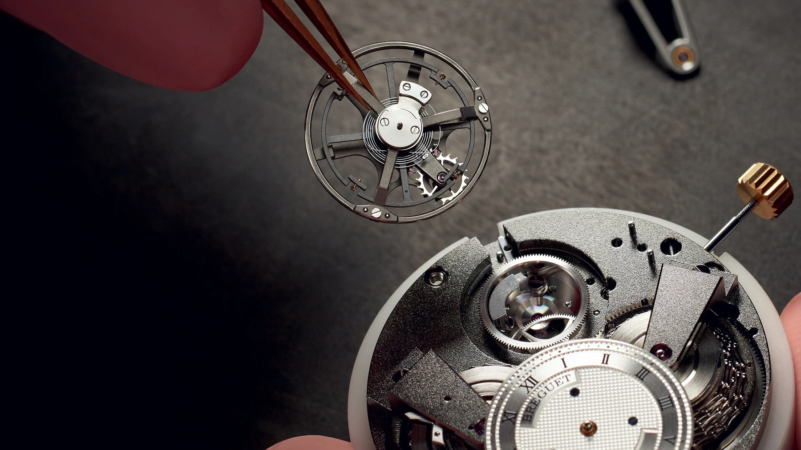
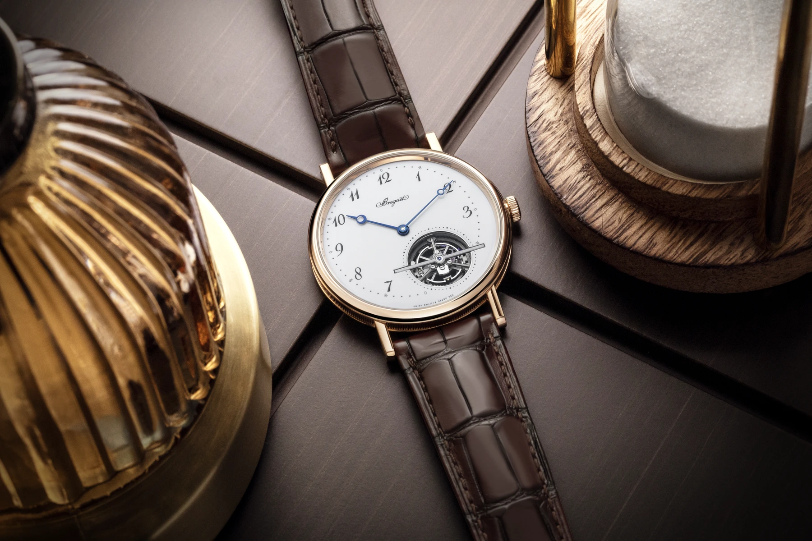

It is remarkably easy to lose track of time while watching a tourbillon. The balance swings rapidly back and forth while the mechanism surrounding it turns at a much slower pace. At first, the movements are difficult to separate. Once the different rhythms become clear, we tend to stay for another revolution.

That experience explains much of the tourbillon’s appeal today. It is also more honest than the familiar claim that the device “eliminates gravity”. Gravity still acts inside the rotating carriage. Breguet’s invention attempts to average certain consequences of it. How much that helps on a wrist requires a more careful answer.

## An invention for the waistcoat pocket

Abraham-Louis Breguet obtained his tourbillon patent on 26 June 1801. The original problem is easy to picture: a pocket watch spends hours almost upright in a waistcoat. Its regulator remains in much the same orientation. If the watch consistently gains or loses in that position, the error accumulates in the same direction.

Breguet did not propose rotating the entire watch. Instead, he reorganised its most sensitive working elements. The balance, hairspring and escapement travelled together inside a rotating carriage. The case could stay still while these components successively adopted different orientations relative to gravity.

*Breguet No. 1188 with its back open. The tourbillon is visible through the opening in the large movement plate. Photograph: Montres Breguet.*

Building and regulating the early watches took considerable time. The patent date should not be mistaken for the start of effortless series production. Breguet’s historical account describes watches used for scientific and navigational purposes as well as by collectors. This was not originally a device conceived to animate a wristwatch dial.

## The problem is not switching gravity off

An ideal balance and hairspring would keep the same rate however the watch was oriented. Real components have mass, imperfect weight distribution and a spring whose behaviour is not ideal in every respect. Bearings and friction matter too.

A mechanical watch can therefore run at different rates in different positions. Gravity is not simply “holding back the hands”. Small changes in the oscillator’s behaviour and energy delivery can become measurable timing differences.

Consider a deliberately simplified example. A movement gains in one vertical position and loses in the opposite one. Let it spend equal time in the intervening positions and some of those differences may average out. That is the principle behind the tourbillon. If the watch runs equally fast in every position, however, rotating its regulator will not by itself correct the common error.

*Detail from the 1801 patent drawing. A contemporary explanation of the carriage and drive, rather than a modern concept illustration. Archival image: Montres Breguet.*

## Two movements at very different speeds

The balance’s oscillation and the carriage’s rotation are separate movements. The balance still swings rapidly back and forth, setting the timekeeping rhythm. The carriage turns much more slowly: sixty seconds per revolution in the familiar one-minute construction.

In a conventional arrangement, the train drives the carriage while the escape-wheel pinion travelling with it engages a stationary wheel. The escapement’s releases govern the assembly’s progress. It is not simply a complete working movement being spun by an unrelated miniature motor.

*The Extra-Plat 5377 assembly on the left and the Tradition 7047 assembly on the right, as identified by Breguet. Different constructions built around the same principle. Photograph: Montres Breguet.*

## A desk makes the limitation clear

In a conventional single-axis tourbillon, the carriage axis is parallel to the balance staff. With the watch upright, rotation carries the regulator through a sequence of vertical orientations. Lay the watch dial-up on a desk, however, and the same axis is now parallel to gravity.

The carriage still turns, but it no longer tips the balance through those vertical positions. That geometric distinction is the limitation. The tourbillon has not stopped working; its rotation simply cannot, on its own, erase the difference between horizontal and vertical rates.

F.P.Journe’s 2019 Tourbillon Souverain Vertical makes an instructive comparison. Its carriage is mounted in a different plane and completes a revolution in thirty seconds. In the manufacturer’s announcement, Journe specifically discussed a watch resting flat versus on its edge. The development itself is a useful reminder that the axis of rotation matters.

## A wrist is not a uniformly rotating test rig

Our arms move, but neither continuously nor randomly. Typing, reading and driving can hold a watch in particular orientations for long periods. At other times the positions change rapidly. One wearer walks for hours; another spends much of the day at a desk.

The claim that the wrist “already does the tourbillon’s job” is therefore incomplete. It changes the watch’s orientation without guaranteeing equal time in each position. Wrist movement and carriage rotation act together. To predict the result, we would need both the movement’s positional rate profile and the time spent in those positions.

The Workshop below builds the explanation from the basics. Explore the balance and hairspring first, then the carriage rotation and energy path. Step four shows how a changing rate contributes to an average. The final view places the entire watch in space: compare upright, dial-up and the scripted wrist movement.

<!-- lume-model tourbillon -->

## What does an accurate tourbillon prove?

It would be wrong to say that a tourbillon can never have a purpose in a wristwatch. Greubel Forsey’s Double Tourbillon 30° places a one-minute inner carriage at a thirty-degree inclination inside an outer carriage turning once every four minutes. The construction addresses sustained wristwatch positions rather than merely adding movement to the display.

Greubel Forsey also won the 2011 chronometry competition with a Double Tourbillon 30°. That is a meaningful counterexample to the claim that the mechanism can only be decorative. It does not establish that every tourbillon, on every wrist, will outperform a conventional movement. The result belongs to a complete, carefully developed and regulated watch.

*Greubel Forsey Double Tourbillon 30°. The inclined inner axis is functional: it changes the orientations visited by the regulator. Manufacturer’s close-up: Greubel Forsey.*

A fair comparison would examine the whole system, including regulation, amplitude, changing energy supply and the test conditions. Grand Seiko’s Kodo, for example, combines a tourbillon with a constant-force mechanism. Their jobs are distinct: one addresses the consistency of energy delivery, the other positional variation. The finished watch’s accuracy cannot be credited solely to its rotating carriage.

## How many components are turning?

The frequently mentioned seventy to a hundred components are not a universal tourbillon specification. For the Master Ultra Thin Tourbillon Enamel **Q13224E2**, Jaeger-LeCoultre describes the tourbillon in calibre **978** as comprising 77 components and weighing less than half a gram. That is a figure for a particular assembly, not a rule for the category.

It should not be confused with the component count of an entire calibre either. The automatic **581** in the Breguet Classique Tourbillon Extra-Plat **5367BR/29/9WU** contains **334 components in total**. The movement is three millimetres thick, runs at four hertz and offers an eighty-hour power reserve. The carriage visible inside the 41-millimetre case is only one part of it.

*Breguet Classique Tourbillon Extra-Plat 5367BR/29/9WU. The enamel dial leaves an opening at five o’clock for the tourbillon. Original transparent-background product photograph: Montres Breguet.*

Low mass matters because the mainspring must maintain the oscillation and drive the rotating assembly. Titanium is more than a modern-sounding catalogue detail: it permits light, rigid components, while bringing its own machining and finishing challenges. Additional moving elements also demand careful adjustment and assembly.

*Assembling the Tradition tourbillon. The photograph makes clear how much more is involved than exposing a balance through the dial. Photograph: Montres Breguet.*

A flying tourbillon does not introduce a different law of physics. Supporting the carriage from one side removes the upper bridge and opens the view. It does not automatically remove the underlying positional limitations. Nor is every visible balance a tourbillon: the regulator must also rotate within a carriage.

## What accuracy alone cannot explain

In 1986, Audemars Piguet introduced the first selfwinding tourbillon wristwatch. That qualification matters: the claim concerns automatic winding, not the absence of every earlier wristwatch experiment. The tourbillon’s return took place in a setting where its original pocket-watch problem no longer applied in quite the same way.

Breguet’s own historical essay acknowledges this. Greater precision is not necessarily the chief attraction of the wristwatch tourbillon anymore. Even its inventor’s company does not need to pretend that affection for a mechanism must always be justified by technical indispensability.

*The Classique 5367 in a manufacturer’s still-life photograph. Setting and finishing contribute to the experience alongside the moving carriage. Photograph: Montres Breguet.*

Part of the pleasure is being able to follow the operation directly. A rapid oscillation becomes part of a slow revolution. Polished surfaces catch light at changing angles; a component briefly appears behind the carriage, then disappears again. None of this requires us to believe gravity has been switched off inside the case.

On the wrist, a tourbillon is neither necessarily pointless nor necessarily more accurate. It is a solution that has outgrown its original setting, and its technical value must be assessed in the particular watch. Its beauty can be enjoyed on its own terms. Breguet’s invention is interesting enough without promising more than it can actually deliver.
