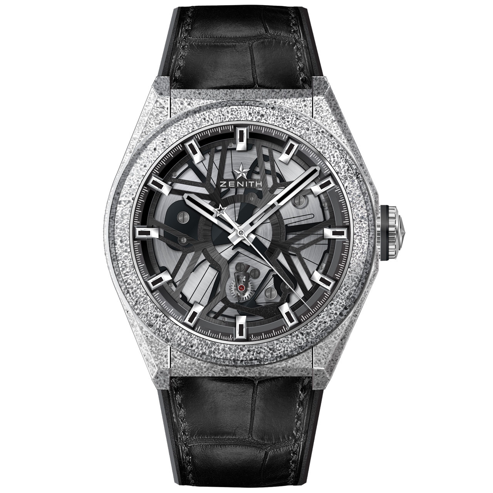
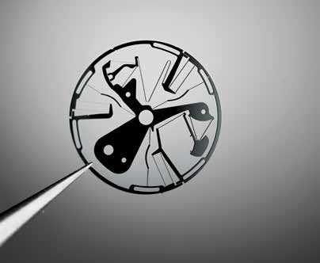
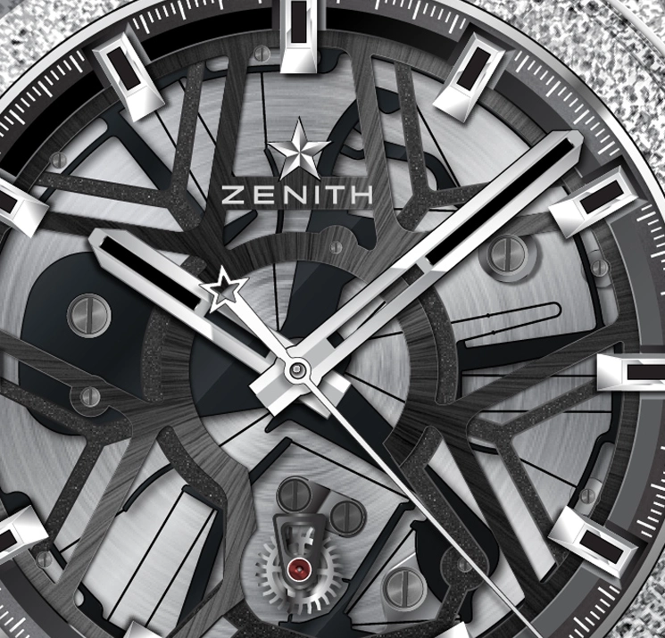
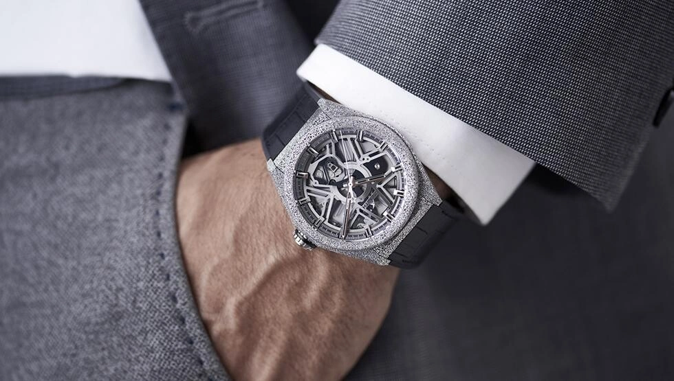
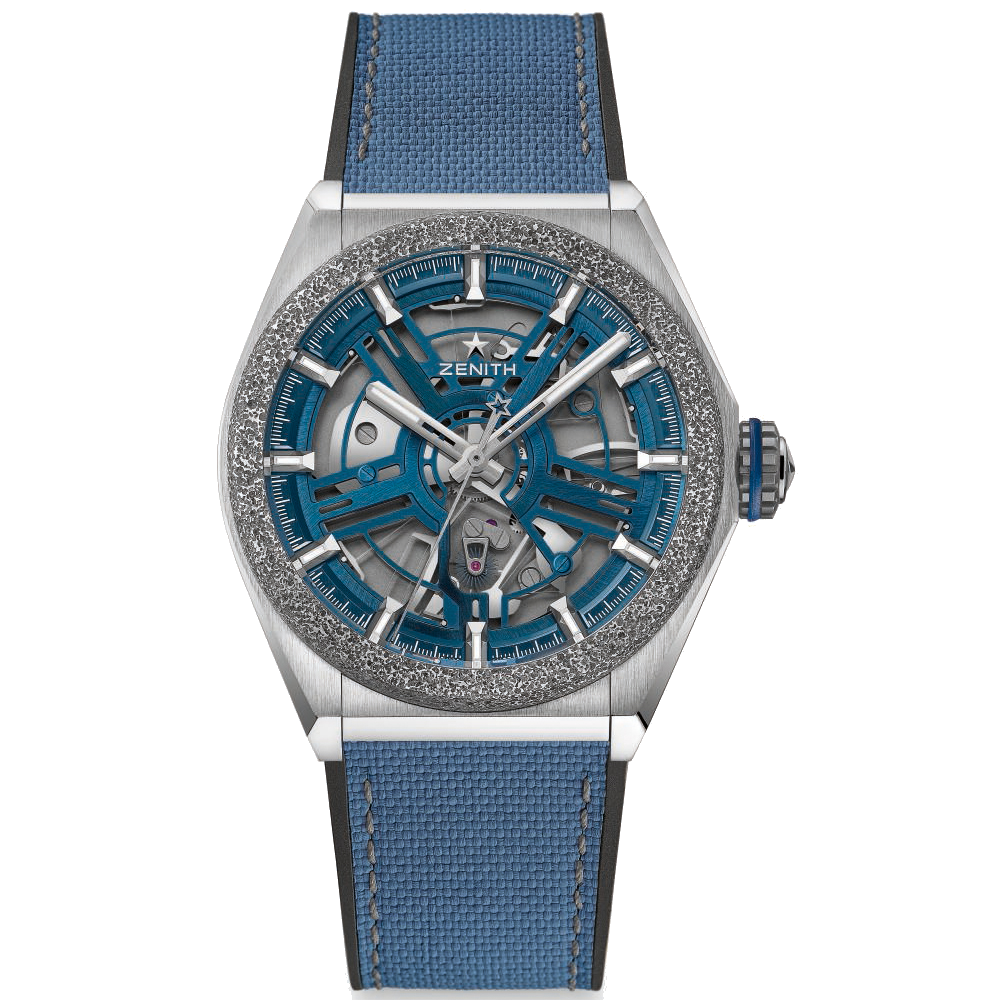

The Defy Lab keeps time with a silicon plate. Broad regions provide moving mass. Slender connections flex and pull that mass back, giving one component the jobs of balance and hairspring.

The interesting part is the material left between the holes.

I have not handled a Defy Lab. Looking at the photographs, I find the rough-looking case rather distracting from what happens underneath, particularly when the moving parts have been stopped by the camera and their outlines merge with the upper architecture. Zenith introduced the watch in 2017 as reference 27.9000.342/78.R582, powered by the ZO 342. There is plenty to see through its open front. A familiar balance swinging on a staff is conspicuously absent. The alternative takes rather longer to recognise, which is a good reason to slow it down and pull its jobs apart.

*The Defy Lab in its granular Aeronith case. Follow the fine cuts beneath the hands to find the compliant parts of the regulator. Photo: Zenith / GPHG.*

## Letting the shape do the work

A conventional balance supplies inertia. Its hairspring supplies restoring torque. The escapement sustains their oscillation and releases the train at a controlled rate. Different components have distinct jobs.

Huygens's work on the balance spring in 1675 belongs in that history. The entire modern lever escapement does not date from the same invention. What Guy Sémon and the LVMH research team reconsidered was the familiar pairing of a moving mass and a separately attached spring. The associated patent also names Wouter Pieter van Zoest and Nima Tolou as inventors.

Their alternative depends on how much material you leave in place. A broad silicon region is relatively stiff under the operating load. A long, slender connection can flex. Pattern both into one plate and the component acquires regions that behave differently, although the material is continuous. This is a compliant mechanism. There is no need to assemble a miniature hinge where controlled bending can provide the required movement.

The centre has three fixed mounting points. Outside it, the moving sectors oscillate through a small angle, flexing the narrow connections as they go. A still photograph rather undersells this arrangement. Those long slots can look like decoration, especially with the hands and upper architecture crossing them. Follow a thin connection from one end to the other and its job becomes clearer. Change its width and you change its bending stiffness. Combine that stiffness with the moving mass and you change the natural frequency. That is an enormous amount of design work to give to a small piece of geometry. It also moves much of the difficulty from assembling individual parts to making the right shape accurately in the first place.

*The actual oscillator, held with tweezers. The three central branches and the slender connecting members are easier to follow outside the watch. Photo: Horological Times / AWCI, November 2017, page 33.*

## About thirty parts, rather than an entire watch

Zenith presented the oscillator as replacing roughly thirty parts of a conventional regulating assembly. The boundary of that count matters. A separate, specially shaped escape wheel remains. So do the winding system, stored mainspring energy and the train that drives the hands.

The rest of the watch still requires some assembly.

The plate is half a millimetre thick and made from monocrystalline silicon. It is patterned by micromachining, rather than poured into its finished shape. Deep reactive ion etching appears among the fabrication routes described in the patent. AWCI's contemporary technical account describes compliant blades around twenty micrometres wide. Plate thickness and blade width are measurements in different directions. The latter helps explain why a material commonly thought of as brittle can work here as a spring. Leave a connection narrow in the intended bending plane and comparatively deep across it, and the shape also helps select the direction in which it yields most readily.

Removing the conventional balance pivots and separate spring attachments removes several frictional interfaces and lubrication tasks from the regulator. The oscillator still exchanges energy with its escape wheel. Nor have the barrel and transmission suddenly stopped having bearings. Calling the complete movement frictionless would ask a little too much of one silicon component.

*The narrow cuts define flexible and comparatively rigid regions within the same plane. The open architecture gives a view into both. Photo: Zenith / GPHG.*

## Fifteen complete cycles every second

Frequency describes complete oscillations. At 15 Hz, the Defy Lab makes fifteen outward-and-return cycles per second. Watch specifications often count each half separately, giving 108,000 vibrations per hour. Its angular excursion is only about six degrees to either side.

That is a small swing at a very busy rate.

A 4 Hz movement provides fewer cycles over the same interval. A faster rate can spread a brief disturbance across more oscillations. Geometry and energy delivery still determine how well it keeps time.

Zenith's original 2017 award release reported a mean daily deviation of 0.3 seconds and said precision was maintained over 95 per cent of the power reserve. That last claim concerns rate over the running interval. Isochronism concerns the period, particularly how little it changes as amplitude changes. Constant amplitude would be a different claim. I find this distinction rather more useful than the usual competition to find a larger adjective for accuracy. The same applies to magnetism. Zenith gave a test level of 1,100 gauss for the completed watch. A stated level can be discussed and compared. Absolute immunity to every conceivable field cannot. These qualifications leave quite enough engineering to admire, without turning a laboratory result into a promise about every future situation.

## Stop it halfway through

Start the workshop, open the flexure view and pause the motion. Move the phase slider slowly through a cycle, then double the beam's end displacement in the stress view and watch what happens to stored energy.

<!-- lume-model zenith-defy-lab -->

The spatial plate is a teaching reconstruction of the principle. The stress view solves a separate, deliberately simple beam problem with stated boundary conditions. Curvature gives surface bending stress. Displacement gives stored elastic energy. Those calculations make the colours meaningful without pretending to certify Zenith's actual component.

The two hand displays provide another useful comparison. With more increments per second, the 15 Hz version looks smoother at the same average speed. Neither display needs an invented trail of light. The mechanism still locks and releases, passing energy in small portions.

*The complete Defy Lab on a wrist. Aeronith combines porous aluminium with polymer, giving the case its granular appearance. Photo: Zenith.*

## Beyond the first ten

The Defy Lab began with ten individual pieces and received the 2017 GPHG Innovation Watch Prize. Zenith took the idea towards series production with the Defy Inventor in 2019. Its Calibre 9100 runs at 18 Hz. Titanium provides the case, with Aeronith retained for the bezel.

*The Defy Inventor shown in Zenith's GPHG entry as reference 95.9001.9100/78.R5920. Its blue regulator operates at 18 Hz. Photo: Zenith / GPHG.*

The Lab's case is still rather large for my taste. Yet I keep coming back to the fixed mounting points in the middle. Most open movements encourage me to follow something rotating. Here I end up tracing the same piece of material from a rigid anchor into a spring.

## At a glance

| | Defy Lab |
| --- | --- |
| Introduction | 2017, ten individual pieces |
| Reference | 27.9000.342/78.R582 |
| Movement | ZO 342, self-winding |
| Regulator | Monocrystalline silicon, 0.5 mm plate thickness |
| Frequency | 15 Hz, 108,000 vibrations/hour |
| Angular excursion | Approximately ±6° |
| Power reserve | 60 hours in Zenith's original 2017 award release |
| Case | Aeronith, 44 × 14.5 mm |
| Water resistance | 50 m |
| Period price | CHF 29,900 excluding VAT, 2017 GPHG entry |
| Successor discussed | Defy Inventor, 2019, 95.9001.9100/78.R5920, Calibre 9100, 18 Hz |
