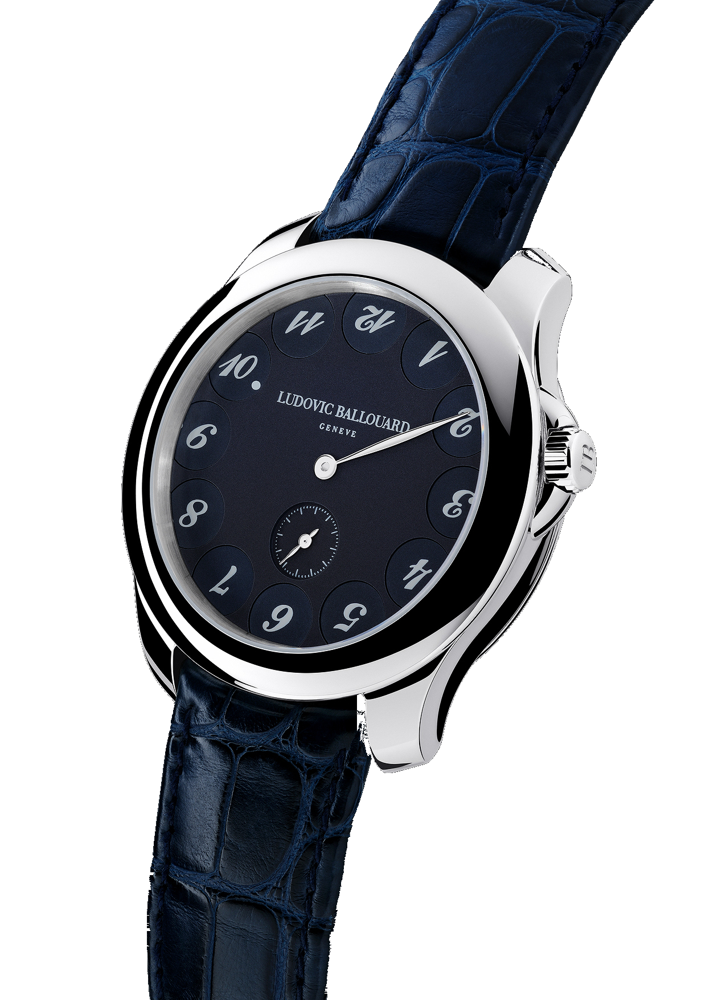
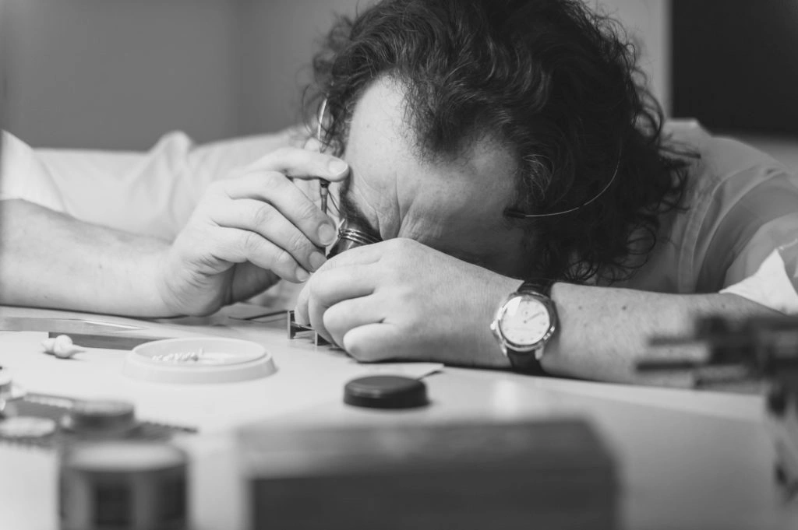
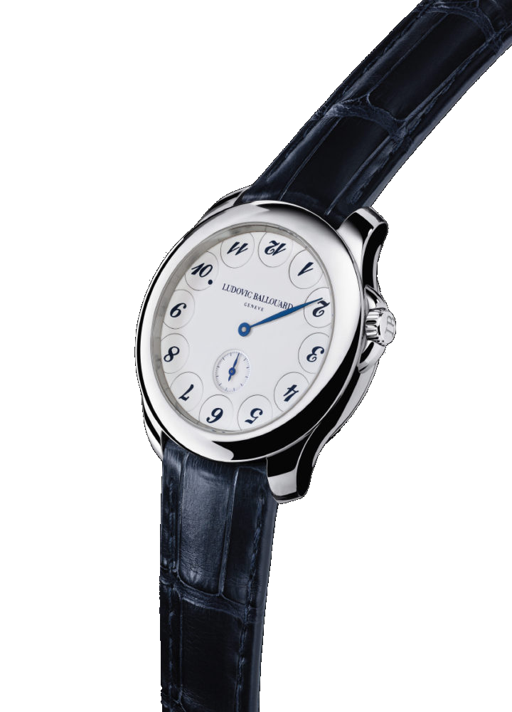
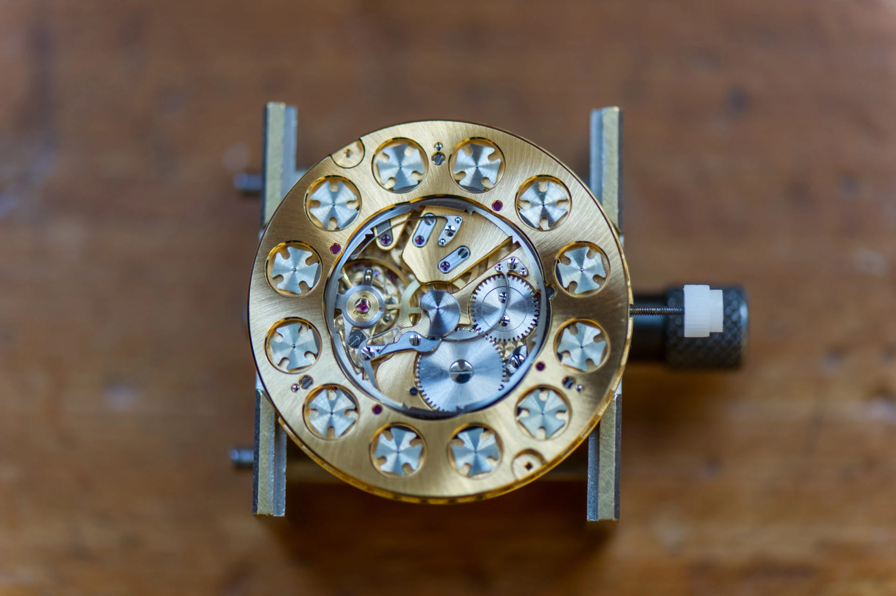
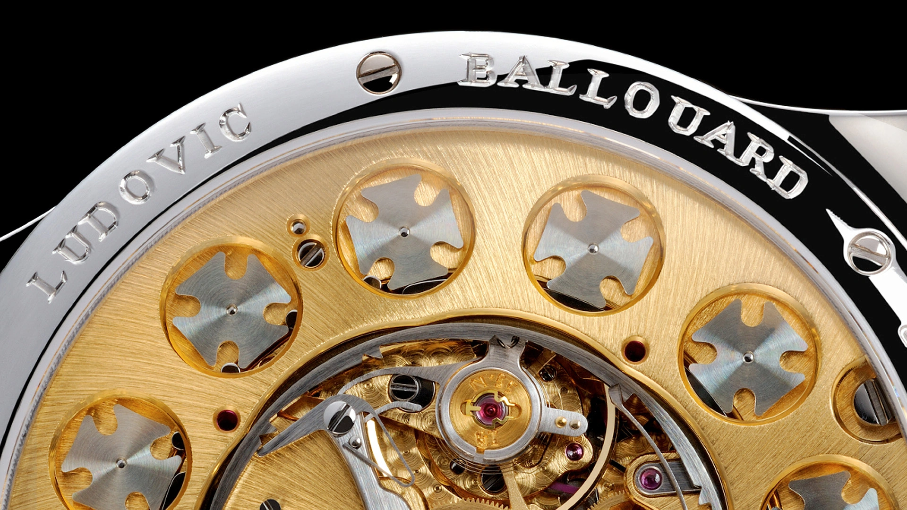
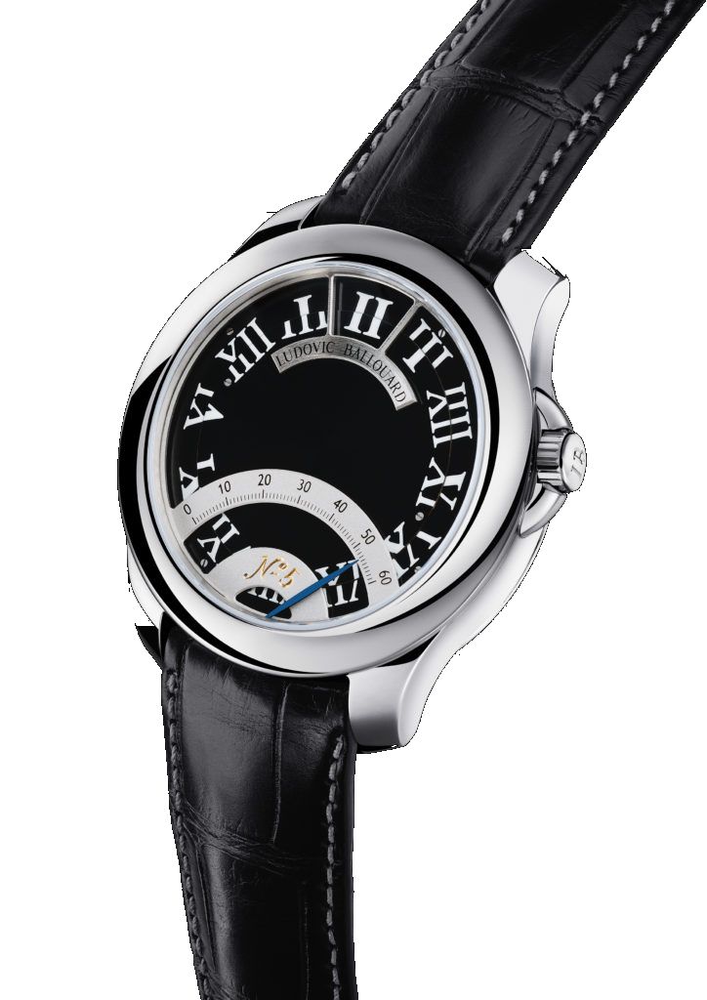

Az Upside Down számlapján tizenegy szám fejjel lefelé áll. Egyedül az aktuális óra néz jó irányba, és egészkor az is visszafordul, hogy átadja a helyét a következőnek. Ludovic Ballouard egy kézi felhúzású karórába építette ezt a rendet. Nekem eddig a fotók jutottak belőle.

A számok a helyükön maradnak. Mindegyik a saját kis korongján fordul el.

Ha a tízes áll helyesen, tíz óra van. A középső mutató a perceket mutatja, a hatosnál pedig külön kismásodperc jár. A tízes mellett megjelenő apró pont segít kiválasztani, melyik számot kell nézned. A kilences és a hatos környékén különösen jól jön, hogy az órás erre is gondolt.

*A tízes mellett keresd a kis pontot. A hosszú középső mutató itt a perceket mutatja. Fotó: Ludovic Ballouard.*

Az első pár leolvasás szerintem szokatlan lenne. A szemem egy óramutatót keresne ott, ahol helyette egy számot kell megtalálni. De éppen ez a kis kényelmetlenség érdekel benne. Rávesz, hogy megnézd a számlapot, ahelyett hogy csak átfutnál rajta.

## Egy órás a műszerek mellől

Ballouard Bretagne-ban nőtt fel, és gyerekként távirányítós repülőmodelleket épített. Az apró alkatrészekkel való bíbelődéshez egy tanára órásiskolát javasolt. Később repülőgépek műszereivel dolgozott, mielőtt Genfben újra az órák mellett kötött ki.

A Franck Mullernél az értékesítés utáni szervizben töltött három évet. Utána hét év következett F.P. Journe-nál, az utolsó háromban a Sonnerie Souveraine összeállításával foglalkozott. Az 1505-ös kaliberrel működő nagyütős óra az időt hanggal is jelzi, az összeszerelése pedig jóval több annál, mint alkatrészeket a helyükre tenni. A mechanizmusoknak együtt kell működniük, és a kész órának biztonságosan kell megszólalnia.

A saját műhelyig innen vezetett az út.

*Ballouard az óráspadnál. A saját órák előtt a Journe-műhely egyik legösszetettebb modelljét szerelte össze. Fotó: Ludovic Ballouard gyári archívuma.*

Az önállósodás időzítése elsőre furcsának tűnik. Ballouard 2009 májusában távozott Journe-tól, miközben a pénzügyi válság az órás cégek megrendeléseit is visszafogta. Decemberben már átadta az első Upside Downt. A Collected Mannek adott interjújában arról mesélt, hogy a beszállítóknak kevesebb munkájuk volt, így szívesebben vállalták egy induló órás megrendeléseit is. A gyűjtők közül többen már a Journe-nál ismerték a munkáját, és az első tizenkét vevő még azelőtt előleget fizetett, hogy láthatta volna a kész órát, pusztán abban bízva, hogy Ballouard majd valami olyat rak össze, amit szívesen hordanának. Egy induló műhelynek ez elég sokat ér. A rossz üzleti környezet közben néhány olyan ajtót is kinyitott, amely egy nagyobb fellendülésben talán zárva marad.

## A válságból lett számlap

A válság a számlapon is nyomot hagyott. Ballouard az interjúban a mindenfelé emelkedő és zuhanó számokról beszélt, és arról, mennyire eluralkodott a félelem a jövőtől. Az óráján a múlt és a jövő számai fordítva állnak. Az egyetlen rendesen olvasható óra a jelenlegi.

Egy ilyen gondolatot könnyű lenne csak a hátlapra gravírozni. Ballouard egy egész kijelzést épített köré, amelyik minden óraváltáskor újra eljátssza.

Engem azért fogott meg, mert a filozófiai mondat mellett a szerkezetet is meg lehet nézni. Van következménye annak, amit a készítő mond. A tizenegy elfordított számot tizenkét külön forgó koronggal kell a megfelelő állapotban tartani, és egészkor kettőt közülük egyszerre kell megmozdítani. A köztes percekben az egész számlap nyugodtan áll.

*A világos számlapon jobban látszik, hogy minden szám külön korongon ül. Fotó: Ludovic Ballouard.*

## Tizenkét máltai kereszt a hátlap alatt

A B01 kaliberben az óraváltásra felhalmozott energia indítja el a kijelzés ugrását. Az óránként körbeforduló kerék egy csigaprofilú bütykön keresztül fokozatosan megfeszít egy rugóterhelt kart. A váltás pillanatában a tárolt energia felszabadul, és a fogazott gyűrűn keresztül egyszerre két számtárcsa állása változik meg, így a régi óra fejre áll, miközben a következő fél fordulatot téve olvashatóvá válik. A többi tíz vár. A számlap rövid mozdulata ezért rendezett és könnyen követhető. A szerkezet hátoldalán körben elhelyezett máltai keresztek irányítják a számtárcsák szakaszos forgását. A kereszt alakú elemek neve ismerős lehet a régi vetítőgépek filmtovábbító mechanikájából. Itt a következő szám kerül a megfelelő állásba, és az ugrások között mozdulatlanul vár.

*A kerület mentén sorakozó apró keresztek a számtárcsákhoz tartoznak. A kép egy szerelőfoglalatba tett B01-et mutat. Fotó: Ludovic Ballouard.*

A máltai kereszt szakaszos mozgást enged meg. A működéshez az is hozzátartozik, hogy az elem két váltás között a megfelelő helyzetben maradjon. Különben az óraszám már a következő ugrás előtt elkezdene elfordulni.

A hátlapnak ezért van ekkora jelentősége.

Ballouard láthatóvá tette azokat az alkatrészeket, amelyek a számlap egyszerűnek tűnő mozdulatát létrehozzák. Megfordítod az órát, és a tizenkét ismétlődő elem rögtön elárulja, hogy valami szokatlan történik benne.

*A B01 szerkezet részlete a gyári katalógusból. A keresztek a hátlapon át is láthatók. Fotók: Guy Lucas de Peslouan és Gary Getz, Ludovic Ballouard katalógusa.*

## Kerek tok és sötétkék számlap

A szokatlan kijelzés körül elég visszafogott az Upside Down. Kerek tok, bőrszíj, kevés szöveg. A Cellini sötétkék változatának termékkódja Upsidedown.PL-dark Blue, és nekem ez a festett számokkal készült számlap tetszik a legjobban. A sötét alapon a korongok határa is kevésbé feltűnő, így előbb veszed észre a helyesen álló számot.

A tok mérete miatt azért óvatos lennék vele. A 41 milliméter az én kisebb csuklómon már próbát kérne, és a széles lünetta is hozzátesz a látványhoz. A középen futó egyetlen hosszú mutató viszont sok üres helyet hagy. A fotókon ezt szeretem benne, mert a különös számok kapnak figyelmet.

A napi felhúzást még megoldanám. A katalógus 2026-os árlistáját nézve a vásárlás már nehezebben férne bele. Az én példányom egyelőre elfér egy böngészőablakban.

## A következő ötlet már kettévágta a számokat

Ballouard a 2012-ben bemutatott Half Time-nál továbbvitte ugyanezt a gondolatot. A B02 két, ellentétes irányban forgó tárcsája a számok felső és alsó felét hordozza. Csak a tizenkettő helyén találkoznak úgy, hogy az aktuális órát egyben el tudd olvasni. Alul retrográd percmutató jár, amelyik az óraváltáskor visszaugrik a skála elejére.

*A Half Time két tárcsája a felső leolvasási pontnál rakja össze az óraszámot. Alul a percjelzés íve fut. Fotó: Ludovic Ballouard.*

A Half Time bonyolultabb látványa mellett nekem az Upside Down marad közelebb. Ugyanazokat a számokat használja, amelyeket egy gyerekkori falióráról ismerünk, és egyetlen mozdulattal teszi őket szokatlanná.

Ha egyszer meg tudnám nézni élőben, néhány perccel egész előtt kérném el. Előbb megkeresném a kis pontot a számlapon, aztán megfordítanám az órát, és a hátlap felől várnám meg, hogy a két máltai kereszt megmozduljon.

### Adatok röviden

| | Upside Down | Half Time |
| --- | --- | --- |
| Kaliber | B01, kézi felhúzás | B02, kézi felhúzás |
| Kijelzés | Óránként két korong 180 fokos fordulata, központi perc, kismásodperc | Két számtárcsán összeálló óra, retrográd perc |
| Tok | Platina vagy 18 karátos vörösarany | Platina vagy 18 karátos vörösarany |
| Átmérő és vastagság | 41 × 11 mm | 41 × 11 mm |
| Frekvencia | 3 Hz, 21 600 féllengés/óra | 3 Hz, 21 600 féllengés/óra |
| Járástartalék | Kb. 40 óra a gyári termékoldalon | Kb. 36 óra a gyári termékoldalon |
| Szerkezet | 228 alkatrész, 51 kő | Saját fejlesztésű, szabadalmazott kijelzés |
| Vízállóság | 30 méter | 30 méter |
| 2026-os gyári katalógusár, adó nélkül | 94 000 CHF, standard arany- és platinaváltozat | 104 000 CHF, standard arany- és platinaváltozat |
| A cikkben azonosított kereskedői változat | Upsidedown.PL-dark Blue, Cellini | Half Time, B02 |
