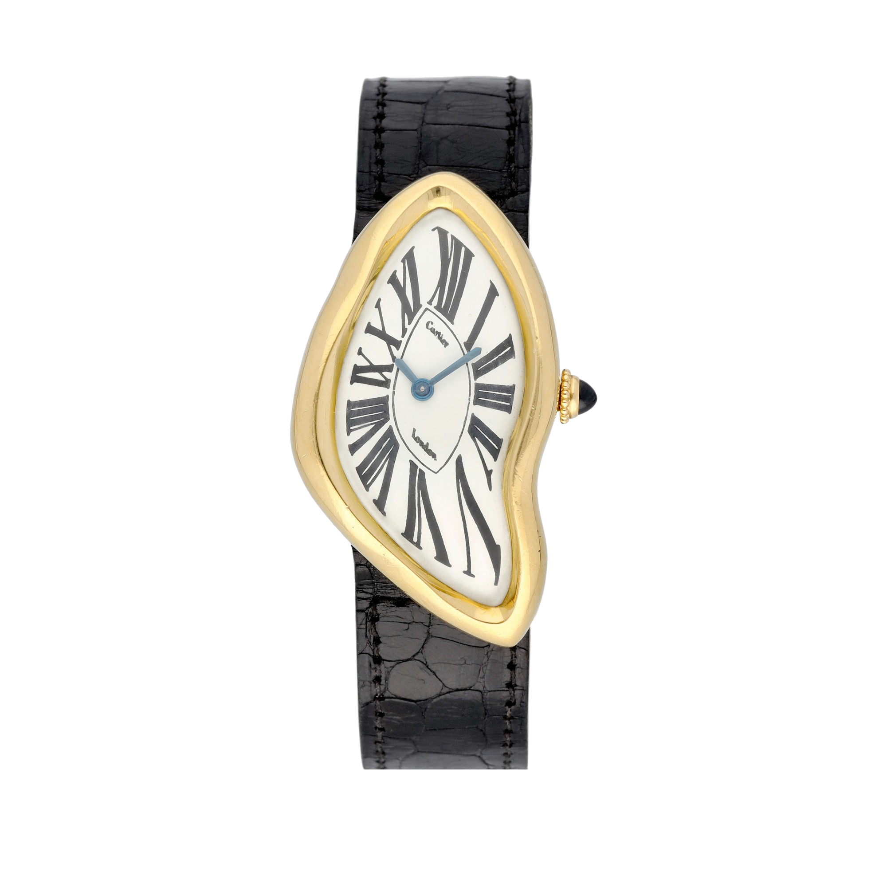
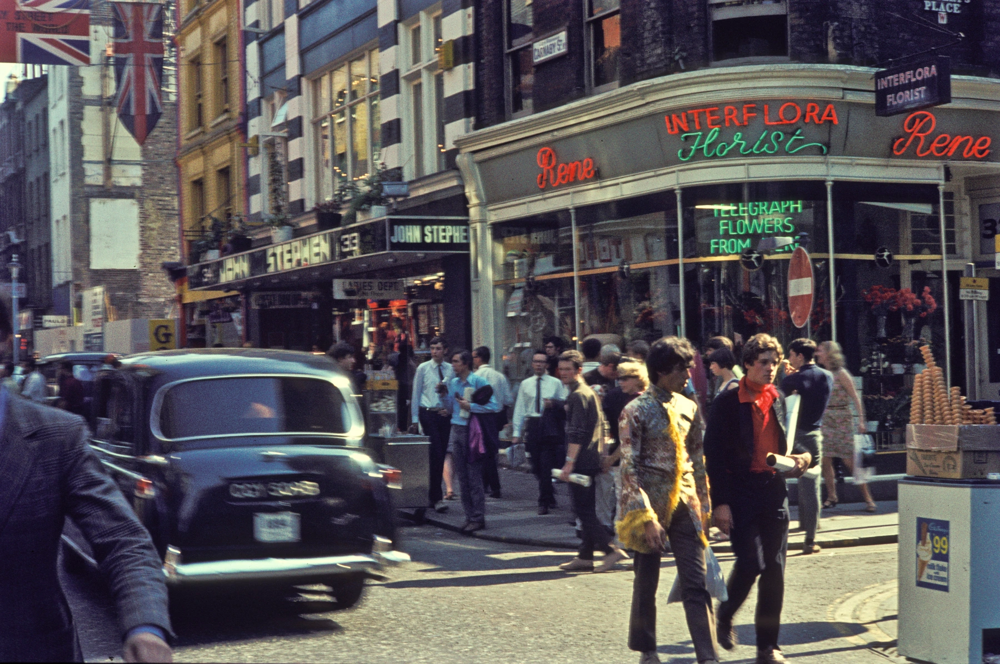
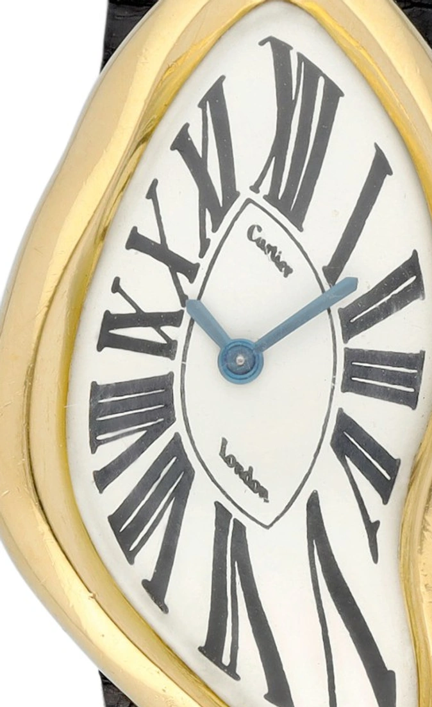
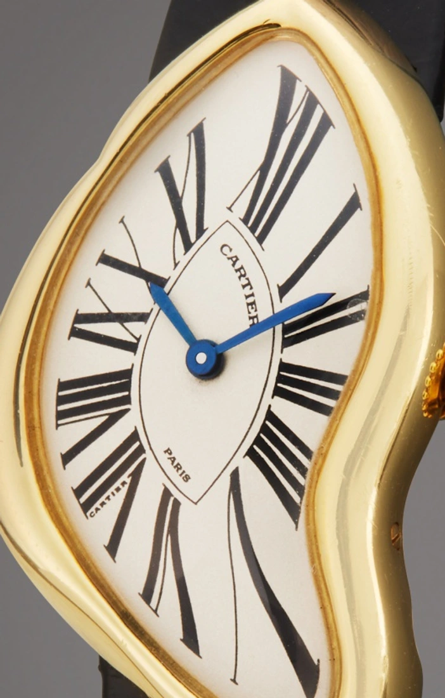
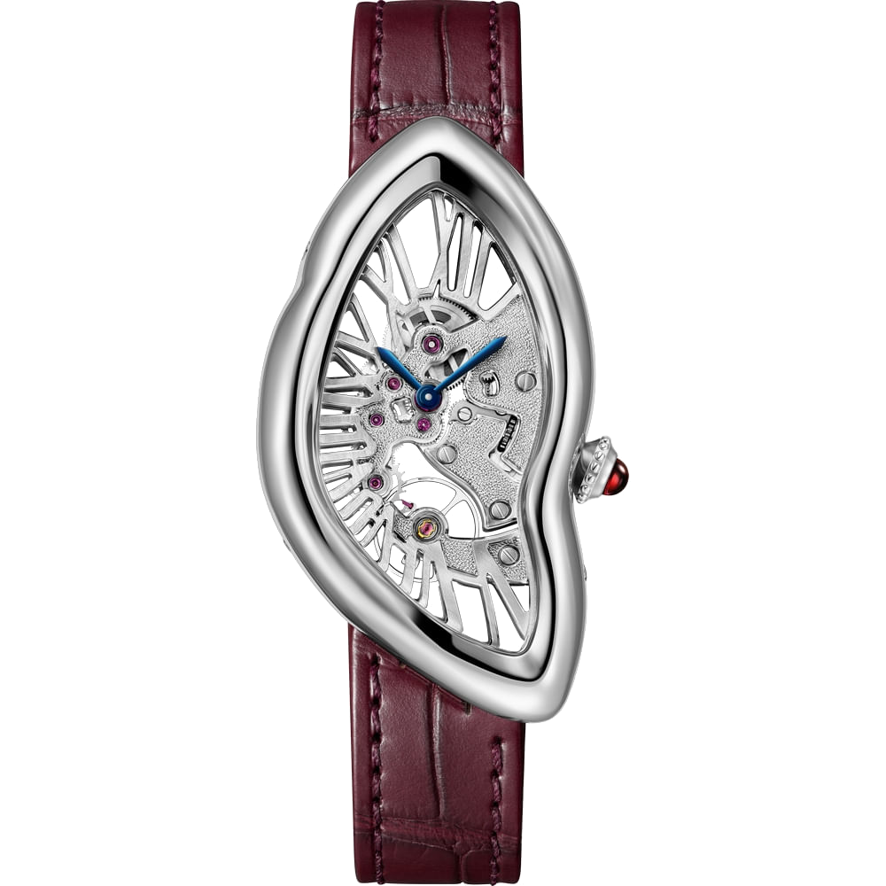

Kevés óráról lehet olyan könnyen elhinni egy képtelen történetet, mint a Cartier Crashről. Az egyik oldala megnyúlik, a másik behorpad, a római számok pedig mintha megpróbálnának helyet szorítani maguknak a szabálytalan tokban. Ha valaki azt mondja, hogy ezt az órát egyszer nagy hő érte, első pillantásra nem feltétlenül vitatkozunk vele.

A legismertebb eredetmonda éppen erre épít: egy autóbalesetben kigyulladt, majd eldeformálódott Cartier Baignoire, pontosabban egy hosszúkás Maxi Oval kerül a londoni műhelybe. A készítők meglátják benne a lehetőséget, és a sérülésből új modell születik. A történethez a Crash név is szinte magától értetődően illik.

Csakhogy a formatervezés történetét nem lehet pusztán abból levezetni, hogy egy tárgy mire hasonlít. A Crash esetében a biztos kiindulópont nem egy roncsautó, hanem London, 1967.

## Mit tudunk a balesetlegendáról?

A történet részletei változnak, de az újra és újra felbukkanó motívum ugyanaz: a véletlen olyan formát hozott létre, amelyet egy tervező magától nem mert volna kitalálni. Ettől működik jól eredetmondaként. Rögtön megmagyarázza a nevet, az alakot és azt is, miért különbözik a Crash minden megszokott karórától.

**A megolvadt órát azonban nem érdemes dokumentált előzményként kezelni.** Francesca Cartier Brickell családtörténeti kutatása és nagyapja, Jean-Jacques Cartier visszaemlékezése egy tudatos tervezési folyamatot ír le. A londoni üzlet vezetője Rupert Emmerson tervezővel együtt kereste, hogyan lehetne a hosszúkás ovális órát szokatlanabbá alakítani. A baleset látszata a gondolat része volt, nem bizonyított kiinduló tárgy.

Ez nem veszi el az óra furcsaságát. Inkább visszaadja a tervezőknek azt, amit a legenda egy véletlennek tulajdonít: valakinek el kellett döntenie, hol legyen a törés, mennyire nyúljon meg a tok, és mikor válik az izgalmas forma egyszerűen esetlenné.

*Egy 1970-ben készült londoni Crash. A számlapon még a London felirat szerepel; ez korai példány, nem az 1967-es legelső óra. Fotó: Sotheby’s, 2021-es genfi árverés, 19. tétel. Háttér eltávolítva, az óra eredeti képpontjaival.*

## A város, amelyben ez értelmet nyert

A hatvanas évek Londonjában az öltözködés egyre kevésbé jelentette azt, hogy az ember fiatalon is a szüleihez próbál hasonlítani. A V&A divattörténeti áttekintésében a butikok, Mary Quant és a mod kultúra ugyanannak a változásnak különböző oldalai: egy új nemzedék saját megjelenést akart. A Carnaby Street és a King’s Road üzletei ennek látványos helyszínei lettek.

A Cartier természetesen nem egy olcsó ruhákat áruló ifjúsági butik volt. A New Bond Street luxusvilágát nem szabad egyszerűen összemosni az utcai divattal. Éppen a különbség teszi érdekessé a Crasht: egy hagyományos ékszerház olyan tárgyat készített, amelyben felismerhető a korszak formai szabadsága, miközben a kivitelezés egyáltalán nem szakított a kézműves igényességgel.

Nem kell ahhoz pszichedelikus plakátnak tekintenünk a számlapot, hogy észrevegyük a rokonságot. A merev rend fellazítása, a megszokott arányok átírása és a látványos egyéniség keresése a korszak több területén is jelen volt. A Crash ezt nem harsány színekkel, hanem egyetlen, nagyon következetesen végigvitt alakváltoztatással oldotta meg.

*Carnaby Street, 1968, egy évvel a Crash bemutatása után. A kép a korszak londoni környezetét mutatja, nem a Cartier üzletét. Fotó: H. Grobe / Wikimedia Commons, CC BY 3.0. Arányos átméretezés.*

## Jean-Jacques Cartier és Rupert Emmerson

Jean-Jacques Cartier a londoni ház vezetőjeként nem egy kész órát választott ki a katalógusból. Emmersonnal közösen alakították azt az elképzelést, amelyből a Crash megszületett. Ez azért fontos, mert egy ilyen tárgyhoz nem elég egy merész rajzoló: kell valaki, aki vállalja, hogy az ötletből valóban eladható, működő óra készüljön.

A családi beszámolóban szerepel egy repedt hatású számlapterv is, amelyet végül elvetettek. A részlet jól mutatja, hol húzódott a határ. Nem egy sérült tárgy pontos mását akarták elkészíteni; a deformációból kellett olyan formát kialakítani, amely önmagában is szép. A végeredményen nincs szükség festett repedésre ahhoz, hogy érezzük a szabálytalanságát.

A Crashben közben feltűnően sok minden hagyományos marad. Nemesfém tok, világos számlap, római számok, kék mutatók, köves korona. Ha ezeket az elemeket egyenként nézzük, nem egy lázadó divattárgy jut eszünkbe. Az újítás abból születik, ahogyan az ismerős részletek egymáshoz viszonyulnak.

## Egy szabálytalan tokban is pontos helyre kell kerülniük a számoknak

A londoni kivitelezésben a Wright & Davies műhely és Eric Denton vezető órás is részt vett; a megfelelő szerkezetről a Jaeger-LeCoultre-rel egyeztettek. A szokatlan aranytok elkészítése önmagában sem volt egyszerű, a számlap beosztása pedig ismételt átdolgozást igényelt.

Egy kör alakú számlapon könnyű természetesnek venni a rendet. A mutatók ugyanabból a középpontból fordulnak el, az órák irányai szabályosan követik egymást. A Crashnél viszont a számjegyeket a torzult kerethez is hozzá kellett igazítani. Az egyik jel hosszabb, a másik keskenyebb, több megdől, mégis úgy kell olvasnunk az egészet, mint egy órát.

Ez nem azt jelenti, hogy a fogaskerekeket is össze kellett gyűrni, vagy hogy egy óra hosszabb ideig tartana a számlap szélesebb részén. A kihívás az idő kijelzésében van: a forma változhat, de a mutatóállások értelmének meg kell maradnia. A Crash ettől jóval érdekesebb egy különös kontúrú aranytoknál.

*Az 1970-es példány számlaprészlete. A külső körvonal és a belső beosztás nem ugyanazt a geometriát követi. Fotó: Sotheby’s. Kivágott makrórészlet az eredeti felvételből.*

## És Salvador Dalí?

Az összehasonlítás érthető. Dalí 1931-es, magyarul *Az emlékezet állandósága* címen ismert festményén a zsebórák elvesztik megszokott merevségüket. A Crash is valami olyasmit tesz bizonytalanná, amit általában szilárdnak és szabályosnak gondolunk. A kép és az óra egymás mellé helyezve valóban könnyen beszélgetésbe kezd.

Ebből azonban még nem következik, hogy Emmerson a festmény alapján rajzolta meg a Crasht. Az áttekintett források nem támasztanak alá ilyen közvetlen tervezői kapcsolatot. A szürrealista rokonság értelmezésként helyénvaló, bizonyított eredettörténetként már nem.

Ráadásul van egy lényeges különbség. Dalí képén a puha óra elveszíti használati tárgyként megszokott biztonságát. A Cartiernek éppen az volt a feladata, hogy a furcsa látvány ellenére hordható, leolvasható órát készítsen. A hasonlóság tehát nem teszi azonossá a két alkotás szándékát.

## London után Párizs

A Crash nem maradt egyetlen londoni kísérlet. A Cartier Paris 1991-ben 400 számozott sárgaarany példányból álló sorozatot készített, az eredeti londoni órákhoz képest módosított arányokkal. Az itt látható párizsi darab aukciós adatlapján a kézi felhúzású 160-as kaliber szerepel. A városnév ezért nem puszta hangulati felirat: a modell történetének különböző szakaszait is segít elkülöníteni.

*A párizsi változat egy 1991 körüli példányának részlete. Jól látható a Paris felirat és a másképp arányított számlap. Fotó: Sotheby’s, Important Watches, 2022, 56. tétel; képkivágás.*

A későbbi feldolgozások közül a 2015-ben bemutatott Skeleton változat különösen fontos. Itt a római számok már nem egyszerűen a számlapra kerülnek: a szerkezet áttört hídjai is részt vesznek a megrajzolásukban. A későbbi rózsaarany WHCH0006 referencia például a kézi felhúzású 9618 MC kalibert használja. Ez már más feladat, mint egy hagyományos szerkezet köré különleges tokot tervezni.

## A 2026-os Crash Skeleton: a forma a szerkezetig ér

A Cartier Privé tizedik kiadásához készült új Crash Skeleton, **WHCH0012**, továbbviszi ezt a gondolatot. A platinatokban az új, kézi felhúzású **1967 MC** dolgozik. A kaliberszám az eredeti bemutató évére utal; nem azt jelenti, hogy a mostani óra egy hatvanas évekből megmaradt szerkezetet kapott.

*Crash Skeleton, 2026, ref. WHCH0012. Platina, kézi felhúzású 1967 MC, 150 számozott példány. Fotó: Cartier. Az eredeti gyári kép háttér nélkül.*

A gyári adatok szerint a tok 45,34 × 25,18 milliméteres, a járástartalék körülbelül 38 óra, a sorozat 150 számozott darabból áll. A hidak felületét kézzel kalapálják; a nyílásokon keresztül a szerkezet alkatrészei és a római számos váz egyszerre láthatók. A bordó szíjhoz rubin koronakő társul.

Ez a megoldás jól megmutatja, meddig lehet továbbgondolni az eredeti ötletet. A korai Crashnél a készítőknek egy furcsa keretben kellett rendet teremteniük. Az új Skeletonnál már maga a látható mechanika is része ennek a keretnek. Nem megolvadt alkatrészeket látunk, hanem olyan szerkesztést, amelynek az aszimmetria eleve az egyik feltétele volt.

## Mi marad, ha levesszük róla a legendát?

Számomra a Crash legjobb részlete nem valamelyik elszabaduló római szám, hanem az, hogy a különös forma mögött végig érezhető a fegyelem. A korona nem egy képzeletbeli katasztrófa maradványa, a tok nem esetlegesen horpadt be, a számok nem véletlenül kerültek oda. Minden döntésnek együtt kell működnie a többivel.

Ettől válhat egy dizájnkísérlet tartósan jelentős tárggyá. Elsőre szokatlan, később viszont egyre több rendet veszünk észre benne. A balesetlegendát könnyű megjegyezni, de a Crash valódi történetében az az érdekesebb, hogy ezt valakik szándékosan, sok munkával és nagyon pontos ízléssel hozták létre.
