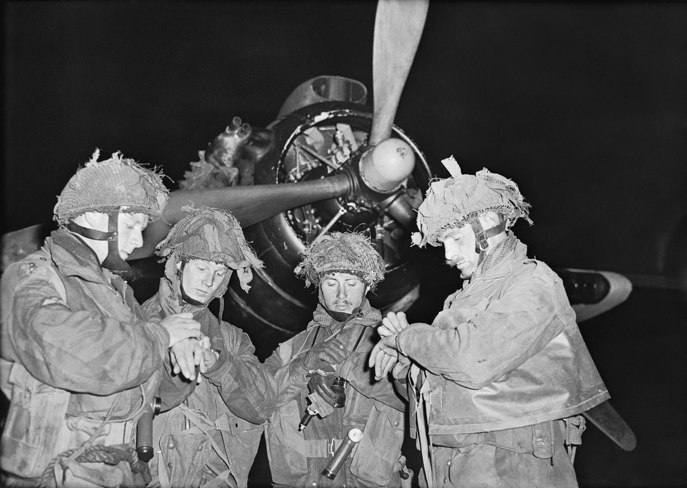
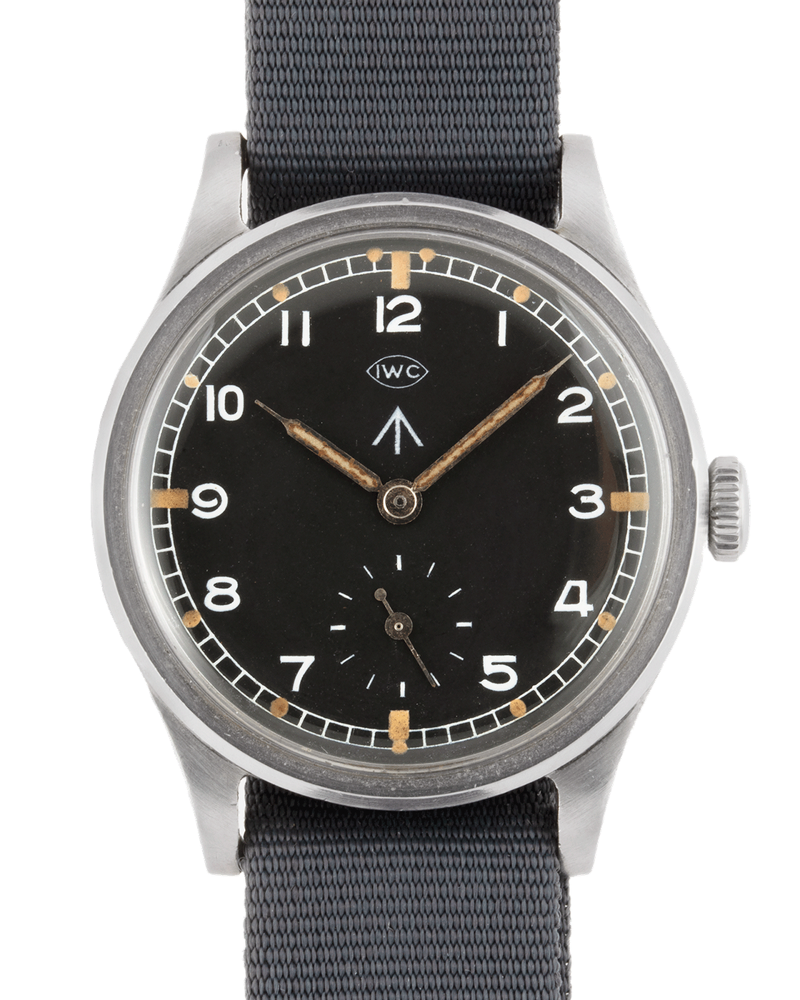
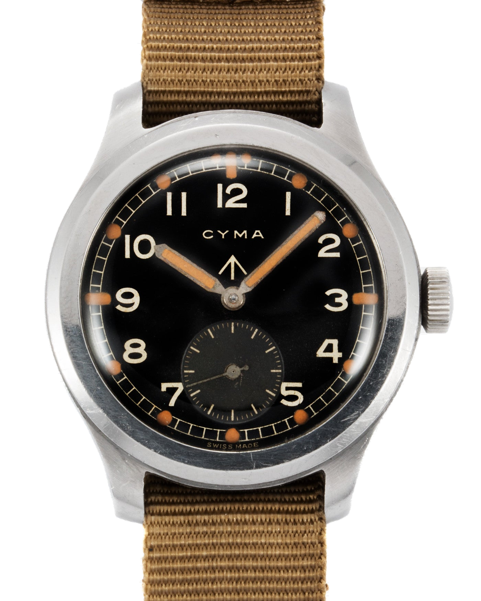
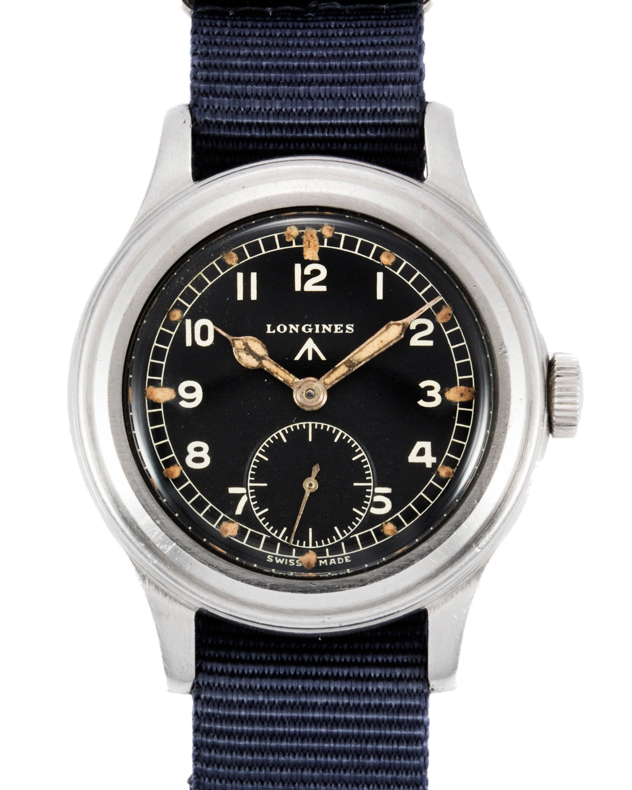
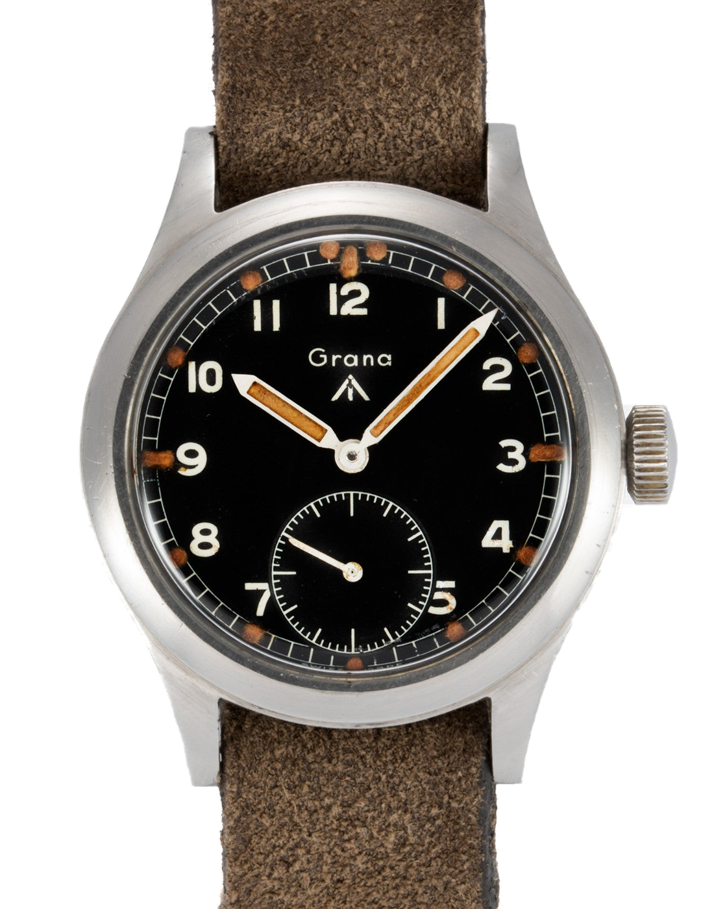
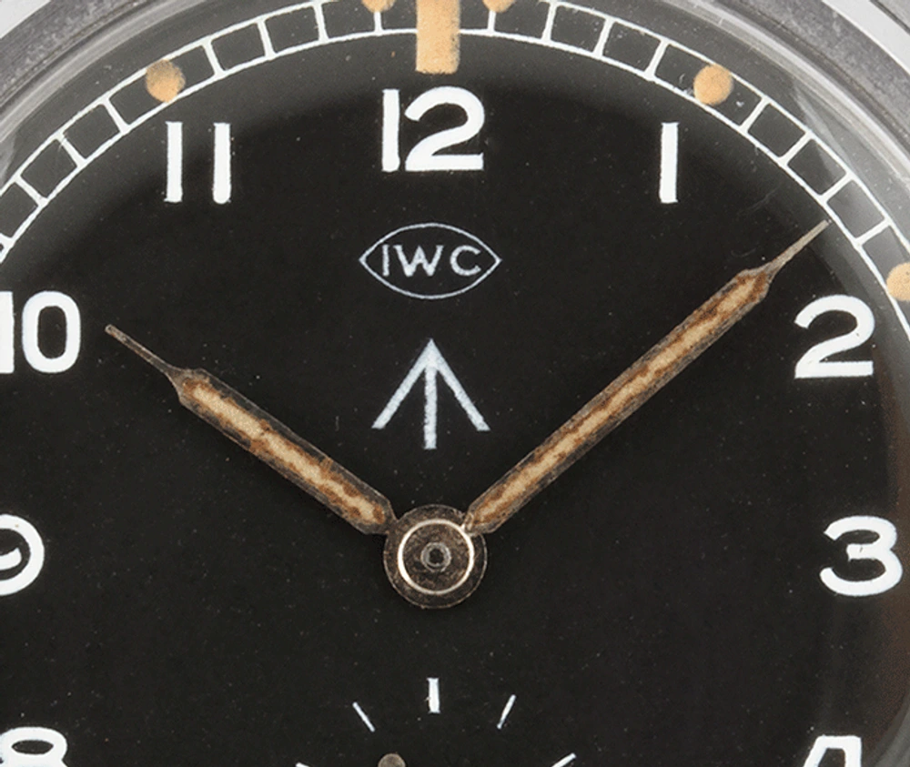
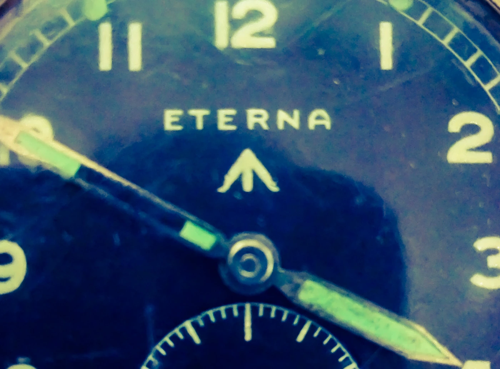

Egy IWC és egy Grana egymás mellett. Ugyanazok a nagy arab számok, sötét számlap, kis másodpercmutató hat óránál. Kicsit más a tok, máshogy kanyarodik a négyes, eltér a mutatók aránya, de elsőre inkább az tűnik fel, mennyire hasonló a két óra. Pedig nem ugyanannak a modellnek a változatai.

A brit hadsereg megrendelésére készültek, olyan követelmények szerint, amelyekhez minden beszállítónak alkalmazkodnia kellett. A számlapon megmaradhatott a gyártó neve, de nem az döntötte el, milyen legyen az óra. A megrendelő jól olvasható, megbízható és a korábbiaknál jobban védett eszközt akart.

Ma Dirty Dozen, magyarul piszkos tucat néven ismerjük ezt a tizenkét gyártótól származó óracsaládot. A név utólagos gyűjtői elnevezés, az azonos című háborús film nyomán. A korabeli hátlapokon ennél jóval szárazabb megjelölés állt: **W.W.W.**

## Előbb a feladat, aztán az óra

1944\. június 5-én, késő este négy brit ejtőernyős tiszt egyeztette az óráját a harwelli repülőtéren. Mögöttük egy Armstrong Whitworth Albemarle állt, indulásra készen. E. G. Malindine fényképe azért olyan erős, mert minden külön magyarázat nélkül látszik rajta, mire kellett az óra: több embernek ugyanahhoz az időponthoz kellett igazodnia.

*Harwell, 1944. június 5. Fotó: E. G. Malindine / War Office, IWM H39070, közkincs. Ez a felvétel a katonai időegyeztetést mutatja, nem a W.W.W. órák bevetését; a viselt modelleket nem azonosítjuk.*

A hadsereg természetesen nem ekkor fedezte fel az időmérést. Brit katonai felszerelési jegyzékek már jóval a második világháború előtt rendelkeztek órákról, a háború elején pedig az Army Trade Pattern, röviden A.T.P. alapján szereztek be karórákat. Ezek között civil eredetű, katonai használatra átalakított darabok is voltak. Az amerikai A-11 szintén a W.W.W. előtt megjelent, meghatározott katonai követelményekkel.

Az „első valódi katonai specifikáció” ezért túlzás lenne. A W.W.W. jelentősége abban áll, hogy a brit általános szolgálati karórával szemben egységesebb, célzott követelményeket fogalmazott meg. Nem a bolti választékból kerestek valamit, ami nagyjából megfelel. A beszállítóknak egy konkrét feladatra kellett órát szállítaniuk.

## Mit jelentett a három W?

A rövidítés a katonai nyilvántartások nyelvén *Watches, Wristlet, Waterproof*: víz ellen védett karórák. A közkeletű *Watch, Wrist, Waterproof* feloldás ugyanerre utal. Az előírás azonosítója R.S./Prov/4373A volt. A történet korabeli brit intézményei a War Office és az ellátással foglalkozó Ministry of Supply; a mai értelemben vett MoD rövidítés önmagában kissé elmossa ezt a hátteret.

Az előírás nem állt meg a külsőnél. Legalább tizenöt köves, nem mágneses kivitelű horgonyjáratú szerkezetet, felhajlított végű spirálrugót és jóváhagyott ütésvédelmet kért. A járást 32 °C-on, négy helyzetben kellett vizsgálni. Ezek követelmények voltak, nem bizonyítékok arra, hogy a leszállított órák minden részletükben teljesítették is őket. Erre még visszatérünk.

A fennmaradt órákon könnyű végigkövetni, hogyan találkozott a követelmény a formával:

| Visszatérő részlet | Mit adott a használónak? |
| --- | --- |
| Fekete számlap, világos arab számok | Erős kontrasztot, könnyen elkülönülő órákat. |
| Jól látható percosztás | Leolvasható perceket, nem pusztán hozzávetőleges időt. |
| Világító jelzések és mutatók | Tájékozódási pontokat gyenge fényben is. |
| Kismásodperc hat óránál | Külön helyet a másodperceknek az óra- és percmutató alatt. |
| Rögzített szíjrudak | Egyszerű, masszív csatlakozást az átfűzött szíjhoz. |
| Zárt hátlap és védett tok | A szerkezet környezeti védelmét szolgáló kialakítást. |

Ez nem egyetlen kötelező tokrajzot jelentett. A szerkezetek és egyes szerkezeti megoldások gyártónként eltértek; a hasonló számlap mögött nem tizenkét, egymással felcserélhető óra lakott. Az IWC pattintott hátlapja és a Longines csavaros hátlapja jó példa arra, hogy ugyanarra az igényre többféle műszaki választ is elfogadtak.

A *waterproof* szót sem érdemes mai búváróra-adatként olvasni. Egy korabeli megnevezés nem mondja meg, mire képes nyolcvan évvel később az adott tok és tömítés. A W.W.W. felirat történeti adat, nem jelen idejű vízállósági garancia.

*IWC W.W.W., 1945 körül. Fotó: S.Song Watches; háttérleválasztás: Lume, az eredeti órarészletek megtartásával. A képen látható modern textilszíj nem a háborús eredet bizonyítéka.*

## Kik tartoztak a tucatba?

A tizenkét név: **Buren, Cyma, Eterna, Grana, IWC, Jaeger-LeCoultre, Lemania, Longines, Omega, Record, Timor és Vertex.** Egy mai órás kirakatban ez meglehetősen szokatlan társaság lenne. Itt viszont ugyanannak a beszerzésnek voltak a résztvevői.

*Cyma W.W.W. A határozott mutatók és a kismásodperckör más arányt adnak a számlapnak, mint az IWC-nél. Fotó: S.Song Watches; háttérleválasztás: Lume. A szíj nem korabeli tartozékként szerepel.*

A „tizenkét svájci gyár” kényelmes rövidítés, de a történet ennél összetettebb. Különösen a Vertex miatt: Claude Lyons londoni hátterű vállalkozása svájci gyártásra támaszkodott, a Revue Thommen együttműködésével. A márka, a megrendelést intéző cég és a tényleges gyártó tehát nem feltétlenül ugyanazt a szervezetet jelentette.

Éppen ez teszi érdekessé a csoportot. Nem közös márkaidentitás tartotta össze, hanem az, hogy a végén mindegyik darabnak ugyanott és ugyanarra kellett használhatónak lennie. A hasonlóságot nem másolási szándékból érdemes megérteni, hanem a közös megrendelésből.

### IWC: nem egy korai Mark 11

Az IWC változatában a kézi felhúzású 83-as kaliber dolgozott. A gyártó történeti összefoglalója mintegy hatezer darabról és 1945. május–júniusi brit szállításokról ír. A bemutatott példány 35 milliméteres tokjában a számlap meglepően nagy felületet kap: a vékony perem és a széléig kifutó percskála segít ebben.

A gyűjtői piacon gyakori a Mark X név, de ezt nem érdemes a korabeli hivatalos W.W.W. megnevezés helyére tenni. A későbbi, RAF számára készült Mark 11 külön történet, más követelményekkel. A két óra rokonsága nem teszi az 1945-ös szolgálati modellt automatikusan navigációs műszerré.

### Longines: ugyanaz a feladat, más tok

A Longines 5707-es referenciája a 12.68Z kézi felhúzású szerkezetet használta. A tok lépcsősen kialakított pereme hangsúlyosabb, a számlap körüli keret más arányt ad az egész órának, mint az IWC-nél. Fekete számlapja, világos számai és hat óránál elhelyezett másodpercköre mégis rögtön elárulják, melyik családba tartozik.

Egy Antiquorum által bemutatott példányhoz gyári archív kivonat is tartozott: az órát 1945. július 17-én számlázták a brit Baume & Co. részére. Az ilyen adat többet ér egy hangzatos harctéri történetnél. Megmutatja az óra útjának egy ellenőrizhető állomását, anélkül hogy ismeretlen viselőt vagy bevetést kellene hozzá kitalálni.

*Longines W.W.W., a jellegzetes tokperemmel és tagolt óramutatóval. Fotó: S.Song Watches; háttérleválasztás: Lume. Ez nem a fent említett Antiquorum-tétel, hanem ugyanannak a típusnak egy másik példánya.*

### Grana: a ritkaság nem katonai rangsor

A Grana KF320-as szerkezettel készült W.W.W. órája ma különösen keresett a teljes sorozatot gyűjtők körében. A Bonhams a tizenkettő közül a legkisebb becsült gyártási mennyiséget kapcsolja hozzá. Pontos, minden forrásban egyező darabszám helyett érdemes ennél az óvatos megfogalmazásnál maradni.

A mai ritkaság azonban nem jelenti azt, hogy a katonának feltétlenül ez lett volna a legjobb óra. A gyűjtő azt keresi, ami hiányzik a dobozából. A korabeli megrendelő azt kereste, ami megfelel a feladatnak. Ugyanazt a tárgyat nézik, egészen eltérő szempontból.

*Grana W.W.W. A világos mutatókeretek és a keskeny percosztás jól összevethetők a Longines részleteivel. Fotó: S.Song Watches; háttérleválasztás: Lume. A bőrszíj nem korabeli tartozékként szerepel.*

### Vertex: a brit kapcsolat

A Vertex történetében Henry Lazarus, az alapító veje kötötte össze a családi céget a katonai beszerzéssel. A márka saját története szerint brit katonatisztként is szolgált. A W.W.W. órák mögött itt nemcsak egy svájci gyártási kapcsolat állt, hanem egy brit vállalkozás és a hadsereg közötti személyes, üzleti kapcsolat is.

A Vertex és a Timor nevét ma sem kell kizárólag múlt időben használni. Mindkettő kínál az eredeti katonai órákhoz visszanyúló modelleket. A kisebb nevek története nem feltétlenül ért véget akkor, amikor eltűntek a legtöbb órabolt kirakatából.

## Az a kis nyíl a számlapon

Az IWC logója alatt egy felfelé mutató, három vonalból álló jel látható. A *broad arrow* brit állami tulajdonjel, nem a gyártó emblémája, és nem is külön pontossági minősítés. A hátlapon megjelenő jelölések, a W.W.W. betűk és a számok az órát a katonai felszerelés részeként azonosították.

*Gyártói név és tulajdonjel egymás alatt. Eredeti IWC-számlaprészlet a S.Song Watches fotójából; képkivágat: Lume.*

Egy mai néző hajlamos minden ilyen részletet stíluselemként olvasni. A nyíl, a kissé szabálytalan számjegyek és az öregedett világítóanyag együtt nagyon karakteres képet adnak. A nyíl azonban eredetileg nem hangulatot teremtett, hanem azt jelezte, kié a tárgy. Ettől érdekesebb, nem kevésbé szép.

Az Eterna alábbi részletén ugyanez az elrendezés figyelhető meg más betűkkel és más mutatóformával. A számlap és az üveg látható öregedése része a ma lefényképezett tárgynak; a fotóból önmagában nem lehet eldönteni, hogy minden alkatrésze gyári állapotában maradt-e.

*Eterna-számlaprészlet. Fotó: Stephenjh / Wikimedia Commons, CC BY-SA 4.0. Képkivágat és méretezés: Lume, ugyanezzel a licenccel. Az eredeti és a licenc a forrásjegyzékben található.*

## A szigorú előírás nem jelentett tökéletes órát

A követelményeket és a tényleges teljesítést fontos különválasztani. David Read levéltári anyagokra épülő kutatása ütésvédelmi és korróziós hiányosságokról is beszámol. Egy Malájföldön használt Vertexet később külön vizsgálatban elemeztek a tok korróziója miatt. A W.W.W. története tehát nem hibátlan tárgyak diadalmenete: a szolgálati tapasztalat megmutatta, min kellett javítani.

A dátumok is józanságra intenek. Az IWC által dokumentált szállítások 1945 késő tavaszára esnek, a fent említett Longines számlája pedig júliusi. Ezért a teljes csoportot nem lehet gondolkodás nélkül a normandiai partraszállás órájaként bemutatni. Egy háborús célra készült konstrukció története nem feltétlenül a legismertebb háborús jelenetben kezdődik.

Ennek a különbségnek egy régi óra megítélésekor is van haszna. A katonai jelölés igazolhatja, hogy egy darab szolgálati rendeltetésű volt. A konkrét harctéri történethez viszont konkrét dokumentum kell. A kettő között nem lehet pusztán egy jól megválasztott fényképpel átjárást teremteni.

## Mi maradt belőle a mai field órában?

A mai field órák világában újra és újra találkozunk ugyanezekkel a döntésekkel: nagy számok, egyszerű percskála, jól elkülönülő mutatók, fölösleges kijelzések nélküli számlap. A W.W.W. ennek fontos történeti mintája, de nem az egyetlen őse. Az amerikai katonai karórák és más brit szolgálati típusok szintén hozzátartoznak a történethez.

A Timor Heritage Field és a Vertex mai katonai ihletésű órái közvetlenebbül nyúlnak vissza ehhez az örökséghez. Egy mai vásárló már választhat, összehasonlíthat, ízlés szerint dönthet. A hasonló külső mögött ezért a tárgy szerepe is megváltozott: amit annak idején kiosztottak, azt ma tudatosan keresik.

Nekem ebben a tizenkét órában az a legérdekesebb, hogy a szűk mozgástér mennyi különbséget hagyott meg. Egy tokív, egy mutató szélessége vagy a másodperckör mérete elég ahhoz, hogy két majdnem egyforma tárgy más benyomást keltsen. Érdemes először letakarni képzeletben a márkaneveket, és úgy végignézni rajtuk. Pontosan akkor kezd látszani a tervezés, amikor nem a logó mondja meg, melyikre figyeljünk.
