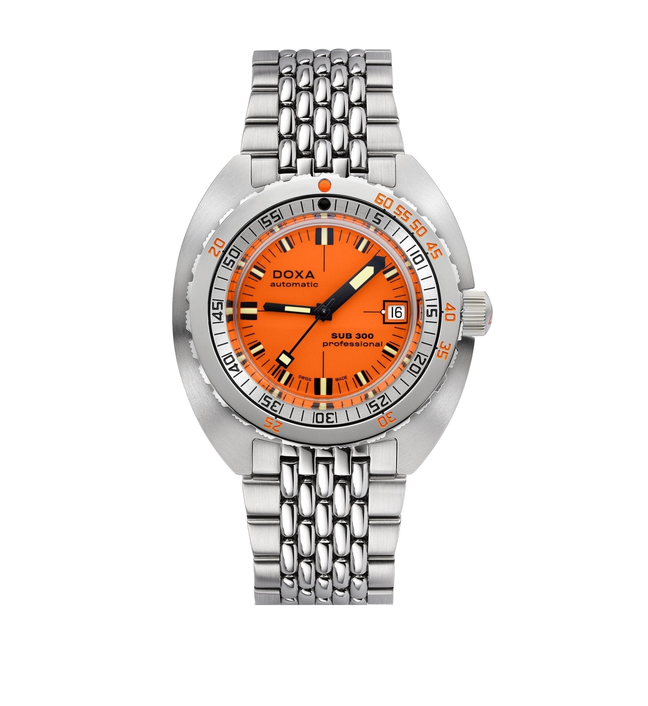
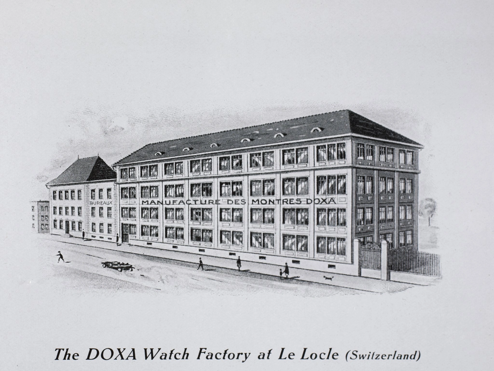
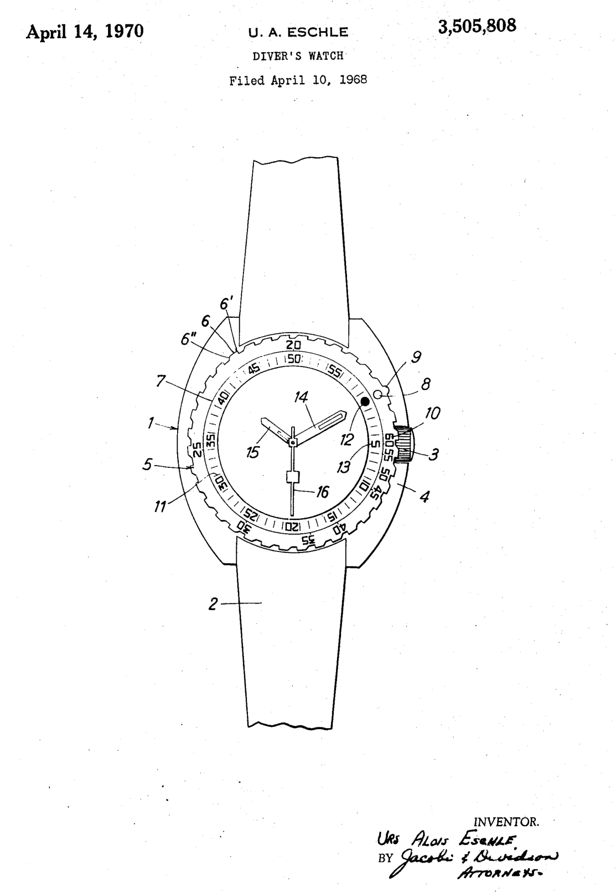
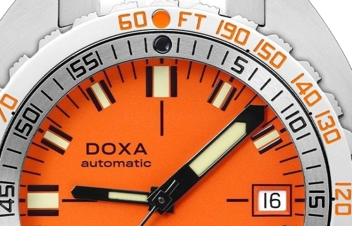
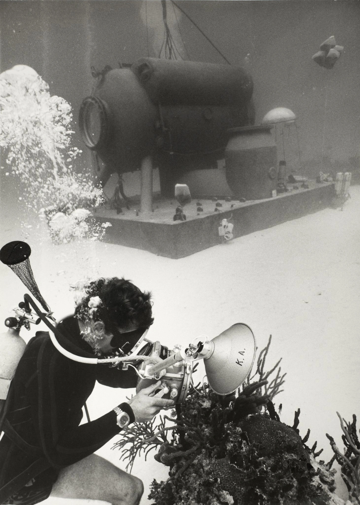
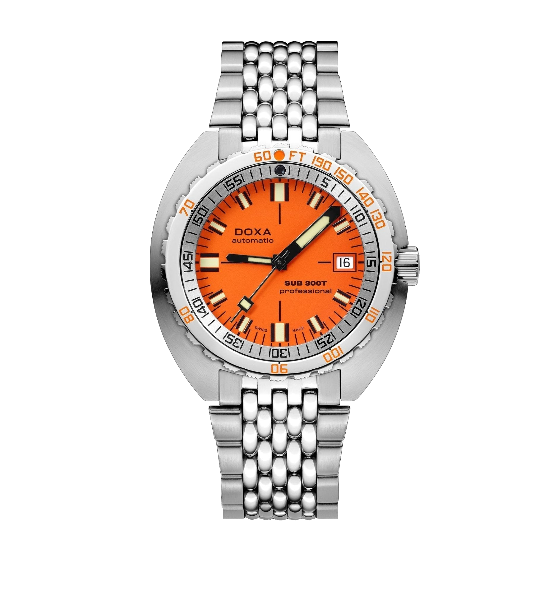

A Doxa az 1967-es bázeli vásárra egy narancssárga számlapos búvárórát vitt, amelynek feltűnően nagy percmutatója körül egy merülési táblázat adatai sorakoztak az acéllünettán. Ez volt a SUB 300. A számsor mellé az eltelt időnek is jutott egy külön skála.

Ezt a narancsot elsőre inkább egy nyári órához kötném. A Doxát eddig fotókról ismerem, és éppen az fogott meg benne, hogy mennyi munka van a szokatlan szín mögött.

Az eredeti történetben még nincs ott a T betű.

A későbbi SUB 300T az első SUB-ból fejlődött tovább. A narancssárga számlap és a két skála viszont már a kezdetekhez tartozik, a megszületésükhöz pedig egy svájci tó is kellett.

*A mai SUB 300 Professional, 821.10.351.10. A narancssárga számlap körül a mélység és a percek külön számsort kapnak. Fotó: DOXA.*

## Eschle leviszi a színeket a tóba

Urs Eschle 1964-ben indította el a fejlesztést a le locle-i Doxánál. Olyan órát akart, amelyet a szaporodó sportbúvárok is meg tudnak venni, és amelynek az adatait rosszabb látási viszonyok között is gyorsan leolvassák. Órások mellé gyakorló búvárokat vont be, köztük Claude Weslyt, Cousteau expedícióinak résztvevőjét.

A színteszteket a Neuchâteli-tóban végezték. Eschle későbbi visszaemlékezésében a víz meglehetősen szennyezett volt. Ez távol áll a búvárórás reklámok áttetsző türkizétől.

Pedig pont az ilyen vízben számít, mit tudsz leolvasni.

A csapat több színnel kísérletezett, köztük sárgával és narancssárgával. Eschle a narancsot találta a legjobban olvashatónak harminc méterig. A döntés köré egész számlapot építettek, amelyen a percmutató nagyobb és hangsúlyosabb lett az óramutatónál, az indexek pedig annyi világítóanyagot kaptak, hogy a formájuk sötétebb környezetben is felismerhető maradjon. Merülés közben a perceknek van közvetlen jelentőségük. A két mutatót sem kellett egyformán kezelni.

*A le locle-i gyár archív ábrázolása a Doxa történeti anyagából. A SUB fejlesztését Eschle itt indította el. Forrás: DOXA.*

## Harminc méteren is narancssárga marad?

A víz fokozatosan elnyeli a fényt, és a hosszabb hullámhosszú vörös, majd a narancs hamarabb fogy el, mint a kék. Egy narancssárgára festett tárgy mélyebben sötétebbnek látszhat, mert egyre kevesebb olyan fényt kap, amelyet narancssárgaként verhetne vissza. A Doxa számlapja is ebben a vízben van.

Az olvashatóságot viszont a teljes számlapon kell nézni. Számít a mutató és a háttér közötti különbség, a világító festék, a rendelkezésre álló fény, és az is, mennyi lebegő anyag van a vízben. Egy színtábla önmagában keveset mond arról, hogy két rövid pillantás között megtalálod-e a percmutatót. Eschle csapata egy adott számlapmegoldást választott ki a saját tavi próbáin. Ebből lett a narancssárga Professional. A harminc méter ennek a teszttörténetnek a része, nem olyan határ, amely fölött minden óra ugyanúgy néz ki, alatta pedig egyszerre eltűnik róla egy szín. A mai fotón a számlap felülete és a fekete mutató közötti különbséget látod. Merüléskor ehhez hozzáadódik mindaz, amit a víz és az aktuális fényviszonyok megváltoztatnak.

Nekem a nagy percmutató legalább annyira érdekes, mint maga a narancs. Valaki eldöntötte, hogy mit kell először észrevenned az órán, és ehhez igazította a méretét.

## Egy táblázat az acélgyűrűn

Az US3505808A rajzán közös kezdőpontból indul a két skála. Eschle találmányának svájci elsőbbsége 1967-es, az amerikai megadás 1970-es.

*Az eredeti amerikai szabadalom rajzlapja. A megadás éve 1970, a svájci elsőbbség 1967-es. A skálák és a mutató kapcsolatát érdemes figyelni. Forrás: US3505808A.*

A fekete számsor az eltelt időé. A mellette sorakozó mélységértékek a változattól függően méterben vagy lábban értendők, és mindegyik egy időértékhez kapcsolódik, így ugyanazon a gyűrűn olvashatod le az eltelt perceket és a mélységhez tartozó időhatárt. Először szokatlan, hogy mennyi szám jutott egy ilyen kis felületre. A mai lünetta egy irányban forgatható. A közös kezdőjelet a percmutatóhoz igazítva a leolvasás az indulástól eltelt perceket adja.

A mélységszámok tehát nem mérések. Az órában nincs mélységérzékelő.

A Doxa az amerikai haditengerészet levegős merülésekhez használt táblázatából emelt át mélységhez rendelt időhatárokat. A no-decompression elnevezés azokra a profilokra utal, amelyeknél az adott táblázat szerint nem szükséges kötelező dekompressziós megálló. Mélyebben rövidebb idő tartozik ugyanahhoz a feltételhez. A lünettán ezért a mélységértékek nem egyenletes lépésekben osztják fel a kört. A két skála ugyanarról a pontról indul, az eltelt időt pedig a percmutató teszi leolvashatóvá. Ezzel az órás egy már létező adatsort tett oda, ahol a búvár egyébként is az időt nézi. A teljes haditengerészeti kézikönyv persze nem fért rá az acélkarikára. Az ismételt merülésekhez és a felszínen töltött időhöz külön számítások tartoztak. Ezekre a számlap körüli gyűrű már nem adott választ.

A levegős merülés során a szervezet nitrogént vesz fel, amelynek mennyiségét a mélység és az eltöltött idő is befolyásolja. A dekompressziós eljárások a nyomás csökkenésekor távozó gázzal számolnak. A táblázat egy meghatározott feltételrendszert ír le, személyre szabott garanciát egy acélgyűrű sem adhat.

Szeretem az ilyen megoldásokat. Az óra egyszerű marad, közben egy külön előkeresendő adatot közelebb hoz ahhoz, aki használja.

*A mai 300T gyári fotójának részlete. Az FT lábat jelent, a külső számok mélységeket jelölnek. A mutató továbbra is az időt méri. Fotó: DOXA.*

A mai merülés megtervezéséhez képzés, megfelelő eljárások és felszerelés kellenek. A történeti skála ezeket nem helyettesíti. A no-deco feliratból a biztonsági megálló elhagyása vagy kockázatmentes feljövetel sem következik.

## Cousteau neve mögött egy búvárfelszerelés-kereskedő állt

Claude Wesly kötötte össze Eschlét a Cousteau-hoz tartozó US Divers csapatával. Az együttműködésben a lünetta tesztelése és az amerikai forgalmazás is benne volt. A márka idővonala 1968-hoz köti az exkluzív terjesztési megállapodást.

Ez az Aqua Lung jelvényes számlapok háttere.

A kétpalackos embléma a kereskedelmi kapcsolatot is láthatóvá tette az órán. Egy Doxa így ugyanott kerülhetett a búvár elé, ahol a merüléshez szükséges többi felszerelés. A név és a terjesztési hálózat együtt sokat ért egy olyan gyártónak, amely éppen helyet keresett magának a búvárórák között.

*Archív búvárfotó a Doxa Non-Deco anyagából. A búvár és a víz alatti berendezés mutatja azt a közeget, amelynek az órát szánták. Forrás: DOXA.*

A Musée international d’horlogerie egy 1970-es, 5042-es azonosítójú SUB 300T-t őriz. Egy svájci katonai búvár felszereléséhez tartozott.

A későbbi francia haditengerészeti változatnál a Doxa az ETA 2872 bázist említi.

## A két mai rokon

A SUB 300T család később a héliumszelepes Conquistadorral is bővült. Telítéses búvárkodáskor a hosszú ideig nyomás alatt lévő órába hélium juthat, amely a külső nyomás csökkenésekor belülről feszítheti az üveget, ha nem tud elég gyorsan távozni. A szelep ennek nyitott utat. Ezzel az óra olyan használathoz alkalmazkodott, amely már messze esett a szabadidős búvár eredeti igényeitől. A szín és a skála közben megmaradhatott.

A mai SUB 300 Professional, a 821.10.351.10 domború üveget kapott. A SUB 300T Professional, a 840.10.351.10 lapos zafírt és héliumszelepet visel.

*A mai SUB 300T Professional, 840.10.351.10. Lapos üveg, narancssárga Professional számlap és rizsszemes acélcsat. Fotó: DOXA.*

A széles acéltokkal nekem még barátkoznom kellene. A számlap körül sok fém marad, és ezt a kis csuklóm miatt előbb megnézném élőben. De a nagy mutató és a sűrű skála együtt már a fotón is elég ok arra, hogy tovább időzzek előtte.

### Azonosítók és mai gyári adatok

| | SUB 300 Professional | SUB 300T Professional |
|---|---|---|
| Acélcsatos referencia | 821.10.351.10 | 840.10.351.10 |
| Tokátmérő | 42,5 mm | 42,5 mm |
| Tokvastagság | 13,4 mm | 13,65 mm |
| Üveg | Domború zafír | Lapos zafír |
| Szerkezet | Automata, COSC | Automata |
| Gyári járástartalék | 38 óra | 38 óra |
| Lengésszám | 28 800/óra | 28 800/óra |
| Gyári vízállósági besorolás | 30 bar | 120 bar |
| Héliumszelep | Nincs | Van |
| Történeti kapcsolódás | Az 1967-es SUB 300 formavilága | A későbbi SUB 300T család |

*A táblázat mai órákat hasonlít össze. A történeti szerkezeti azonosító az említett haditengerészeti változatnál ETA 2872.*

Ha egyszer kirakatban találok egyet, a lábban skálázott lünettát szeretném közelebbről megnézni. A narancssárga számlapot már messziről kiszúrnám, de most leginkább azok az apró számok érdekelnek körülötte.
