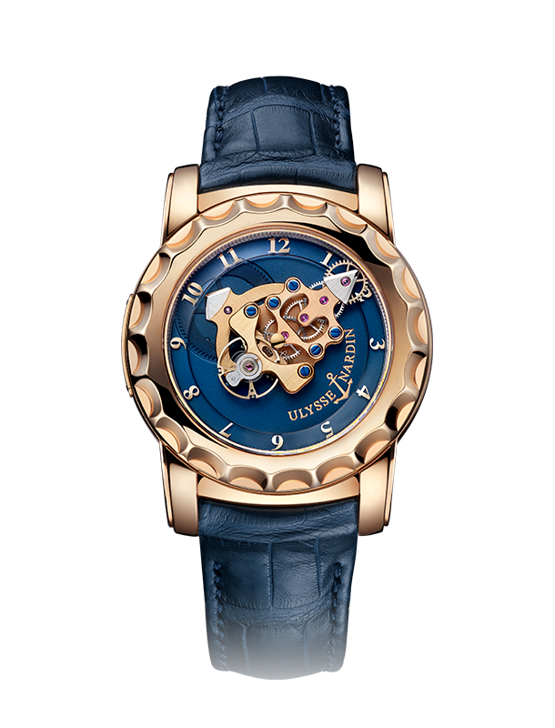
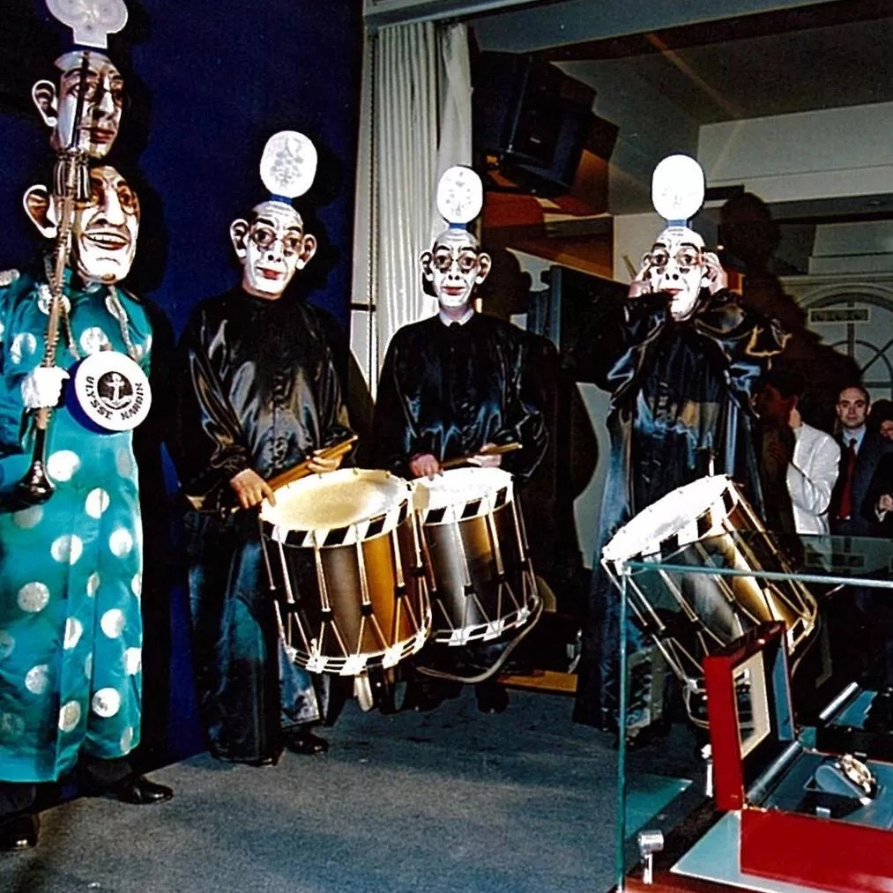
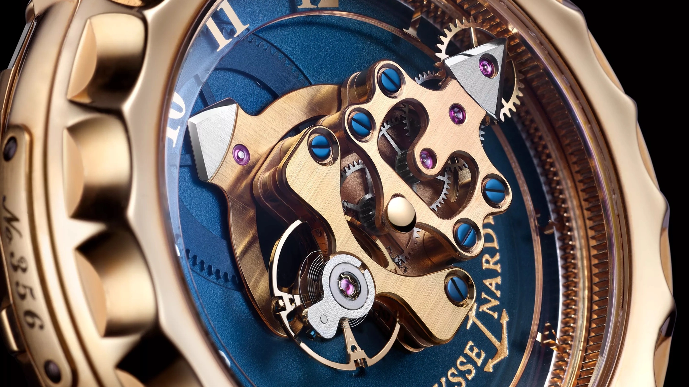
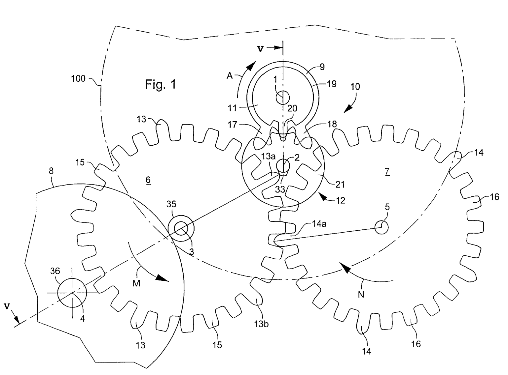
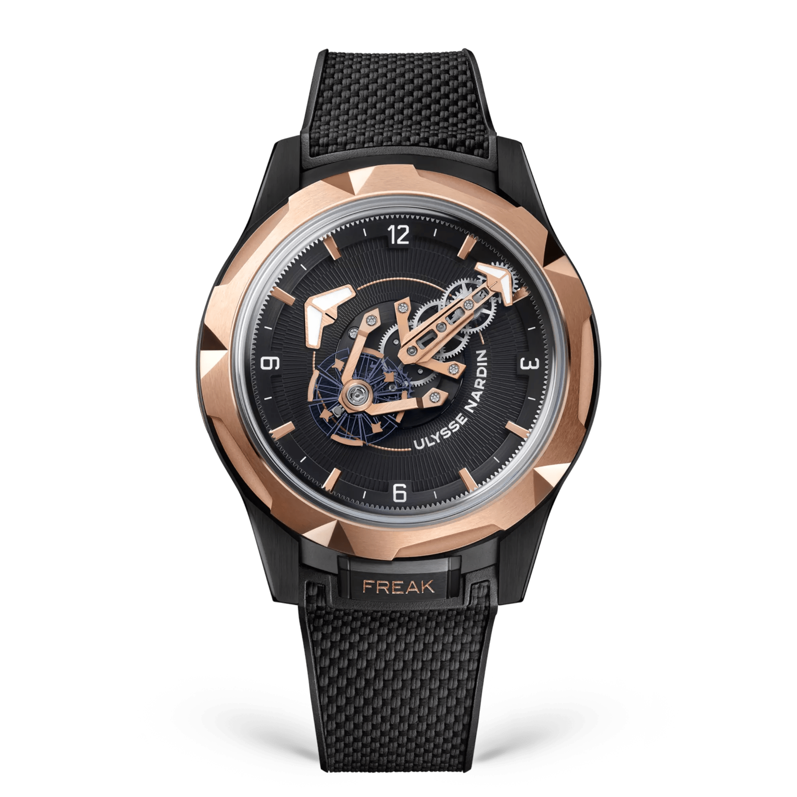
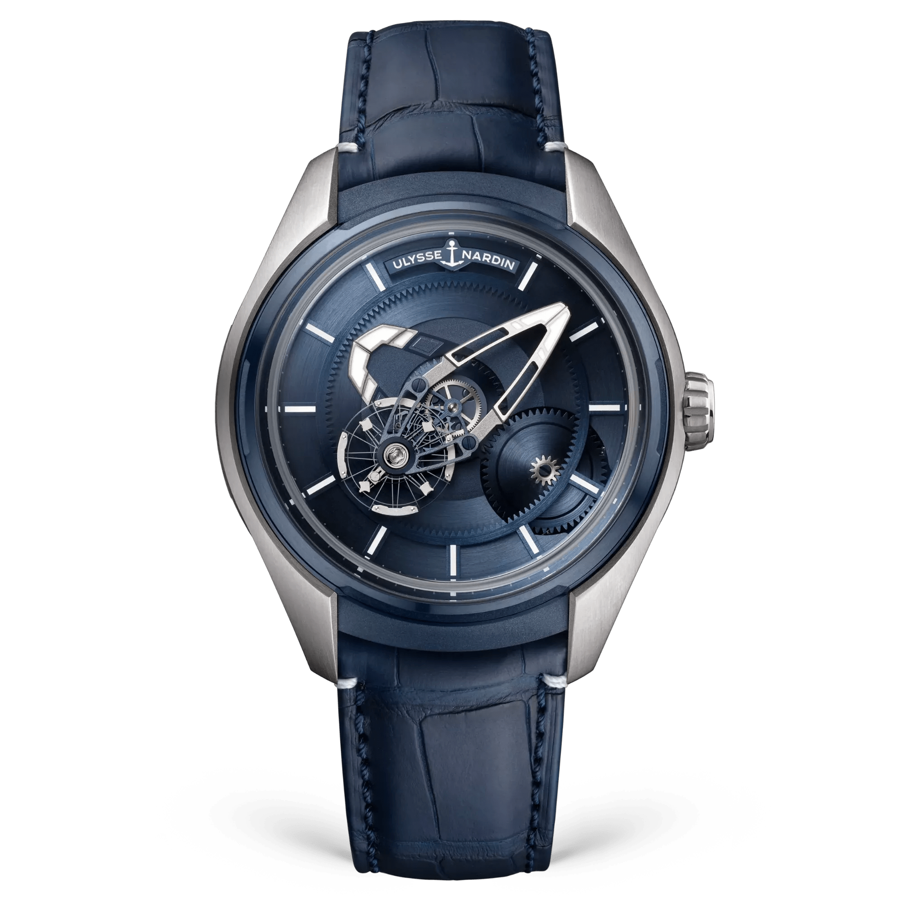

A Freaken a perceket egy működő kerékrendszer mutatja. A hosszú hídján a billegő és a gátszerkezet is ott utazik, miközben a felső egység egy óra alatt körbeér a tokban. A híd végén keresed az időt, ugyanott, ahol más órán egy percmutató hegyét néznéd.

Nekem eddig a fotók jutottak belőle. Az első pillantásnál még a szerkezetet nézem, aztán jut eszembe, hogy erről le is kellene olvasni valamit.

Az első Freak csak órát és percet mutat.

Ehhez viszont a felső emeletét körbeviszi az üveg alatt. Nekem ez a túlzás tetszik benne, főleg úgy, hogy a hétköznapokban azt is elfogadom, ha az órám egy kicsit siet.

*Az első Freak-korszak gyári archív képe. A hosszabb szerkezeti híd a perceket, az alatta futó nyilas elem az órákat jelzi. Fotó: Ulysse Nardin.*

## Két fordulat, két külön sebesség

A tokhoz rögzített számgyűrű helyben marad. Fölötte a hosszú felső híd hatvan perc alatt fordul körbe, az alsó, rugóházhoz kapcsolódó órajelnek ugyanez tizenkét órába telik. Negyedkor a felső egység a hármas irányába mutat. Az órajel közben ugyanúgy két óraszám között halad, mint egy megszokott óramutató.

A fogaskerekeknek ettől még van saját dolguk. A híd a tengelyeiket viszi körbe, a kerekek pedig ezen belül egymáshoz képest is elfordulnak, miközben a rugó energiáját továbbítják a szabályozó felé. A mozgást ezért kétféleképpen látod ugyanazon a kis felületen. A híd lassan bejárja a számlap helyét, a billegő közben sokkal gyorsabban leng. Ha egy percre nézed meg az órát, a híd csak egy kis darabot halad tovább. A billegő viszont addig is folyamatosan dolgozik, és az energiát ütemekre bontó gátszerkezet is vele együtt utazik. A nagy felhúzórugó alul kapott helyet, így a felső egységnek ezt a teljes energiatárolót nem kell óránként magával cipelnie. A Freak látványát ennek a két eltérő mozgásnak az együttese adja.

Az órának koronája sincs. Az eredeti konstrukciót a hátoldali gyűrűvel húzod fel, az időt a felső lünettával állítod. A beállítás és a felhúzás így magának a toknak ad munkát.

A gyár carrouselnek, vagyis karusszelnek nevezi ezt a körbejárást. A tourbillonhoz hasonlóan a szabályozó is elfordul a tokhoz képest, itt azonban a hosszú híd közben magát a percet is kijelzi.

Rolf Schnyder, az Ulysse Nardin vezetője Carole Forestier-Kasapi forgó szerkezetű koncepciójában látott lehetőséget, és Ludwig Oechslinnel jutott el oda, hogy az ötletből sorozatban is elkészíthető óra szülessen. A Freak 2001-ben jelent meg, már a két szilícium gátkerékkel.

*Álarcos bemutató 2001-ben, Schnyderrel és Oechslinnel. Fotó: Ulysse Nardin gyári archívuma.*

Egy ilyen órához az álarcos bemutató valahogy jobban illik, mint egy komoly férfi egy sötét pult mögött. A Phillips később a 016-88 referencia P001 jelű rózsaarany prototípusát is dokumentálta. A furcsa ötletből megmaradt egy számozott, kézbe vehető tárgy.

## Két kerék adja a lökést

A Dual Direct a billegő lengését tartja fenn. A hagyományos svájci horgonygátnál a gátkerék először a horgonynak ad energiát, és ez az átadóelem továbbítja a lökést a billegő tengelyére, így az impulzus egy köztes alkatrészen keresztül jut célba. Oechslin két, egymással kapcsolódó kereket alkalmazott, amelyek felváltva közvetlenül adnak impulzust a billegő tengelyén lévő tárcsának.

A két kerék ellentétes irányban forog.

Az egyik egy irányba segíti tovább a billegőt. A másik a visszaúton ad lökést. A zárásról külön billenő elem gondoskodik, amely felváltva megfogja az egyik vagy a másik kereket. Mivel a kettő kapcsolódik, egyikük rögzítése mindkettőt megállítja.

*Az eredeti felépítés közelről. A kerékrendszer és a szabályozó együtt utazik a hosszú híddal. Fotó: Ulysse Nardin.*

Az US6301981B1 szabadalom négy állapoton keresztül mutatja meg a működést. Az első kerék hosszú foga impulzust ad, utána a záróelem megfogja a második kereket. A billegő közben tovább leng, majd visszafordulva oldja a zárást. Ekkor a második kerék foga adja a következő lökést, és az első kerék zár. A záróelem tehát a megállást és az elengedést intézi. Az impulzus a keréktől jut a billegőhöz. A rajzon minden keréken öt hosszú fog szerepel, köztük rövidebb fogakkal, amelyek a két kerék kapcsolatát adják. Ettől a kerék két feladatot tud ellátni ugyanazzal a fogazással. Hajtja a párját, és a megfelelő pillanatban a billegőnek is energiát ad.

*Az eredeti szabadalom egyik működési fázisa. A rajzot egészben elforgattuk az olvashatóságért. A két nagy kerék között keresd a záróelemet. Forrás: US6301981B1.*

## A szilícium itt lett órás alkatrész

Az újra és újra elinduló, majd megálló két apró kerék tömege sokat számított, mert az ehhez elhasznált energiát a rugónak kellett biztosítania, miközben ugyanebből kellett fenntartani a billegő lengését is. Pierre Gygax a szilícium alkalmazását javasolta. Az anyag könnyű, és olyan apró formák készíthetők belőle, amelyeket az órás hagyományos fémből nehezebben állítana elő.

A könnyebb kereket kevesebb energiával lehet elindítani és megállítani.

A Freak szilícium gátkerekekkel került sorozatgyártásba. Ezzel 2001-ben olyan anyagot vitt a mechanikus karórába, amelyet ma már sok, kívülről egészen hagyományos órában is megtalálsz.

A közvetlen impulzus a horgonygát hosszabb, csúszó energiaátadását kerüli el. Érintkezés és veszteség ettől marad a szerkezetben. A kenés elhagyása az adott gátszerkezeti megoldás eredménye, nem annak bizonyítéka, hogy az egész óra súrlódás nélkül jár.

A későbbi Dual Ulysse már átadóelemen keresztül adott impulzust. A Freakek történetében ezért a két látható gátkerék önmagában még nem mondja meg, pontosan melyik változatot nézed.

## Keresd meg a mozgást a Műhelyben

Először a hosszú hidat és az alul haladó órajelet figyeld, majd lépj tovább a két gátkerék nagyítására. A +1 óra gombbal a perckijelzés ugyanoda ér vissza, miközben az órajel továbbáll. A nagyításban az Egy fázis gomb mutatja meg, mikor van impulzus, és mikor tart a zárás.

<!-- lume-model freak -->

A két mozgáshoz külön időlépték tartozik. A teljes óra gyorsítva mutatja a keringést, a gátszerkezet pedig lassú tanulóciklusban jár. Így mindkettőt követni tudod anélkül, hogy a billegő elmosódna a hídon.

## Egy mai Freak már más szerkezetet takar

A későbbi, UN-01 szerkezetes 026-88 példányok még a korai Freak formavilágát mutatják. A mai Freak ONE UN-240 kalibere már automata felhúzású, és DIAMonSIL kezelt gátszerkezetet használ. A forgó kijelzés megmaradt, mögötte azonban újabb megoldások dolgoznak.

*A mai Freak ONE, 2405-500-2A/3D. A kijelzés az eredeti ötletet követi, az UN-240 már automata szerkezet. Fotó: Ulysse Nardin.*

Az UN-240 billegője másodpercenként három teljes lengést végez, vagyis hat féllengést, ami az óránkénti 21 600-as gyári adatnak felel meg, miközben az őt hordozó hídnak hatvan perc kell egyetlen fordulathoz. A két tempó egymás mellett látszik. A szerkezet 229 alkatrészből áll, a kilencvenórás járástartalék pedig egy szokásos hétvégén túl is elég.

A Freak X külön ág. A 2303-270/03 referencia UN-230 kalibere koronával is állítható, így a családra gyakran ráhúzott háromszavas leírás itt már nem stimmel. Korona van, forgó perckijelzés továbbra is van.

*Freak X Ti Blue, 2303-270/03. A jobb oldalon megjelent a korona, az órajel és a forgó híd megmaradt. Fotó: Ulysse Nardin.*

A ONE mutató szerepét betöltő hídját könnyebben megtalálom a képen, mint az eredeti arany kerékrendszer irányát. A tok méretével már kevésbé vagyok kibékülve. Ezt a negyvennégy millimétert előbb meg kellene próbálnom a saját csuklómon.

### Azonosítók és gyári adatok

| | Freak ONE | Freak X Ti Blue |
|---|---|---|
| Referencia | 2405-500-2A/3D | 2303-270/03 |
| Kaliber | UN-240 | UN-230 |
| Felhúzás | Automata, Grinder | Automata |
| Lengésszám | 21 600/óra, 3 Hz | 21 600/óra, 3 Hz |
| Járástartalék | 90 óra | 72 óra |
| Gyári alkatrészszám | 229 | 214 |
| Tokátmérő | 44 mm | 43 mm |
| Időállítás | Felső lünetta | Korona |

*A táblázat mai változatokat hasonlít össze. A 2001-es Freak kézi felhúzású, hétnapos konstrukció volt. A Dual Direct magyarázata az eredeti szabadalmat követi.*

Én mégis az első kék-arany változatot nézném meg előbb. Ott egy kicsit keresnem kellene az időt a szerkezetben, és most éppen erre lennék kíváncsi.
