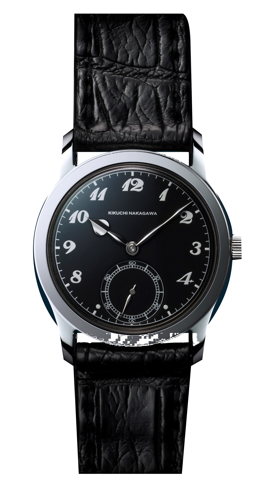
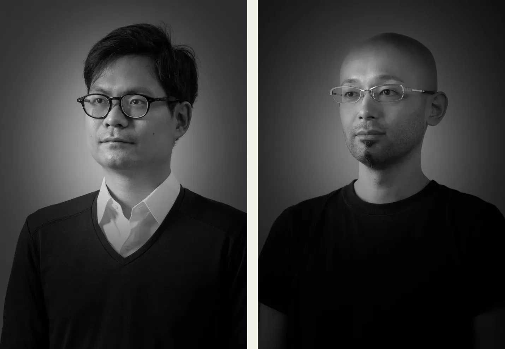
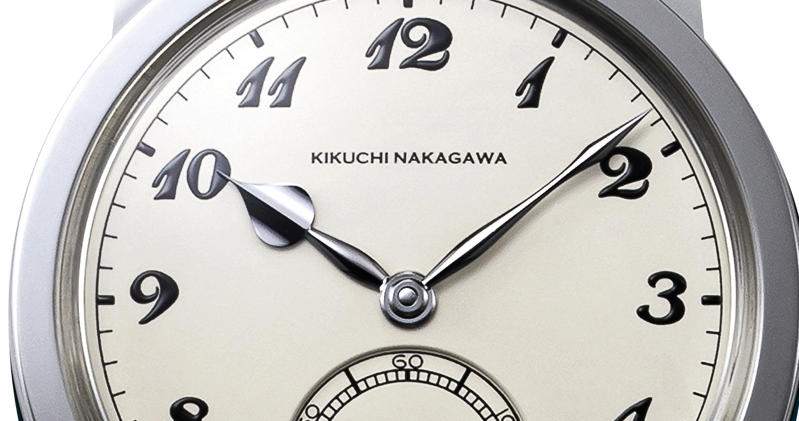
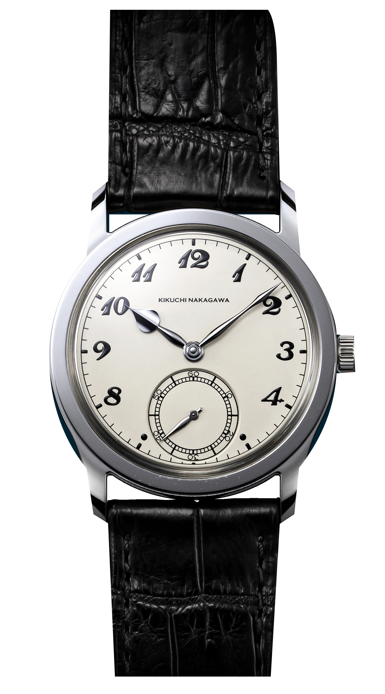
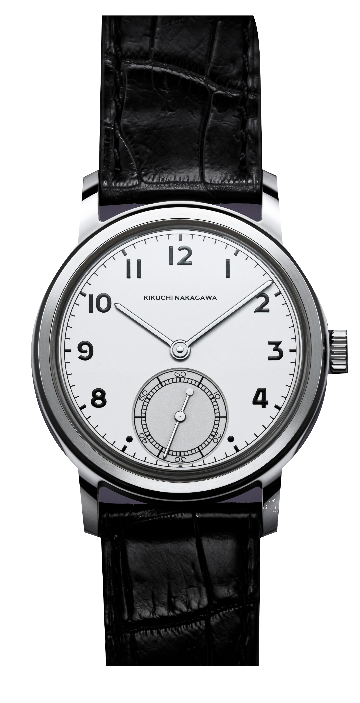
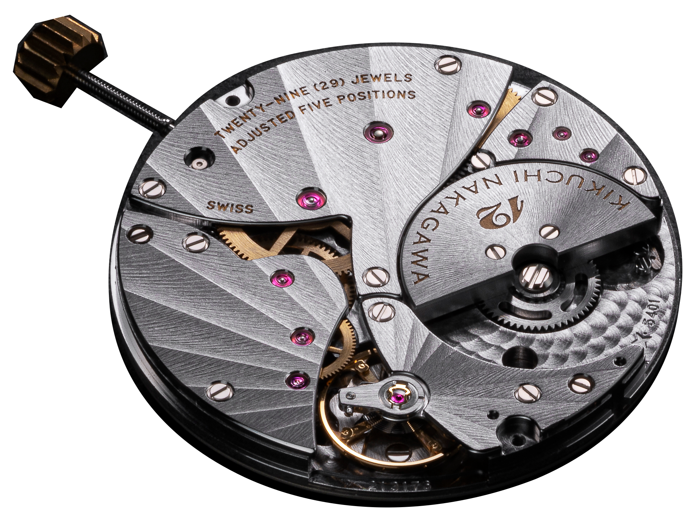

A Murakumo óramutatója az egyik gyári fotón feketének látszik, a másikon majdnem fehérnek. Ugyanaz az acélmutató változik ennyit a fényben. Engem ez fogott meg először, pedig egyelőre csak képekről ismerem az órát.

Távolabbról régi vágású darabnak néz ki. Aztán ránagyítasz a lapátmutatóra, és meglátod a külön oldalfalát meg a vállát. Ezen a kis felületen is bőven volt mit csinálni.

*A Murakumo fekete számlapja előtt a mutatók különböző felületei máshová verik vissza a fényt. Fotó: Kikuchi Nakagawa.*

## Egy építész és egy kardkovács

Yusuke Kikuchi építészetet tanult a Tokiói Egyetemen, majd szoftvercégnél dolgozott, de két éven belül otthagyta, és Párizsba ment órásnak tanulni. Tomonari Nakagawa kardkovácsnak készült, mielőtt az órák felé fordult. Dolgozott a Citizennél, majd egy kisüzemi órakészítő műhelyben is. Párizsban találkoztak 2012-ben. A közös márkát 2018 júniusában alapították, már hasonló elképzeléssel arról, milyen órát szeretnének készíteni. A harmincas és az ötvenes évek közötti karórák formáit vitték tovább. Közben az acél felületével akartak többet kezdeni annál, hogy egyszerűen fényes legyen.

*Balra Yusuke Kikuchi, jobbra Tomonari Nakagawa. Két külön gyári portré egy képtáblán, a Lume szerkesztésében. Fotók: Kikuchi Nakagawa.*

## A fekete itt fényjelenség

A fekete polírozásnál az acél szinte tükörként működik. Ha a világos környezet képét veri a szemedbe, felvillan, más szögből elsötétül. Festék nincs rajta. A fény és a megfigyelő helyzete dönti el, milyennek látod.

A hagyományos eljárás finom csiszolópasztával és fém polírozólappal dolgozik, és közben a kéz nyomására éppúgy figyelni kell, mint arra, milyen irányba mozgatják az alkatrészt. Az egyenetlenül levett anyag megbontaná a felületet, a lekerekített él pedig másképp tükrözne. A nagy óratok különösen kényes feladat, mert a tokfülek formáját és a síkok találkozását is meg kell tartani munka közben. Egy apró csavarfej még elfér egyetlen síkban. A Murakumón egymás mellett vannak sík és ívelt részek, a mutatón pedig több, eltérő irányba néző felület. Ezek különböző helyzetben villannak fel. A fotókon engem pont az érdekel, hogy egy sötét mutató mellett a tok pereme közben világos marad. Ettől lehet követni, hogyan áll a két fémfelület egymáshoz képest.

*A lapátmutató felső síkja és oldala külön fényt kap. A részlet az eredeti gyári óraképből készült. Fotó: Kikuchi Nakagawa.*

Egy karcolás viszont feltűnő lehet ezen a nagy, tükröző felületen. Elég közel kerül az asztalhoz meg az inggombhoz. Nem szeretnék egész nap arra figyelni, nehogy valamihez hozzáérjek.

## A két testvér más fényt kér

A Murakumón a számlap elég teret hagy a mutatóknak, ezért a lapát alakú óramutató széles feje rögtön odavonzza a szemem, miközben a vékony percmutató egészen a percosztás közeléig ér. A fehér változat gyári képein könnyebb külön megnézni a kontúrokat. A GPHG nevezési adatlapján ez a változat KN001WH referenciával szerepel.

*A fehér Murakumo számlapján a kismásodperc skálája majdnem hozzáér a hatoshoz. Fotó: Kikuchi Nakagawa.*

Az Ichimonji rúd alakú mutatókat és egyszerűbb arab számokat kapott. A tokfülek közötti nyílás is szűkebb. A tok középrésze és a hátlap szálcsiszolt, ami megszakítja a Murakumo összefüggő tükröződését. Közelebb áll ahhoz, amit egy hétköznapi órán megszoktam, a mutatók viszont itt is térbeli tárgyak.

*Az Ichimonjin az eltérő számozás mellett a hosszú, keskeny mutatók változtatják meg leginkább az összképet. Fotó: Kikuchi Nakagawa.*

A Genmon még a kismásodpercet is elhagyja. Két mutatóval és KN002 kaliberjelöléssel folytatja ugyanezt az irányt. Én ennél a pontnál már visszakérném a másodperckört, mert a Murakumo arányaihoz nekem hozzátartozik az a nagy, külön kis számlap.

## A svájci szerkezet hátul marad

A két kismásodperces modellben KN001 néven dolgozik a Vaucher automatája, a VMF 5401 mikrorotoros családjából. A felhúzó súlyt a szerkezet síkjába süllyesztették, így a fölötte körbeforduló nagy rotor helyét meg lehet takarítani. A vékony szerkezet köré alacsony tokot lehet építeni, ami ennél a régi formánál sokat számít. Oldalról nézve az órának a tokfülei is jól láthatók maradnak. A járástartalék két nap, tehát a péntek este letett órát hétfő reggelre újra kellene indítanom.

A hátlap viszont mindkét órán zárt marad.

*A gyári szerkezetfotón a mikrorotor a hidak mellé simul. A Murakumo viselése közben ezt egy fém hátlap takarja. Fotó: Kikuchi Nakagawa.*

Ezt a döntést én nehezen engedem el. Szeretném látni, mi jár odabent, különösen ilyen ár mellett. Közben értem, miért álltak meg a zárt hátlapnál, hiszen a tokon végig lehet dolgozni a felületeket, és ott is folytatódik az acél, ahol más órán üvegablakot találnál. A szerkezet felhúzását a csukló elvégzi, tehát a hétköznapokban a tulajdonos akár hosszú ideig csak a mutatókkal és a koronával találkozik, a belső szerkezetről pedig legfeljebb az árulkodik, hogyan jár az óra. Megfordítanám, látnám a saját tükörképemet a fedélen, majd valószínűleg újra megfordítanám. A fekete polírozást így a tok hátoldalán is lehet nézni. A fogaskerekeket továbbra is hiányolnám.

## A neveket is odaírják

A gyári leírás név szerint felsorolja az alkatrészgyártókat. A tok Matsuura-munka, a mutatók a YUKI Precisiontől érkeznek, a számlap a svájci Comblémine-től. A szíj és a zafírüveg készítője is szerepel a listán. Kikuchi és Nakagawa ezekből a meghatározott alapokból, a saját formáikkal és felületi munkájukkal készít órát.

Nekem ez a névsor többet mond a manufaktúra szónál.

A kicsi műhelynek így ott kell időt és pénzt ráfordítania az órára, ahol a saját elképzelését meg tudja valósítani. A Vaucher vékony automatát gyárt, a két órás pedig a tok és a mutatók formáját viszi végig. Ettől még bőven lehet vitatkozni az árral. A Vaucher alapja más márka órájában is felismerhető lenne, a Murakumo mutatóját viszont nehéz lenne mással összetéveszteni.

Új rendelést most egyáltalán nem fogadnak.

Az árak ott maradtak a honlapon, az új jelentkezéseket viszont szüneteltetik. Nálam már a rendelési szünet előtt az ár megállítaná a folyamatot. Az alábbi összegek adó nélkül értendők, és a gyártó november 6-án ellenőrzött oldaláról származnak.

| Modell | Murakumo | Ichimonji | Genmon |
| --- | --- | --- | --- |
| Kaliber | KN001, Vaucher | KN001, Vaucher | KN002, Vaucher |
| Kijelzés | Óra, perc, kismásodperc | Óra, perc, kismásodperc | Óra, perc |
| Tokátmérő | 36,8 mm | 36,8 mm | 36,8 mm |
| Vastagság, üveggel | 8,5 mm | 8,5 mm | 9 mm |
| Tokfültáv / szíjszélesség | 45,5 / 22 mm | 45,3 / 20 mm | 45 / 21 mm |
| Járástartalék | 48 óra | 48 óra | 48 óra |
| Frekvencia | 3 Hz | 3 Hz | 3 Hz |
| Vízállóság | 3 atm | 3 atm | 3 atm |
| Gyári ár, adó nélkül | 23 000 USD | 22 000 USD | 27 000 USD |

A fehér Murakumót nézném meg először. Lassan elfordítanám a fény felé, hogy lássam, mikor világosodik ki az óramutató lapátja. A hátlapot utána is megfordítanám egyszer, csak hogy tudjam, mennyire bosszant az a hiányzó ablak.
