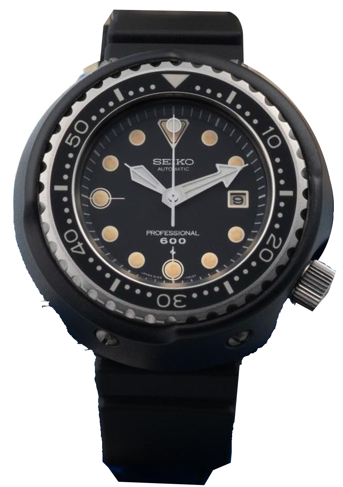
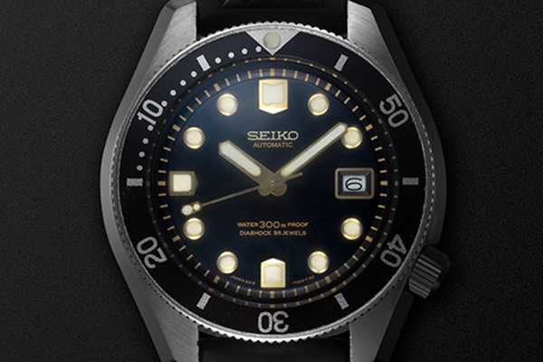
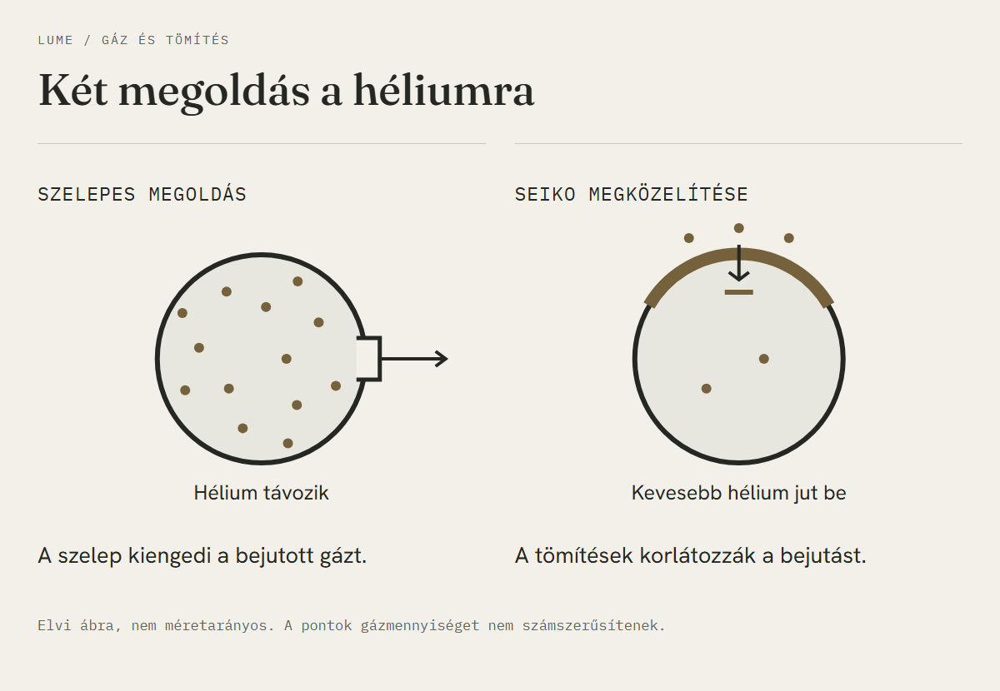
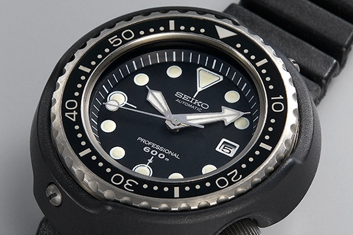
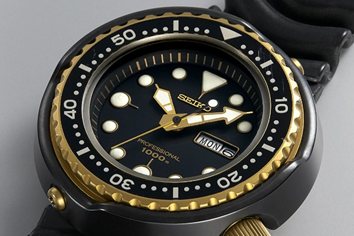

A Seiko 1968-ban levelet kapott egy hivatásos búvártól. Oshima búvárharanggal dolgozott, akár 350 méteres mélységben, és azt írta, hogy a cég akkori 300 méteres órája alkalmatlan erre a munkára.

Ez azért elég kellemetlen visszajelzés egy búváróra gyártójának.

A gyár meghívta a levélírót, aztán elmentek vele a hajóra.

Hét évvel később megjelent a Professional Diver's 600m, a 6159-7010. Ma többnyire Tuna néven keresed, a nagy, kerek védőburkolata miatt. Engem ezen az órán a négy csavar fogott meg. A burkolatot tartják, és meglepően sok minden kiderül a formából, ha utánamész annak, miért kellett leszerelhetőnek lennie.

*Az Antiquorum által vizsgált 1975-ös 6159-7010. A nagy nyíl alakú percmutató és a csavarokkal rögzített fekete burkolat jól látszik. Fotó: Antiquorum.*

## A baj a hajón is folytatódott

A Seiko fejlesztésvezetője, Taro Tanaka és a suwai gyár egyik mérnöke Kure kikötőjében nézte meg a fúróhajót. A búvárok a kamrában jelentkező hibák mellett a tokba akadó kábelekre és a hidegben megkeményedő szíjra panaszkodtak, vagyis elég gyorsan kiderült, hogy a megoldásnak a gáztömörségen túl is lesz dolga. Az alábbi elődön már látszik a süllyesztett korona, a tok pedig egydarabos volt. Mégsem oldott meg minden gondot.

*A gyári történeti anyag 1967-es, 300 méteres modellje. A monoblokk tok már a Tuna előtt is létezett. Fotó: Seiko Watch Corporation.*

A szaturációs búvár idejének jelentős részét nyomás alatt tölti, akkor is, amikor éppen pihen. A héliumot tartalmazó légzőgáz a száraz kamrában körülveszi az órát, és az apró héliumatomok lassan áthatolhatnak a tömítéseken. Ehhez víz sem kell. A gond akkor jelentkezik, amikor a kamra nyomását csökkentik, de a tokba jutott gáz nem tud ugyanilyen gyorsan távozni. Az üveget ilyenkor belülről terheli a nyomáskülönbség.

A vízzáró tömítés tehát még átengedhet héliumot.

A számlapra írt mélységből ezt nem tudod meg. A külső víznyomást elviselő tok a hosszú héliumterheléstől még bajba kerülhet. Más vizsgálat kell hozzá.

## A szelepnek nagyon is volt feladata

A Rolex automatikus héliumszelepet használt a túlnyomás leengedésére. Amikor a tok belsejében elég nagy nyomáskülönbség alakul ki, a szelep kinyit, majd visszazár. A DOXA Conquistadorján is megjelent ez a megoldás. A CH492246A szabadalmi irat eredeti bejelentőjeként a Rolex Montres szerepel, 1967-es bejelentési dátummal.

Én itt elengedném a japánok és a svájciak közötti pontozást. A szelep működő válasz a tok belső túlnyomására. A Seiko a bejutó gáz mennyiségét akarta korlátozni.

*A szelep a már bejutott gáz távozását segíti, a Seiko tömítési rendszere a bejutást korlátozza. Elvi, nem méretarányos vázlat. Illusztráció: Lume.*

Amit túlzásnak tartok, az a szelep mint általános minőségi jelvény. Egy uszodában úszó óra körül nem alakul ki a szaturációs kamra héliumos környezete. A tok oldalára tett plusz alkatrész önmagában sem a jobb órát, sem a jobb tömítést nem bizonyítja.

## Egyetlen gumigyűrűnél több kellett

Ikuo Tokunaga az anyagok viselkedésével foglalkozott. A vele készült interjúban azt mondta, a nyomáspróbánál sokkal nehezebb feladat volt megépíteni a berendezést, amellyel a hélium behatolását tudták mérni.

A megoldásban az L keresztmetszetű üvegtömítésnek és az azt rögzítő rendszernek együtt volt szerepe. A tömítés az üveg pereménél zár, a csavarmenetes rögzítőgyűrű pedig a helyén tartja az egész összeállítást. Közben az anyag gázáteresztése is számít, hiába lenne megfelelő a forma, ha a hélium könnyen átdiffundálna rajta. Az egydarabos titán belső tokból kimarad a lecsavarható hátlap illesztése, de a koronát és az üveg környékét ettől még meg kell oldani. A Seiko már a korábbi búváróráján is használt monoblokk szerkezetet, így a Tuna fejlesztését nehéz volna egyetlen nagy ötletre visszavezetni. Egymáshoz kellett igazítani a tömítést, a rögzítést és az anyagokat, majd kipróbálni őket abban a környezetben, amelyben a korábbi óra elbukott.

Az L betű önmagában nem állít meg egyetlen atomot sem.

A héliumtömörség itt használati feltételekhez tartozó teljesítmény. A cél az, hogy a tokban ne épüljön fel káros túlnyomás a szaturációs munka és a dekompresszió során. Ebből nem következik, hogy bármilyen nyomáson, bármennyi idő alatt pontosan nulla atom jutna be.

*Az 1975-ös modell részlete. A széles percmutató és a jól elkülönülő tizenkettős jelzés a gyors leolvasást segíti. Fotó: Seiko Watch Corporation.*

## A fekete burkolat alatt titán van

Az 1975-ös külső védőburkolat kemény fekete bevonatot kapott, alatta titán van. A tömör kerámia az 1986-os, már ezerméteres változatnál jelent meg. A vízzáró belső tok külön alkatrész.

A shroud a koronát és a lünettát védi az ütésektől meg a beakadástól. Leszerelve a lünetta körül felgyűlt szennyeződéshez is hozzá lehet férni. Egy ötvenéves példány merülésre való alkalmasságát persze ez nem igazolja.

Tanaka tervezői munkájától lett ez a sok követelmény egyetlen hordható tárgy. Az eredeti 6159B kaliber maradt a tokban, a család nagy frekvenciájú automatája. A fejlesztők közben olyan részletekkel is foglalkoztak, amelyeken könnyű átsiklani egy fotón. A szíj hullámos szakasza például engedni tud, amikor a búvárruha vastagsága és a szíj körüli körülmények változnak, az anyaga pedig a korábbi PVC-nél jobban viseli a hideget. Tokunaga visszaemlékezése a harmonikás fényképezőgéphez köti Tanaka ötletét. Az órától elvárt feladatok között a fedélzeti munka mellett az is szerepelt, hogy a búvár a parton se érezze kínosnak felvenni. A közel ötcentis tokból nézve ez elég ambiciózus kérésnek tűnik. Az én csuklómon a visszafogottsággal lenne a legtöbb munka.

## Ugyanaz a forma, más órák

A Professional 600m 1975 júniusában került piacra. A kvarcos utód 1978-ban érkezett a 7549 kaliberrel, az 1986-os generáció pedig már a 7C46-ot használta. A nagy percmutató és a kerek védőburkolat megmaradt, miközben belül és kívül is változott az óra.

*Az 1986-os utódon már 1000 méteres jelölés és kerámia védőburkolat szerepel. Fotó: Seiko Watch Corporation.*

A 2020-as SLA041 még későbbi újraértelmezés, zafírüveggel és 8L35 szerkezettel. Ha annak az adataiból indulnál ki, könnyen átkerülne a zafír az 1975-ös történetbe is. Az eredeti óra Hardlex, azaz keményített ásványi üveget kapott.

| Történeti támpont | Adat |
| --- | --- |
| Első Professional 600m | 6159-7010, 1975. június |
| Eredeti szerkezet | 6159B, automata, kézzel is felhúzható |
| Frekvencia | 36 000 féllengés/óra, 5 Hz |
| Belső tok | Egydarabos titán |
| Külső védőburkolat | Kemény fekete bevonatú titán |
| Üveg | Keményített ásványi üveg |
| Korabeli vízállósági besorolás | 600 m, szaturációs használatra tervezve |
| Átmérő | Az Antiquorum vizsgált példányánál 50 mm |
| Korabeli árpélda | 85 000 jen, 1977-es japán gyári katalógus |
| Kvarcos átállás | 1978, 7549 |
| Kerámia külső burkolat, 1000 m | 1986, 7C46 |

A 6159-7010 fotóján most már először a tok peremén ülő csavarokat nézem. Korábban egyszerűen nagynak láttam a burkolatot. Most inkább azt nézném meg közelről, hogyan férsz hozzá a koronához és a lünettához úgy, hogy közben mindkettőt körülveszi ez a vastag védőelem.
