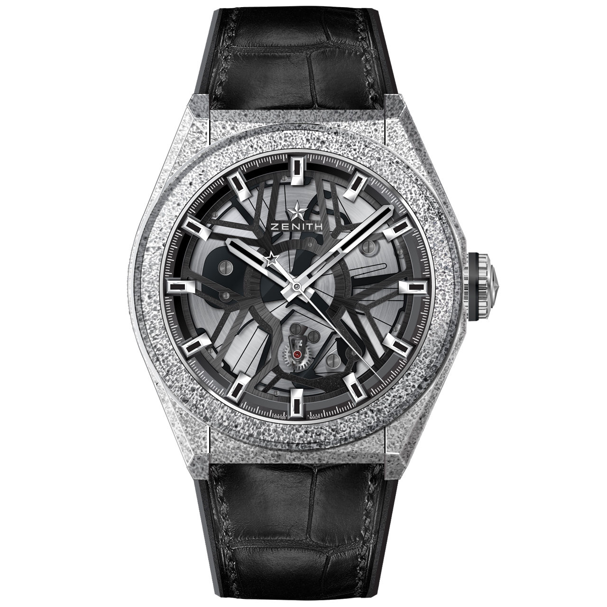
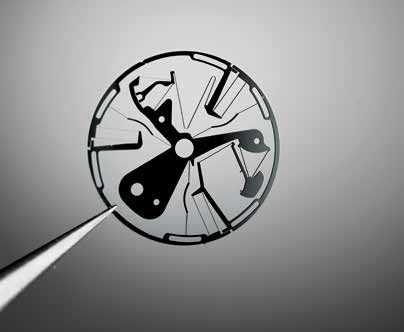
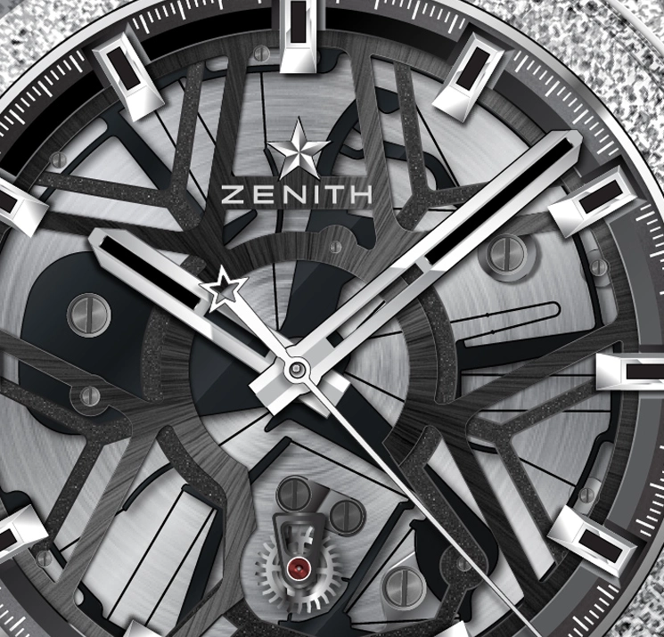
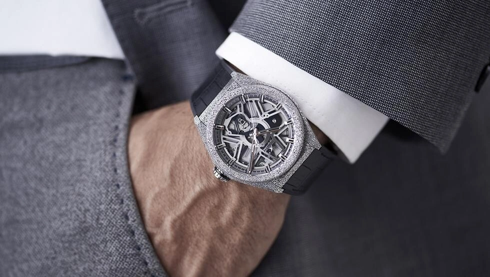
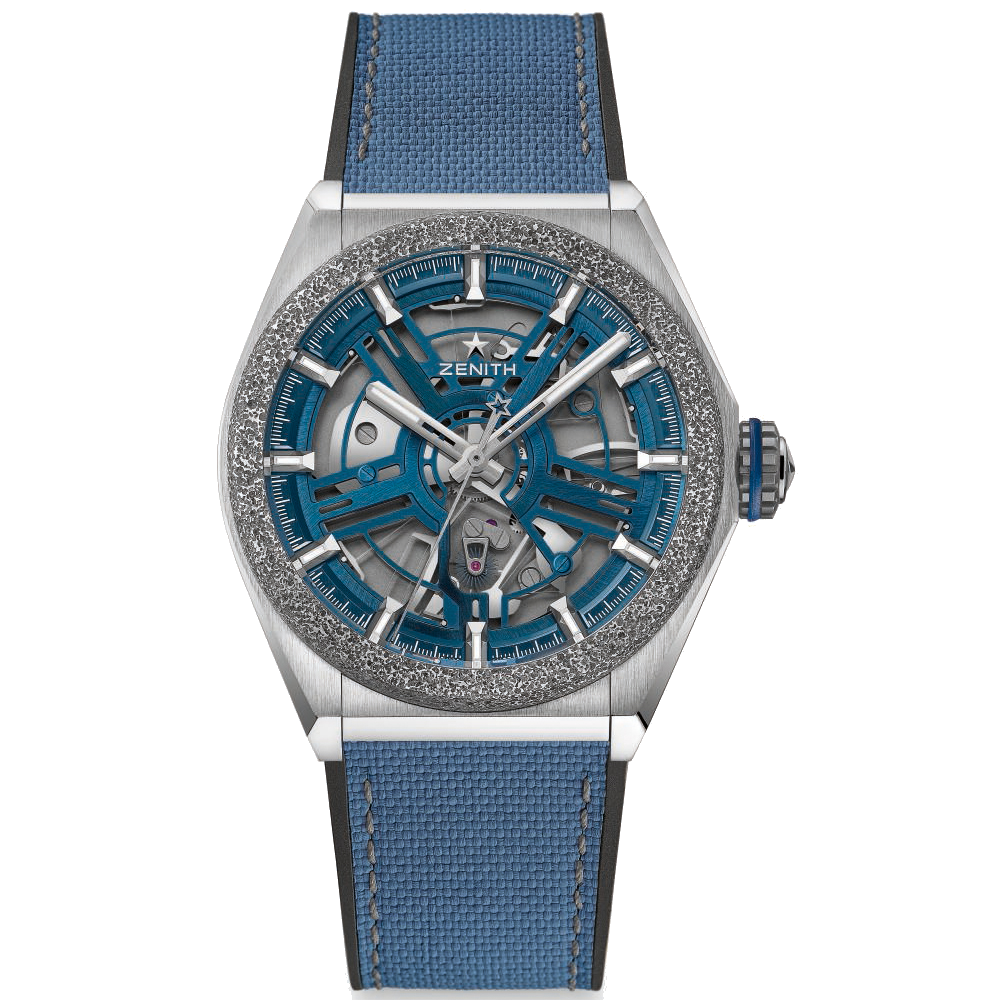

A Zenith Defy Labban egy szilíciumlap méri ki a rezgések ütemét. A vastagabb részei lengenek, a keskeny karjai visszahúzzák őket középhelyzetbe. A billegő és a hajszálrugó munkáját ugyanaz az alkatrész végzi.

Ez az a fajta megoldás, ami miatt szívesen olvasok óraszerkezetekről.

Defy Labot még nem fogtam a kezemben. A fotókon először a szokatlan, szemcsés tokot veszem észre, pedig az egész történet néhány hajlékony szálon múlik a mutatók alatt, és még akkor is nehéz őket követni, ha már tudod, mit keresel. A 2017-ben bemutatott óra 27.9000.342/78.R582 referenciája mögött a ZO 342 kaliber dolgozik. A hagyományos billegő megszokott alakja hiányzik belőle, helyette a nyitott számlap nagy részét szétágazó, egymásba futó formák töltik ki. Ezt a látványt szeretném szétszedni, mert állóképen sokkal bonyolultabbnak látszik, mint az alapötlete.

*A Defy Lab szemcsés Aeronith tokja körülveszi a nyitott szerkezetet. A középen átfutó merev részek és az alattuk húzódó finom kivágások adják a történet lényegét. Fotó: Zenith / GPHG.*

## A billegő helyén geometria

Egy szokásos mechanikus órában a billegő adja a lengő tömeget, a hajszálrugó a visszatérítő erőt. A gátlómű energiával tartja fenn ezt a rezgést, közben az üteméhez igazítja a kerékrendszer haladását.

A hajszálrugós billegő történetében Huygens 1675-ös munkája fontos állomás. Azóta rengeteg minden változott az órákban, maga a tömeg és külön rugó párosa viszont ismerős maradt. Guy Sémon és az LVMH kutatócsapata ennek a párosnak keresett más felépítést. A kapcsolódó szabadalmon Sémon mellett Wouter Pieter van Zoest és Nima Tolou neve is szerepel.

A megoldást a lapba vágott üres helyek adják.

Egy széles szilíciumdarab az adott terhelés alatt alig mozdul, egy hosszú, keskeny szál viszont meghajlik. A tervező ugyanabból az anyagból merev tartót, lengő tömeget és rugóként működő összekötést alakíthat ki. Ez a rugalmas mechanizmus alapja. A monolitikus szó itt annyit jelent, hogy ezek a részek egy darabból készülnek, szerelési hézag nélkül.

A szilíciumlap közepét három ponton rögzítik. A körülötte elhelyezkedő szektorok kis szögben ide-oda lengenek, miközben az összekötő karok meghajlanak. Külön tengely körül forgó billegő helyett az anyag alakváltozása vezeti meg a mozgást. Itt érdemes egy pillanatra elidőzni, mert a fényképen a keskeny kivágások könnyen díszítésnek tűnnek. Pedig azok szabják meg, hol enged a lap, és hol marad merev. Ha ugyanott vastagabb anyagot hagysz, más rugómerevséget kapsz, az pedig a lengő tömeggel együtt más rezgésszámot ad. A geometria olyan feladatokat vesz át, amelyeket a megszokott szerkezetben külön alkatrészek egymáshoz szerelésével oldasz meg. Ettől még rendkívül pontosan kell megmunkálni, csak a munka nagy része átköltözik a gyártás és a tervezés korábbi szakaszába.

*A csipeszben tartott oszcillátoron látszik a három központi ág és a külső részeket összekötő finom karok hálózata. Fotó: Horological Times / AWCI, 2017. november, 33. oldal.*

## Harminc alkatrész feladata egy lapon

A Zenith nagyjából harminc alkatrész kiváltásával mutatta be az újdonságot. Ebbe a hagyományos szabályozó külön szerelt elemeit számolta bele. A különleges profilú gátkerék megmaradt, ahogy a felhúzás, az energiatárolás és a mutatókat hajtó kerékrendszer is.

Az egész órát azért még nem lehet egy lapból kivágni.

A fél milliméteres lemez monokristályos szilíciumból készül. A kívánt alakot mikromegmunkálással hozzák létre, a szabadalmi leírás a mély reaktív ionmarást is bemutatja a lehetséges eljárások között. Az AWCI korabeli ismertetése körülbelül húsz mikrométer széles rugalmas karokról ír. A fél milliméter a lap vastagsága, a húsz mikrométer a hajló rész síkbeli szélessége. Két külön méret, és a működés megértéséhez mindkettő számít. A vastag lapból kivágott keskeny szál az egyik irányban könnyen hajlik, más irányú terheléssel szemben viszont jóval merevebb. A tervező ebből az irányfüggő viselkedésből is dolgozik.

A csapágyazott billegő csapjai és a külön összeépített rugókapcsolatok helyett itt összefüggő anyag hajlik. Ezzel több súrlódó kapcsolat és kenési feladat kiesik a szabályozóból. A gátkerék és az oszcillátor viszont továbbra is kapcsolatba lép egymással. A teljes kalibert súrlódásmentesnek nevezni nagyobb ugrás volna, mint amit a szilícium elvisel.

*A mutatók alatt keresd a keskeny réseket. A szabályozó merev és hajlékony tartományai egy síkban helyezkednek el. Fotó: Zenith / GPHG.*

## Mit jelent a tizenöt hertz

A Defy Lab másodpercenként tizenöt teljes rezgést végez. Egy teljes rezgés oda-vissza mozgás, az órás adatokban szereplő lengésszám pedig a két félutat külön számolja. Innen jön az óránkénti 108 000 féllengés.

A szöglengés közben kicsi marad, nagyjából plusz-mínusz hat fok.

Egy 4 Hz-es szerkezethez képest sűrűbb ütemben dolgozik a szabályozó. A pontosságot továbbra is a karok mérete, a hőmérsékleti viselkedés és az energiaátadás együtt határozza meg.

A Zenith a 2017-es díjsajtóanyagában napi átlag 0,3 másodperces eltérést közölt, és azt írta, hogy a pontosság a járástartalék 95 százalékán át megmarad. Az izokronizmus a rezgések időtartamáról szól, különösen arról, mennyire változik a periódus a lengés nagyságával. Az állandó amplitúdó más állítás volna. Hasonlóan érdemes olvasni a mágnesességről szóló adatot is. A kész órára közölt vizsgálati szint 1100 gauss volt. Ez számszerű ellenállás egy megadott vizsgálatban, és sokkal többet mond annál, mintha egyszerűen mindennel szemben érzéketlennek neveznénk. Nekem az ilyen adatoknál pont az tetszik, amikor a nagy ígéret mögött végre találok egy határt, amihez hozzá lehet kötni.

## A Műhelyben állítsd meg félúton

Indítsd el a modellt, majd a hajló karok nézetében állítsd meg a mozgást, és húzd végig a fáziscsúszkát. Utána a feszültségnézetben emeld kétszeresére a végeltolást, és figyeld meg, mennyivel nő a tárolt energia.

<!-- lume-model zenith-defy-lab -->

A háromdimenziós lemez a működés térbeli vázlata. A feszültségnézet külön tanulópéldát számol, egy egyszerű gerendát ismert befogással. A hajlítófeszültség a görbületből, a rugalmas energia az alakváltozásból adódik. Így a színváltásnak van számonkérhető mechanikai alapja, miközben nem keveredik össze a gyári alkatrész igazolásával.

A mutatókat is érdemes összehasonlítani. A 15 Hz-es oldalon sűrűbbek az apró lépések, ezért a szem könnyebben összemossa őket folyamatos mozgássá. A kerékrendszer ettől még adagokban engedi tovább az energiát. A szép, úszó mozgás mögött ugyanúgy ott a zárás és az újabb impulzus.

*A teljes óra a csuklón. A szemcsés Aeronith alumíniumhabot és polimert társít, ezért a tok felülete egészen másképp néz ki, mint egy polírozott acélé. Fotó: Zenith.*

## A tíz óra után

A Defy Lab tíz egyedi darabbal indult, és 2017-ben elnyerte a GPHG innovációs díját. A 2019-es Defy Inventor már a sorozatgyártás felé vitte tovább az ötletet. A Calibre 9100 frekvenciája ott 18 Hz-re emelkedett, a tok titán lett, Aeronith lünettával. A kék színű, 95.9001.9100/78.R5920 jelzésű GPHG-példányon a szerkezet könnyebben elkülönül a tok körvonalától.

*A folytatás a Defy Inventor. A kék szabályozó már 18 Hz-en működik, a titántokot Aeronith lünetta fogja körbe. Fotó: Zenith / GPHG.*

A Lab nagy tokja nekem továbbra is sok volna, de a benne megoldott feladatot nehéz elengedni. A legtöbb nyitott szerkezeten a forgó részeket keresem. Ennél inkább a három befogási ponton marad a szemem, mert onnan kezdve ugyanaz a darab anyag már enged is a mozgásnak.

## Adatok röviden

| | Defy Lab |
| --- | --- |
| Bemutató | 2017, tíz egyedi darab |
| Referencia | 27.9000.342/78.R582 |
| Kaliber | ZO 342, automata |
| Szabályozó | Monokristályos szilícium, 0,5 mm vastag lemez |
| Frekvencia | 15 Hz, 108 000 féllengés/óra |
| Szöglengés | Körülbelül ±6° |
| Járástartalék | 60 óra a 2017-es gyári díjsajtóanyag szerint |
| Tok | Aeronith, 44 × 14,5 mm |
| Vízállóság | 50 m |
| Korabeli ár | 29 900 CHF, áfa nélkül, 2017-es GPHG-adat |
| A cikkben szereplő utód | Defy Inventor, 2019, 95.9001.9100/78.R5920, Calibre 9100, 18 Hz |
